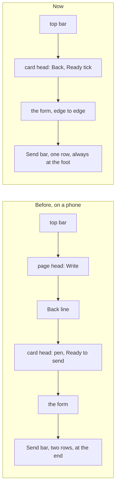

# Write fits a phone and reads what it is given

> **In plain words.** The owner asked which of the first client's email-page features Write lacks
> (reading pasted addresses, filling in people from past emails, checks that catch mistakes) and,
> from a phone screenshot, for a Write page that does not waste its top and runs edge to edge.
> Oltrem Mail's record, `synced-docs/oltrem-mail/docs/records/2026-11-11-write-smarter.md` on the
> docs mirror, holds the whole change and its checks before a send. This record is the kit's
> part: the To box in the frame script, the guard on words typed, and the compose card's head on
> a phone.

## What changed in the kit

| Area | Before | Now |
|---|---|---|
| A pasted list in a `data-chips` box | split at commas, semicolons and new lines once the one-line box had flattened it | read from the clipboard before that: tabs, lines and spaces between bare addresses part it; `Name <address>`, `Name (address)` and `Name address` stay one; `mailto:` and quotes go |
| The same address twice | two chips | one, whatever its capitals |
| A bare address the suggestions know | shown as typed | `Name <address>`, the name the suggestions carry |
| Leaving a form with `data-keep-typed` | lost without a word | a link stays put and a closed tab makes the browser ask; sending or saving leaves freely |
| `ComposeSheet` on a phone (below 1024 px), page mode | the page's head band, the mail Back line, then the card's head: about a third of the screen | the card's head alone, with `back` as an arrow at its start; the card meets the top bar and both edges; the Ready chip is its icon; the Send bar stays at the foot in one row that scrolls sideways |

The page's heading and the Back line stay in the page for a screen reader; only their room is
given back. Everything new runs in the browser: no request, no query, no CPU on the Worker.

## How it was checked

- `packages/screens/test/frame.test.ts`: a pasted list read once each with the names known, and a
  typed Write form kept from a link until it is sent (16 tests).
- The template's Write page at 390 px in a headless browser, before and after: the head went
  from the page band, Back line and card head to the card head alone.
- Oltrem Mail's own tests for the checks before a send; `pnpm verify` in both repositories before
  the push.
