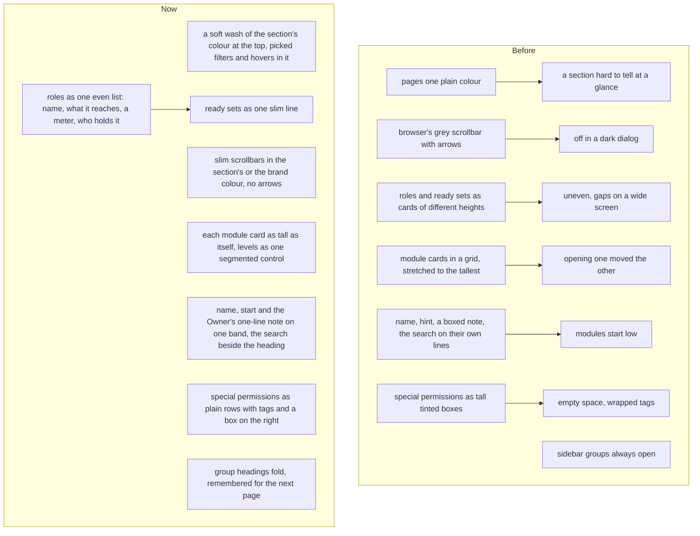

# A bold, even look: section colours, scrollbars in the palette, and the role pages redone

> **In plain words.** After the no-wasted-room update the owner found the pages "a little
> different but not to the extent I was expecting" and chose a bold look on every page, "useful,
> modern, professional, smart, easy to understand". While it was being built he sent five more
> points from his screen: a grey browser scrollbar in a dark dialog, the role editor's save bar
> covering the next heading, the role editor's coloured boxes looking uneven and amateur, a
> module card stretching the one beside it when opened, and the top of the role editor wasting
> 40% of the screen. He also asked for sidebar groups that fold, and for the Roles list to follow
> how well-known products lay roles out. Every page now carries its section's colour, the
> scrollbars follow the palette in light and dark, and the role pages are rebuilt as even lists.

## Why

The owner's words: "Not just bold looks but useful, modern, professional, smart! easy to
understand!", then, on the role pages: "weird, bad designed, uneven made", "every left side
change affects right side sections", "wasting 40% of top page part", and "can you please research
ton of references online?". The references read were the published write-ups on how software
products lay out roles, permission matrices, settings pages and collapsible sidebars (saasui.design,
figr.design, saasframe.io, Supabase's design system, shadcnblocks): roles as a plain, even list
with counts; permissions grouped by module; a box for a change that waits for Save, a switch only
for a change that applies at once; label on the left and control on the right; group headings
that fold with a turning arrow.

## What changed

| The owner's point | What changed |
|---|---|
| A bold look on every page | The page carries its sidebar group's colour (`data-hue` on `main.ui-page`): a soft wash at the top, the picked filter chips, row hovers and table heads in it. Empty states have the colour round their icon. Tables have tinted heads and phone cards with a coloured edge. The audit log says what happened in words, its section a coloured tag, the action's own name small under it; its filters and Export share a line. Home's welcome is a compact band and its cards take their section's tint. |
| The scrollbar is off and ignores the palette | Every scrollbar is slim, in the colour of the section or dialog it sits in (the brand colour elsewhere) mixed with the border, on a clear track, in light and dark. Safari, which lacks the standard property, gets the same bar through its own selectors with no arrow buttons. |
| The save bar covers "Who holds it" | A form with more of the page after it keeps its bar inside the form, so it never sits over the next heading. |
| Opening a module moves the card beside it | Each module card is as tall as its own content; the card itself is plain, the colour in its tile and its picked level. The four levels are one segmented control, the picked one raised in the module's colour. |
| The top wastes 40% | The role's name, where a new role starts from and the Owner's note share one band (the note is one line, not a box; the hint is the field's placeholder). The module search and Set all sit beside the "What it may do" heading. |
| Special permissions look amateur | One plain card per module, each permission a row: what it lets a person do, then small tags with an icon (Owner role only in amber, Fresh sign-in, Second person's yes), and its box on the right. A box, not a switch, because it takes effect with Save the role. On a wide page the cards pack in two columns with no empty boxes. |
| The Roles list is uneven | Roles are one list with every row the same height and its columns lined up: tile and name with what it reaches, a meter and the count of permissions, how many hold it, an arrow into the editor. The ready sets are one line of three buttons under it. |
| Fold the sidebar's groups | Each group's heading folds it shut and open with a turning arrow, in the sidebar and in the phone's menu alike. The folded groups are kept in a cookie the page script writes, so the next page is drawn the same; the group of the page in view is always drawn open, and a sidebar closed to icons shows every row. |

The stylesheet is 157 KiB; its cap is now 164 KiB (it was 156), under the owner's standing "if
you need more skills and libs get them". The unused card meter and the ready set card's corner
were taken out.

## How it was verified

- Tests: the role editor's band, the search beside its heading, the Owner's one-line note, the
  special permission rows with their tags and box (`role-pages.test.ts`); the audit log in words
  with its tag; the roles list (`no-wasted-room.test.ts`); a group folded by the cookie and the page's own
  group drawn open (`module-pages.test.ts`); the fold press in both copies of the sidebar and the
  cookie it writes (`frame.test.ts`); the scrollbar rule, the even module cards, the save bar and
  the folded group in the stylesheet (`theme.test.ts`).
- Looked at in a browser at 390 and 1600 px: Roles, the Owner role, Create role, a dark dialog that
  scrolls, the sidebar's groups.
- `pnpm verify` green before the push.
- Not verified: the look on a real phone (P170 to P174 in the phone tests).
