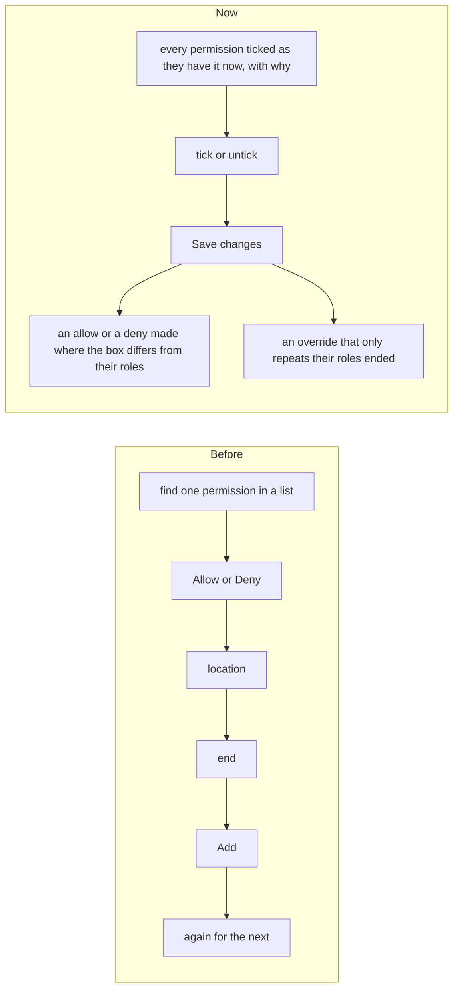

# A person's permissions on one page: tick what they should have

> **In plain words.** Giving or taking one permission from one person asked for too many choices:
> find the permission, pick Allow or Deny, a location, an end, and add it, one at a time. The owner
> said it was "still a bit more complicated" and asked for it to be as easy as the first client's
> current access editor. Now a person's **Change permissions** page lists every permission that may be given one
> person at a time, each ticked when they have it now and saying why. Tick or untick what they
> should have, pick when the changes end, and press **Save changes**: the page works out the rest.

## Why

The owner's words: "Permissions override is still bit more complicated for individual user, role
etc. it can be bit more better! refer [the first client's platform] and other research material to make it easy!".
The first client's current platform (studied for what it does, R-03) has an access editor that shows every item with its state (from the
role, granted, revoked) and one control to flip it, with a Reset. The research read the same
morning (saasui.design, figr.design, saasframe.io) says the same: show what a person has and why,
let them change it in place, and use a box for a change that waits for Save.

## What changed

| Part | Now |
|---|---|
| The page | `/people/:id/exceptions`, renamed **Change permissions** in the person's row of pages. Plain cards by module (two columns on a wide screen), a search over them, and when the changes end. |
| A row | The permission in words, its level (View, Edit, Admin), and why they have it or not: From their roles, Not in their roles, Given to them, or Taken away (with its end). A row with its own override has **Reset**, which ends it. |
| Save changes | Each box that changed ends its override, and makes a new one only when the box now differs from what their roles give: ticked and not in their roles is an allow, unticked and from their roles is a deny. A save with nothing changed says so. |
| An Owner | A one-line note: an Owner already holds every permission but the Vendor's. |
| At one location | An override made at one location is listed under the page, each with End. The page itself works at the whole company. |

The API is unchanged: the page calls `POST /api/iam/overrides` and `DELETE /api/iam/overrides/:id`,
under the same permission checks. One permission posted alone, as before, still works.

## How it was verified

- Tests: the page's rows, ticks, tags, Reset and the hidden state of each row
  (`people-access.test.ts`); what a save asks for, in every case (`permissionChanges`); the whole
  flow on the client template, a save that gives one permission and takes one away, and a save with
  nothing changed (`templates/client/test/screens.test.ts`).
- Looked at in a browser at 390 and 1360 px.
- `pnpm verify` green before the push.
- Not verified: on a real phone (P178).
