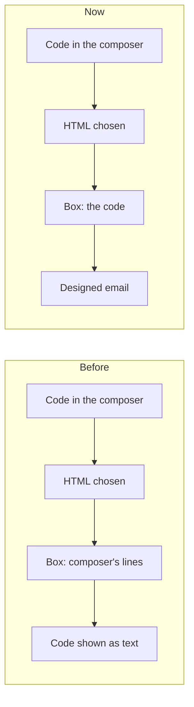

# Coded emails found anywhere, one dropdown, and Write without the portal's bar on a phone

> **In plain words.** The owner pasted a designed email from an AI chat into Write and its preview
> showed the code as text. The cause: the code went into the message editor unnoticed, and
> choosing HTML then handed over the editor's own lines of the code instead of the code. The
> owner also asked for one dropdown used everywhere, for signatures that can be designed like
> templates, for the To line's chips not to touch the line above, and for a calmer Write screen on
> a phone. Oltrem Mail's record ([coded email anywhere](../../vendor/mail/published/docs/records/2026-11-12-coded-email-anywhere.md))
> tells the email side; this one tells the kit's.

## What changed in the kit

| Part | Before | Now |
|---|---|---|
| The frame's composer, HTML chosen | the plain box got the composer's HTML, the code written as `&lt;…&gt;` | when the composer's text is code, the box gets the code itself |
| The frame's composer, Words chosen with code in the box | the code was cleaned to the composer's tags, lost | the code shows as the composer's lines, which the server reads as the code |
| A composer with no Words or HTML choice (a signature) | pasted code said it goes as words | the code takes the plain box as code |
| `Dropdown` (core-ui) | each page drew its own `details.ui-drop`, or a select | one primitive: radios under a line, a heading, hints, a face for the closed line, `field` for a form, `wide` to span the line or toolbar, `fit` in a row of tools, `submitWith`, `cmd` for a composer command that is never posted |
| `data-submit-with` | a select or a file input | a radio too, so a dropdown's pick posts its form |
| `data-unfold` | one row | several ids: one Cc/Bcc button opens both lines |
| A line of chips (`.ui-line`) | a chip touched the line above; the label sat between the rows | room above and below; label and buttons level with the first row; no arrow beside a box with suggestions |
| Write on a phone | the portal's bar above the compose head | the compose head is the only bar while an email is written; Ready to send shows its words |
| The style sheet's cap | 144 KiB | 148 KiB, the owner's yes on 2026-11-12 (`packages/screens/test/css.test.ts`) |

## Impact

- Every client portal: the Write page and Email settings change on the next update; no data or
  setting changes in the kit. Oltrem Mail's migration `1017` gives the code permission to every
  role that may send.
- The page weighs a little more: the style sheet's cap rose by 4 KiB, cached after the first visit.

## How it was verified

- `packages/core-ui/test/dropdown.test.tsx`: radios, the picked option, the FormField label, a
  pick posting with a button, a composer command never posted.
- `packages/screens/test/frame.test.ts`: HTML chosen with code in the composer hands over the code;
  a signature's composer takes pasted code into its box.
- `pnpm verify` in both repositories; screens checked at a phone's width in the dark theme.
