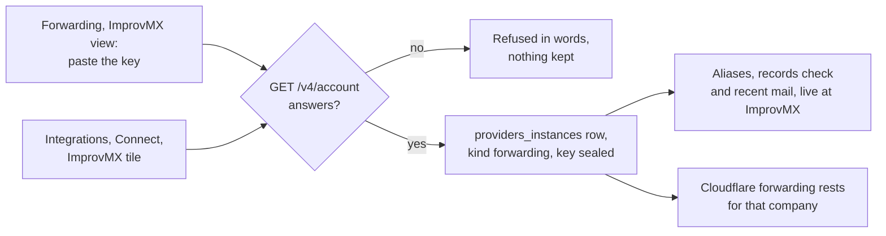

# Forwarding through ImprovMX, and plainer Forwarding and Mail setup pages

> **In plain words.** The owner asked whether an ImprovMX API key could set forwarding up by
> itself instead of Cloudflare, and picked "Forwarding through ImprovMX" on the card. Forwarding
> now opens on an ImprovMX view: paste the key once and the portal keeps it locked, lists the
> account's domains and aliases, changes them at ImprovMX, checks a domain's records and shows the
> mail ImprovMX forwarded. The same night Mail setup was made to lead with its one next step, and
> the boxes of figures on Addresses were removed. The full account is
> [Oltrem Mail's record](../../vendor/mail/published/docs/records/2026-11-12-forwarding-through-improvmx.md).

## What the kit changed with it

| Area | Before | Now |
|---|---|---|
| The providers module's kinds | `email` and the others it had | Also `forwarding`: a service that forwards a domain's mail to people's own inboxes; nothing is sent through it, so no send, no batch and no delivery reports |
| Its definitions | Twelve email services | Plus ImprovMX (`modules/providers/src/definitions/forwarding.ts`): basic auth with the user `api`, the account read as the probe, its key sealed like any other |
| Integrations, Connect an integration | One group of tiles | Two groups, email and forwarding; ImprovMX connected here is the same connection Forwarding shows |
| Sending | Picked among kind `email` | Unchanged: every send, failover and Email screen asks for kind `email` only, so ImprovMX is never offered as a way to send |
| `vendor/mail` | Oltrem Mail 5ee9ec9 | Oltrem Mail cb27410 |

The stylesheet stays at 144 KiB, under its 148 KiB cap.

## How it works now

Either door, Forwarding or Integrations, leads to the same row in `providers_instances`, so a
key pasted in one place is the connection the other shows. Disconnect on Forwarding removes the
row; the aliases keep forwarding at ImprovMX, and the portal's Cloudflare forwarding picks up
again.

## How it was checked

- `modules/providers/test/definitions.test.ts`: the email twelve filtered by kind, and ImprovMX's
  own test (kind, auth, probe, no send, no reports, no fingerprint).
- Oltrem Mail's verify, 11 gates, for cb27410: 15 ImprovMX tests in the Workers runtime against a
  scripted ImprovMX, the Forwarding page's two views, Mail setup's next step, Addresses without
  boxes.
- The kit's `pnpm verify` once for the batch.
- Not checked against a real ImprovMX account: the key is the owner's to paste. Phone tests P160
  to P163 in [the email phone tests](../phone-tests-email.md), with P158 brought up to date.
