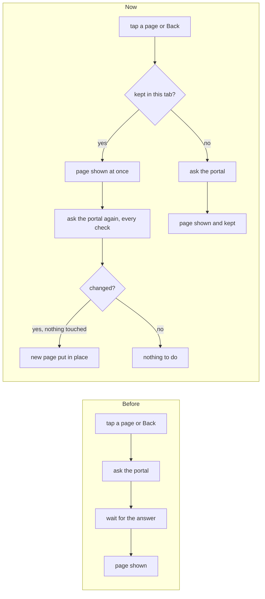
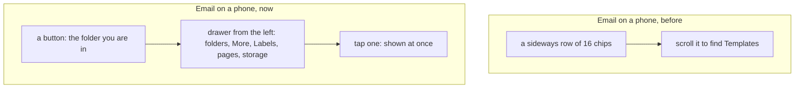
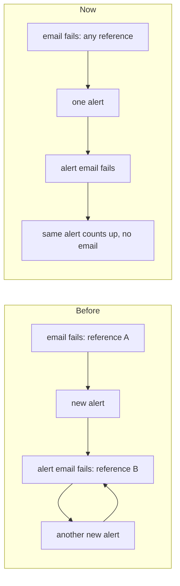

# Pages kept in the tab's memory, and Email's folders in a drawer on a phone

> **In plain words.** The owner asked that he never wait seconds for a page, going back included,
> that Email load its pages into the browser's memory as soon as he opens it, and that Email on a
> phone be easier to move around in. Now each page opened is kept in the tab's memory for 15
> minutes. Back, Forward and a link to a page already seen show it at once, and the portal is then
> asked for it again, with every check, so nothing about sign-in or permissions is loosened. When
> Email opens, its other pages are fetched quietly one at a time. On a phone, the long sideways row
> of folder chips is gone: a button over the list names the folder you are in and opens every
> folder, label and Email page as a drawer from the left, the way the portal's own menu opens.

## Why

Opening a page was one request to the portal and two trips to the database. That is quick next to
the database, and slow from far away or on a phone network. Going back fetched the page again.
On a phone, Email's 16 folders, labels and pages sat in one sideways row: to reach Templates you
scrolled past every folder, and the row did not say where you were.

## How it was, and how it is

| Area | Before | Now |
|---|---|---|
| Back and Forward | the page fetched again | shown from the tab's memory at once, then checked |
| A page seen in the last 15 minutes | fetched again | shown at once; asked for again when the copy is older than 15 seconds |
| Opening Email | each folder fetched when tapped | its 16 pages fetched one at a time while the browser is idle |
| A change sent (a form, a module's own request) | nothing kept | every copy forgotten, so the next page is asked for first |
| Email's folders on a phone | a sideways row of chips | a button naming the folder, opening a drawer from the left |
| Email on a computer | the left pane | unchanged |

## Decisions

- **Memory only, never the disk.** Local storage and the browser's cache would keep a person's
  mail after sign-out and could hand a page over without the portal's check. The copies live in
  the tab's memory and go with the tab, a reload and the sign-out's full page load.
- **Every page is still asked for.** A copy is shown, and the portal is asked at once unless the
  copy is less than 15 seconds old (the same window the page fetched under the pointer already
  had). A session that ended or access taken away shows on that answer, as it does today: the
  person sees only a page they already saw in that tab, for the moment the answer takes.
- **What the person started is never swept away.** A newer page replaces the copy only if the
  person has not tapped, typed or opened a dialog since; otherwise it is kept for the next time.
- **Nothing along the bottom of a phone.** The owner asked on 2026-11-11 for only the sidebar and
  no bar along the bottom, so the folders open as a drawer from the left, like the portal's menu.
- **Compose is not fetched ahead.** Opening Write checks the senders, so only a tap opens it.

## The figures

On this computer, every database trip made 25 ms slower: Templates from Email's drawer opened in
77 ms with no request, and Back to the Inbox in 59 ms with no request. Opening Email fetched its
16 pages one after another; each Email page makes 9 to 15 database queries, so a fresh visit costs
about 180 queries at most once every 15 minutes, and none while the copies last.

## Impact on each part

| Part | Impact |
|---|---|
| Every portal page | Back, Forward and pages seen again open at once |
| Email | its pages fetched ahead when it opens; on a phone the drawer in place of the chips |
| Oltrem Mail | nothing to change: its pages are drawn by core-ui's `MailShell` |
| A client's own module | its pages are kept the same way; a part marked `data-preload` is fetched ahead |
| Sign-in and permissions | unchanged: every page is still checked by the portal |

## Found on the way: an alert that never stopped

The kit's full check kept failing while this was tested. The cause was in the alerts module, not
in these pages. A server error is kept as one alert per failure, keyed by its message with the
ids taken out, but the runtime's `reference = …` on a network error was not taken out. So when
no email provider could be reached, each failed email opened a new alert, the alert's own email
failed the same way and opened another, and so on without end: in the test, 800 messages in a
minute. On a live portal whose provider was down, every turn of that loop cost D1 writes and queue
operations. Such a reference now counts as an id, so the same failure counts up on one alert, and
the screens test waits for the queue to be empty instead of a fixed five seconds.

## How it was verified

- `@oltrem/screens` frame test: a page opened before opens again from memory without a request,
  is asked for again after 15 seconds while shown at once, and is forgotten once a change is sent.
- `@oltrem/core-ui` mail test: the phone's folder button names the folder on screen with its
  count, the pane is a popover with its close and `data-preload`, Compose and the + are skipped,
  and nothing is drawn along the bottom.
- The stylesheet test: the drawer from the left, the button's 44 px, no bar class left.
- The alerts test: two network errors that differ only in their reference share one key. The
  screens test alone: the queue empties in about 8 seconds where it grew without end before.
- The local portal at 390 px (the drawer, Templates, a label) and at 1024 and 1440 px (the pane
  unchanged, 208 px wide), with the timings above.

## What is left

- The phone tests P153 and P154.
