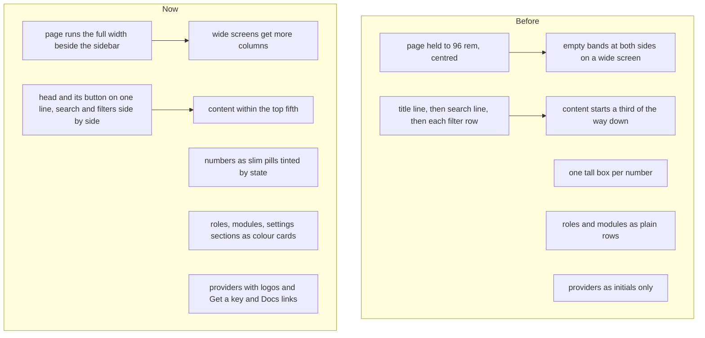

# No wasted room: full-width pages, colour cards, logos and a System status for an AI

> **In plain words.** The owner looked at the live portal on 2026-11-12 and found pages wasting
> about 40% of the width on empty space, heads and filters taking several lines before anything
> useful, tall boxes for single numbers, a Roles page and role editor that were hard to read, a
> Settings page that looked broken, and providers with no logos or links. Every page now uses the
> full width beside the sidebar, the head, search and filters share as few lines as fit, numbers
> are slim colour pills, and roles, modules, settings and providers are colour cards. System
> status says where each problem is fixed, can run every check again, and copies one plain report
> to paste into any AI assistant. The rule behind it is now part of R-12, so every later page
> follows it.

## Why

The owner's words: never waste room at the sides; never waste the top, so the page's own content
starts within the top fifth of the screen, without making it cramped; and use logos, icons,
colours and gradients so a person tells things apart at a glance. He tests on a phone and on a
computer, so both count.

## What changed

| The owner's point | What changed |
|---|---|
| 1. Heads, filters and sorting take too much room | `.ui-page` is one wrapping row with no width cap: the head and its commands share a line, a search and each chip row sit side by side under it. Users, Roles and every list page follow without their own changes. |
| 2. The Roles list is hard to read | Each role is a card in its own colour (the Owner amber with a crown): what it reaches, a meter of how many of every permission it holds, and how many people hold it. The ready sets (View only, Standard user, Full admin) are cards with their own icon and colour. |
| 3. The role editor overlaps and wastes room | Name and Start from side by side; each module is a card tinted in its colour, two columns on a wide screen; special permissions are cards; the save bar is solid, full width and stuck to the foot. |
| 4. Settings looks broken and wastes 40% | Settings uses the full width: the sections are cards with a tinted head, two columns from about 1,340 px. |
| 4.1 Settings, Modules | Modules are tinted cards in their sidebar group's colour, an off module goes quiet; the counts are pills; the save bar is solid and full width. |
| 5. System status: fixing and an AI report | Each check that is not OK has a link to the page that fixes it; the problems are listed first; **Check again now** makes the health job run within five minutes; **Copy the report for an AI** copies one plain text with every check, budget, the queue and the open alerts, and asks for the cause and the steps. |
| 6. A dropdown's list cut off at the card | An open dropdown lifts the clipping of every box around it, in a page or a dialog. |
| 7. Big boxes for single numbers | `Figures` (and so `Stats` on every page) draws slim pills in a row, each as wide as what it says. The Addresses page itself is being redone in the Email work. |
| 8. Mail setup and Forwarding are confusing | Taken by the Email work, which is rebuilding Forwarding. |
| 9. Providers: logos, links, less room | Each provider shows its logo on a white tile where one exists (Resend, Brevo, Mailgun, Mailtrap, Cloudflare, ImprovMX), else its initials on its colour, with **Get a key** and **Docs** opening the provider's own pages in one tap. The empty "No integration connected" box is gone when Ready to send already says it. |

"Auto fix" here means the page takes a person straight to the fix and runs the checks again on a
press; it does not change settings by itself, because most fixes need a key or a choice only a
person can give.

The logos are Simple Icons' paths (CC0 1.0), copied into `provider-logos.tsx` rather than adding
the whole package (about 26 MB) for six marks. The rule is in [rules.md](../../rules.md) R-12 and
in the `ui-design-system` skill, which also now allows a soft gradient of one colour on a card
(never two colours blended, never a coloured glow).

The stylesheet grew from 144 to 149 KiB; its cap is 156 KiB (it was 148), with the owner's
"if you need more skills and libs get them".

## How it was verified

- Tests: the page frame has no width cap and wraps; figures are pills; the dropdown rule is
  there; colour cards fade one hue only (theme tests). The Fix link and its pages, the report's
  contents and order, Check again now posting the health job and coming back, the role cards'
  colour, meter and holders, the provider logo and links, and one hue per id (screens tests).
- Looked at in a browser at 390, 1440 and 1840 px, light and dark: Users, Roles, Create role,
  Settings, Modules, System status, Email settings.
- `pnpm verify` green before the push.
- Not verified: the look on a real phone (P164 to P168 in the phone tests).

## Follow-up the same morning: a tab kept open showed the old look

At 07:33Z the owner said almost everything still looked the same, though his portal was on this
update (its recorded fingerprint matched the commit). The cause: the frame script opens every page
in place and kept the stylesheet the tab first loaded, so a phone tab open since before the update
drew the new pages with the old styles. Now a page built by a newer portal (its stylesheet or
script has another version) opens whole, with its own styles. A tab still running the old script
needs one reload to get this fix; every later update arrives by itself.

He also asked that a dropdown open upward when there is no room under it: the frame script now
marks a dropdown whose choices would run past the foot of the screen, when there is more room
above, and its card opens over the line instead (P169).

