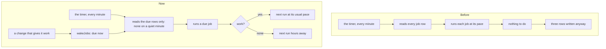
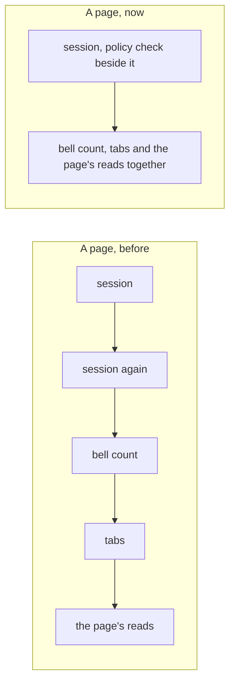

# A quiet portal costs almost nothing, and a page waits for one trip less

> **In plain words.** The owner, testing a live portal alone, saw it use about 202,000 database
> rows read and more than 10,000 written in a day, and pages that took long to open and to move
> between. Almost none of that was his own use. The portal's timer woke every minute and ran
> about fifteen background jobs every five or fifteen minutes, whether they had anything to do or
> not, and each run wrote to the database just to say it had run. Now a job that finds nothing to
> do sleeps for hours, and whatever gives it work wakes it at once. The checks of System status
> write only when something changed. The nightly backup, its reminder and the daily audit seal
> are switched on by whoever wants them, not found running. And a page now starts its reads
> together instead of one after another, so it waits for the slowest one, not for their sum.

## What the day cost, and where it went

The owner's figures for one day, by statement, with what each was:

| Statement | Runs | Rows | What it was |
|---|---|---|---|
| waiting alerts read | 247 | 68,200 read | `alerts.release`, every five minutes, read every alert ever raised to find none waiting: the table had no index for the question |
| every job's row read | 1,322 | 38,340 read | the timer, every minute, read all 29 job rows to find the ones due |
| every check's row read | 284 | 14,200 read | `health.run`, every five minutes |
| the budgets read | 1,350 | 9,450 read | the timer asking whether jobs must pause |
| a job's outcome written | 2,482 | 4,960 written | two rows a run: the row and its place in the index on the next run |
| a job's lease written | 2,416 | 2,420 written | one row a run |
| a check's row written | | 1,624 written | one row a check a run, whatever it found |

A job run costs three rows written whether it found work or not, and the free plan gives 100,000
a day: fifteen jobs polling was a tenth of it, on a portal doing nothing.

## What changed

| Area | Before | Now |
|---|---|---|
| A job with nothing to do | ran at its pace for ever | declares `idle`, answers `'idle'`, and runs at that slower pace; `wakeJobs` makes it due the moment something gives it work, in the same write where it can |
| The timer's read | every job row, every minute | only the rows that are due, through the index; every row on a Worker's first tick and once an hour |
| Waiting alerts | every alert read on each run | a partial index (migration `0060`), and the job sleeps six hours while none waits |
| Webhooks, automations | read the audit log every five minutes | with none switched on: no read, the place moved to the end of the log, asleep; switching one on wakes the job |
| System status's checks | a row written a check a run, every five minutes | a row written only when a result changed; when each last ran is kept in one row; asleep half an hour while all is well, back in five minutes to confirm a failure |
| Measuring the plan's use | every fifteen minutes | hourly while each budget the jobs can spend is under a quarter of its limit |
| Nightly backup, restore drill reminder, daily audit seal | on for every portal | extras on the Modules page, off on a new portal until switched on; a copy by hand, a drill and a restore still work |
| Oltrem Mail's jobs | held messages, scheduled emails, domain checks, list look-ups and campaigns polled every five minutes | each sleeps while it has nothing to do, woken by the write that gives it work |
| A page's reads | the session read twice, then the bell's count, then the tabs' permission, then the page's own reads | the session read once, the policy check beside it, then everything else at once |

## The figures

**Job runs in a day of a portal with nothing to do** (the client template's worker test, 1,500
one-minute ticks): about 3,950 before, 390 now. The kit's own jobs make 305 of them and Oltrem
Mail's five, which sleep the same way since its release of the same day, 85 where they made
1,500. At three rows a run that is about 11,900 rows written a day before and about 1,200 now.
The test pins the total, so a job added without a slow pace shows.

**Each page**, on this computer with every trip to the database made 25 ms slower, which is the
low end of what the live portal's own job timings show (a query took 7 ms when the Worker ran
near the database and up to 260 ms when it ran far away):

| Page | Before | Now |
|---|---|---|
| Settings | 129 ms, 4 trips in a row | 84 ms, 2 |
| Audit | 130 ms, 4 | 80 ms, 2 |
| Users | 109 ms, 3 | 85 ms, 2 |
| System status | 102 ms, 3 | 73 ms, 2 |
| Bulk mail | 102 ms, 3 | 77 ms, 2 |
| Integrations | 159 ms, 5 | 129 ms, 4 |
| Email | 144 ms, 4 | 119 ms, 3 |
| Home | 235 ms | 210 ms |
| Write | 339 ms, 11 | 158 ms, 4: Oltrem Mail starts its reads together and reads the sending services once (9 queries, were 11) |

Each other page's count of queries is unchanged, and stays pinned.

## Decisions

- **The slow pace is the safety net, the wake is the rule.** A wake that was lost (a write that
  failed between the change and the wake) is found at the next slow run. A job never wakes itself.
- **A wake made while the job runs is kept.** The outcome write leaves a next run that was set
  after the tick started.
- **A problem opens within about 35 minutes of starting, where it was 10.** That is the price of
  the checks sleeping while all is well; a run by hand checks at once.
- **Off by default is the setting's default, not a migration.** A portal whose list of modules was
  already saved keeps its nightly backup and its seal until someone switches them off there. The
  command-line tool reads the same default before anything is saved, so the first list it writes
  keeps them off.
- **The backup's page stays always on.** Only the schedule, the first copy by itself and the two
  reminders are extras: a copy by hand never depends on a switch.
- **Permissions are checked as strictly as before.** The policy version is still compared on a
  new isolate's first request, before anything is answered; it is asked for beside the session's
  read instead of after it. Checking it after the answer was looked at and refused: a person
  whose access was just taken away could have read one more page.

## Looked at, and not built

- **Keeping data in the browser** (local storage, session storage, a signed token). The portal
  already keeps what can be kept: the whole permission map is worked out once and travels with the
  session, and the browser already fetches the next page when a link is touched and keeps the
  frame between pages. What is left to read is the page's own data, which a browser copy would
  show stale, and none of it was what the day's rows were spent on.
- **Running the Worker near the database** (Cloudflare's placement setting). Free on every plan,
  and it would shorten every trip for someone far from the database. Not switched on here: the
  sign-in is read from what Cloudflare Access hands the Worker, which is not handed on through
  every route into a Worker, and its documentation does not say whether it survives placement.
  It is a switch in the Cloudflare dashboard, tried on one portal and switched back in a minute
  if the sign-in page shows.
- **Database read copies near the visitor.** Still a public beta; every read would go through the
  Sessions API. Unchanged from [2026-11-11](2026-11-11-page-costs.md).

## Impact on each part

| Part | Impact |
|---|---|
| A live portal | after its next deploy: far fewer rows read and written by the timer; its nightly backup and seal stay as its saved list says |
| A new portal | starts with the nightly backup, the drill reminder and the daily seal off; Home and Backups say so |
| A client's own module | nothing changes; its job may declare `idle` and be woken the same way |
| Oltrem Mail | its five-minute jobs sleep the same way (its record of the same day, `2026-11-12-jobs-that-sleep.md`); `mail.soon` too where Oltrem Mail is on |
| `oltrem parts` and the first deploy's question | read the new default before anything is saved |

## How it was verified

- `@oltrem/core-jobs`: a job that answers `'idle'` run at its idle pace, woken by `wakeJobs`, a
  wake made while it ran kept; a tick reading only the due rows through the index, every row on
  the first tick and once an hour; an extra stopping a flow's schedule while a start by hand runs.
- `@oltrem/core-health`: the job running the checks whose time has come, writing a row only when
  a result changed, sleeping unless a failure waits; twelve checks at most a run; the measuring
  hourly while the spendable budgets are low.
- `@oltrem/alerts`, `@oltrem/developer`, `@oltrem/automations`, `@oltrem/analytics`,
  `@oltrem/backup`, `@oltrem/core-audit`: each job's idle answer, and the wake where one exists.
- `@oltrem/core-config` and `@oltrem/cli`: the default list, the reader's set, the tool's read
  before anything is saved.
- `@oltrem/iam`: four calls started together make one session read and one compile.
- The client template: a fresh portal ticked until every job ran, the extras' jobs left waiting;
  a day of ticks within 45 queries a tick, the jobs that sleep run far less, the day's runs
  pinned at 450 (measured 390); every page opened, each page's query count unchanged.
- The index on waiting alerts read back with `EXPLAIN QUERY PLAN` on this computer.

## What is left

- The live portal's 274 open `error.email.*` alerts are never resolved by anything; they cost
  nothing now, and are worth a look on the Alerts page.
- On a portal whose list was saved before, the Vendor switches the nightly backup, the reminder
  and the seal off on the Modules page if they are not wanted.
