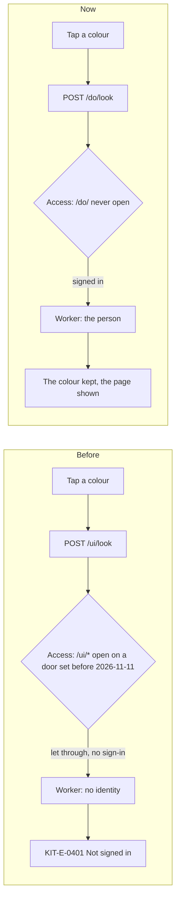

# The screens' actions moved behind the door on every portal

> **In plain words.** On 2026-11-12 the owner changed the colours on his live portal and got
> "Not signed in" (KIT-E-0401) at `/ui/look`, the same refusal he reported the day before. The fix
> of 2026-11-11 closed the hole only in a portal's Access, and only when someone runs
> `npm run deploy` again. Since that evening the fleet updates his portal instead, and the fleet
> cannot change Access, so the hole stayed open. Now the screens' own actions live under `/do/`,
> a path no door has ever opened, so they work on every portal as soon as the fleet updates it,
> whatever its Access says. Nothing for the owner or a client to run.

## Why it failed

A portal's Access application lets a few paths through without a sign-in: the webhooks, the
health check, the customers' pages and the screens' public files. Until 2026-11-11 the deploy
opened all of `/ui/*` for those files. The screens' own actions sat under `/ui/` too: the colour
(`/ui/look`), the theme, the sidebar's open or closed, saved views, bulk actions and Get started.
A request on an open path reaches the Worker with no identity from Access (`ctx.access` is not
there), so the Worker refused each of them with KIT-E-0401.

70d96a8 (2026-11-11) made the deploy open only the four public files and take `/ui/*` out of a
door set before. That runs in `npm run deploy`, step 6, with cf's sign-in. The fleet
(`oltrem fleet`, live since 2026-11-11 19:40Z) updates the code, the database and the Worker, and
its key deliberately has no Access permission ([the fleet](../reference/fleet.md)). So the owner's
portal, updated by the fleet, still had `/ui/*` open, and every action under it still failed.

The line in the browser's console, `InvalidStateError: Transition was aborted because of invalid
state. ViewTransition opt-in disabled`, was the same refusal seen from the page: the Look page's
form posts as a plain page load, the kit's style sheet asks the browser to animate from one page
to the next (`@view-transition`), and the refusal is a JSON answer that cannot take part, so the
browser dropped the animation and said so. It goes with the refusal.

## What changed

| Part | Before | Now |
|---|---|---|
| The screens' actions | `POST /ui/look`, `/ui/look/everyone`, `/ui/theme`, `/ui/side`, `/ui/views`, `/ui/views/remove`, `/ui/bulk`, `/ui/get-started` | the same under `/do/` |
| What sits under `/ui/` | the public files and the actions | the public files alone, by GET (`packages/screens/test/paths.test.ts`) |
| The frame's script | left `/api`, `/hooks`, `/ui`, `/local` to the browser | `/do` too, so the actions behave as before |
| A module's pages | refused under `/api`, `/hooks`, `/ui`, `/local` | `/do` too |
| The door (`DOOR_OPEN_PATHS`) | unchanged | unchanged: a deploy still closes `/ui/*` on an old door |

Before, the door decided whether an action worked, and a door set before 2026-11-11 broke it. Now
an action is always behind the door: Access signs the person in, and the Worker sees who it is.

## Decisions

- **Move the actions, not ask for a deploy.** The other two ways were for the owner to run
  `npm run deploy` once on his PC (it closes `/ui/*`), or to give the fleet key Access permission
  so each run sets the door. The first is a manual step on every portal set before 2026-11-11; the
  second widens a key that reaches every client's account. Moving the actions fixes every portal
  with the next fleet run and needs nobody.
- **`/do/` for the actions.** Short, and outside every path a door opens (`/hooks/*`, `/healthz`,
  `/account`, `/account/*`, `/ui/...`). The old `/ui/` actions are not kept: on an old door they
  only ever answered KIT-E-0401.

## Impact on each part

- **A live portal:** fixed by the next fleet run (every push to `packages/*` starts one).
- **The door and the deploy:** unchanged. An old door still has `/ui/*` open; it now opens only
  public files, which are public anyway.
- **Oltrem Mail:** none of its pages posts to the screens' actions (checked in its packs).

## How it was verified

- `packages/screens/test/paths.test.ts`: under `/ui/` the screens answer GET alone, and the actions
  are under `/do/`.
- The screens', core-ui's, core-module's and the door's tests, and the template's screens journeys
  (theme, colour, everyone's look, sidebar, saved views, bulk, Get started) on the new paths.
- `pnpm verify` before the push.
- Not verified: the live portal's Access itself. This cloud session cannot reach the portal, and
  the fleet key cannot read Access; the cause is read from the refusal (the Worker answered, so
  Access let `/ui/look` through) and from 70d96a8 and the fleet's code. Phone test P132.

## What is left

- The phone test P132 once the fleet has updated the portal.
- A refusal of a plain form post still shows the problem as JSON rather than a page; separate.
