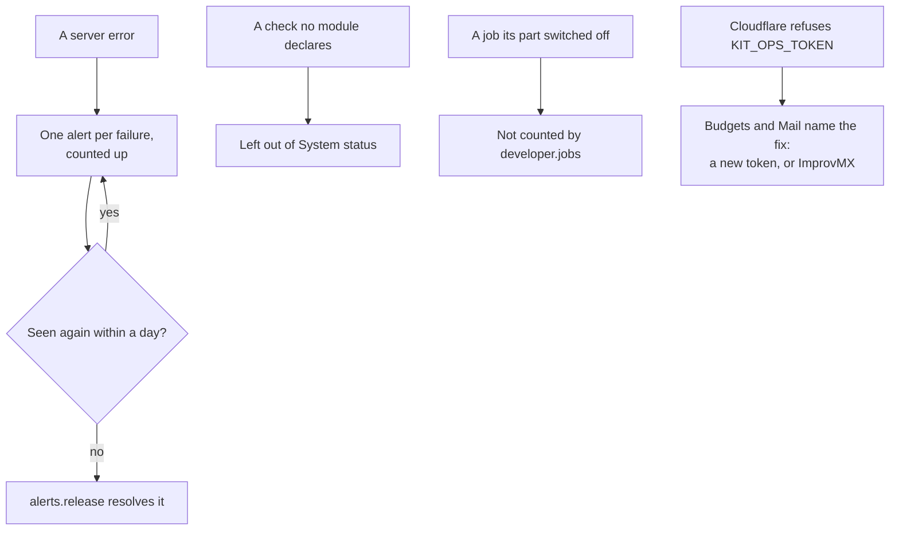

# What a live portal's System status report found, and what was fixed

> **In plain words.** The owner copied his live portal's System status report and asked for every
> problem to be fixed. One cause sat behind most of the report: Cloudflare does not accept the key
> the portal holds for its own Cloudflare calls (`KIT_OPS_TOKEN`), so the day's budgets, the
> nightly backup and the Cloudflare forwarding all failed, each in its own words. Three more lines
> were the portal's own fault: 274 old errors that nothing ever closed, a check taken out of the
> kit on 2026-11-05 that kept showing its last answer, and a job paused by hand that warned even
> once its part is switched off. Those three are fixed here; the key is the owner's to replace,
> and every failure of it now says so.

## Each line of the report

| Line | Cause | Now |
|---|---|---|
| 274 open alerts, "Every email provider refused the message … Resend … API key is invalid" (5 and 10 Nov) | Alert emails failing while the email service's key was wrong; each opened its own alert (fixed earlier the same day by the fingerprint), and no check passes to close a server error | The alerts job resolves a server error not seen again for a day; the 274 close on its next run |
| `iam.door`, failing since 2026-11-05 | The door job and its check were taken out of the kit on 2026-11-05; their last row stayed and was listed | System status leaves out a check no module declares |
| `health.budgets`, "Cloudflare analytics: HTTP 400" | Cloudflare does not accept `KIT_OPS_TOKEN` (its refusal comes on a 400) | The line names the fix: a new token with Account Analytics Read, set as the Worker secret |
| `mail.forwarding`, "could not check, try again (Invalid request headers)", and the hourly error | The same key, used by the Cloudflare forwarding | Oltrem Mail 7f492f3 names the fix; forwarding through ImprovMX needs no Cloudflare key at all |
| The backup alerts, "HTTP 401: 10000 Authentication error" | The same key; the nightly backup ran at 03:03 UTC, before the owner switched it off at 05:34 | Off now; the alert closes a day after its last time |
| `audit.sealed` and `developer.jobs`, "paused: audit.seal" | The owner paused the seal job by hand on 2026-11-08, but the Daily seal is still on in Settings, Modules | Switching the Daily seal off hides both: the seal check goes with its extra, and the jobs check now passes by a job the Modules page switched off |

## How it works now

## What the owner does

1. Forwarding: connect ImprovMX with its API key. The Cloudflare forwarding rests and stops
   failing every hour.
2. Settings, Modules, Audit log: switch **Daily seal** off and save.
3. For the budgets: make a token in the client's Cloudflare account with Account Analytics Read
   (and D1 Edit, for when backups go back on), then in Workers and Pages, the portal's Worker,
   Settings, Variables and Secrets, set `KIT_OPS_TOKEN` to it.

## How it was checked

- The live portal's database read through the Cloudflare connector, read only: the alert rows by
  key and date, the health rows (the `iam.door` row last written 2026-11-05), the jobs (the seal
  job paused 2026-11-08) and the saved Modules switches (backups off at 05:34 UTC).
- `modules/alerts/test/alerts.test.ts`: a server error open at 23 hours 59, resolved at 24 hours
  01, a check's alert left open, and the same error seen again opening anew.
- `packages/core-health/test/health.test.ts`: rows of checks no module declares left out of the
  list; `budgets.test.ts`: a 400 with Cloudflare's code 6003 named with its fix, another 400 with
  Cloudflare's own words.
- `modules/developer/test/developer.test.ts`: a paused job warns, and passes once the Modules page
  switched it off.
- The kit's `pnpm verify` once for the batch. Not checked: the key itself, which a cloud session
  cannot read; phone tests P175 to P177 in [the phone tests](../phone-tests.md).
