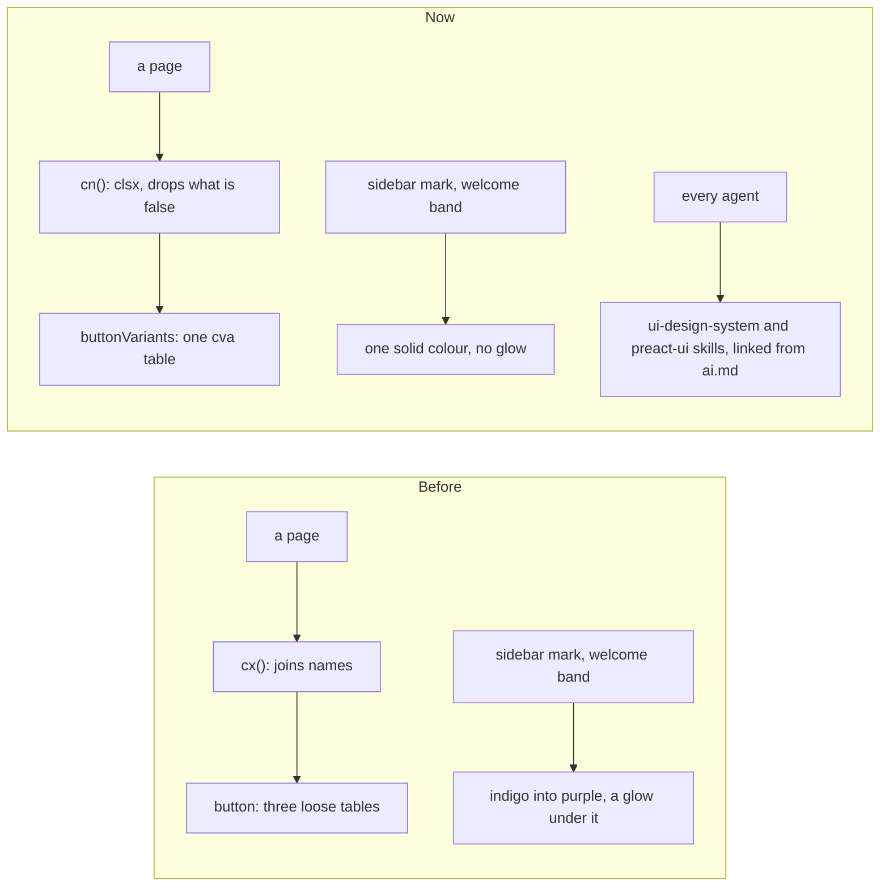

# Class names, button looks and the two design skills

> **In plain words.** The owner asked for a four-step overhaul of how the screens are built: check
> the set-up, add a small set of tools for class names, write down the design rules where every
> AI agent reads them, and rebuild one piece as a proof. His prompt was written for a site built
> with Astro and React-style islands. Oltrem is built differently (pages drawn on the Worker, one
> small browser script), so each step was applied the way it fits Oltrem, and where a tool would
> cost more than it gives, it was measured and left out. The visible change is small: the
> sidebar's mark, Home's welcome band and the setup page's mark and main button lose their
> two-colour gradients and coloured glows and become one solid colour.

## Why

The owner found the screens' output uneven and asked for rules an agent cannot drift from: no
purple-to-blue gradients, no glowing shadows, no random colours, thin borders, a calm neutral and
one accent, clear states, and a fixed way to write class names. Before this, class names were
joined by a hand-written `cx()` that did not drop `false`, and a button's looks lived in loose
tables a caller could fight with its own classes.

## What the audit found

| Asked to check | What Oltrem has |
|---|---|
| Astro config, islands, the React alias | none: pages are Preact drawn on the Worker, the browser runs one script; no `react` import anywhere |
| Tailwind's scanning | the stylesheet build reads core-ui, the screens, each module's pages and Oltrem Mail's built pages; nothing missed |
| Class names built from a variable | none that Tailwind cannot see; the few built names (`ui-fill-${tone}`) are written out in `theme.css` |
| Raw colours, palette classes, `shadow-xl` | none in the pages: every colour is a theme token, so a client's brand and the seven themes keep working |
| Two-colour gradients and coloured glows | the sidebar mark and Home's welcome band (indigo into purple, with a glow); the setup page's mark and main button; Email's own pieces (left to the Email work) |

## What changed

| Asked for | Done in Oltrem | Why |
|---|---|---|
| clsx | added; `cn()` in core-ui, `cx` kept as the same function | Oltrem Mail's packed pages import `cx` |
| class-variance-authority | added; the Button's looks and heights are one `cva` table, `buttonVariants` exported | a look is picked by name, never fought with a class |
| tailwind-merge | left out | 8.4 KB more and about 18 ms of CPU on a first page for 392 real class strings, past the free plan's 10 ms; it also failed to see the kit's own sizes |
| lucide-preact | already in use | |
| nanostores | left out | there are no islands to share state between; the address and the server are the state |
| `src/lib/utils.ts` | `packages/core-ui/src/cx.ts` | where every page already imports from |
| two skills, linked from CLAUDE.md | `ui-design-system` and `preact-ui` under `.claude/skills/`, linked from ai.md | CLAUDE.md is generated from ai.md |

clsx and class-variance-authority have their rows in the dependency registry with the
measurement.

## How it was verified

- Tests: `buttonVariants` gives the button's classes and its defaults; `cn` drops what is false
  and `cx` is the same function; no gradient in the theme blends the primary into the accent and
  the welcome band is flat; the setup page's mark and main button are one colour with no glow.
- `pnpm verify` green before the push.
- Not verified: the look on a real phone (P157 in the phone tests).
