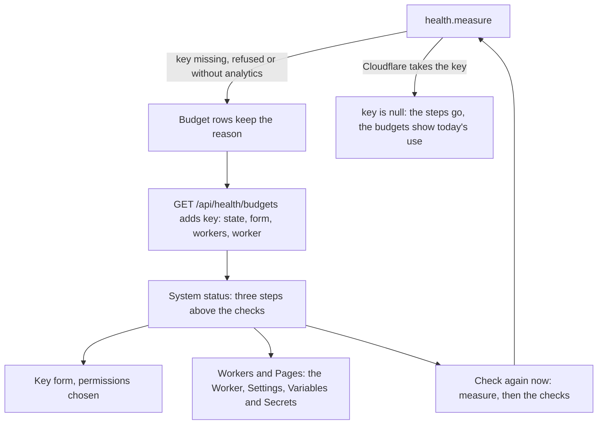

# The Cloudflare key fixed from a phone

> **In plain words.** A live portal had gone a week with a Cloudflare key that Cloudflare refuses
> (`KIT_OPS_TOKEN`), so System status could not measure the plan's use and backups could not run.
> The fix was written as a terminal command (`npx wrangler secret put`), and the owner works from a
> phone. Now System status itself shows three steps above its checks while the key is missing,
> refused or too narrow: Cloudflare's key form opened with the right permissions already chosen,
> the place in the dashboard where the key goes, and Check again now, which measures the plan's
> use before it runs the checks, so the new key shows at once. The steps go away by themselves
> once Cloudflare takes the key.

## What changed

| Where | Before | Now |
|---|---|---|
| System status, key refused | the budgets line: "Cloudflare does not accept KIT_OPS_TOKEN ... set it as the Worker secret" | a box above the checks: 1. Open the key form, 2. Open Workers and Pages (the Worker named, then Settings, Variables and Secrets), 3. Check again now |
| The key form | the owner picked two permissions by hand | the form opens with Account, D1, Edit and Account, Account Analytics, Read chosen, and DNS, Edit too while Oltrem Mail is in the portal (Cloudflare's "API token template URLs") |
| Check again now | ran the checks; the plan's use was measured hourly when quiet | measures the plan's use first, then runs the checks |
| `audit.sealed` when the seal stopped | Fix opened Audit log, which has no switch | the message says where to switch Daily seal off or resume the job, and Fix opens Modules |
| The key recipe | "run npx wrangler secret put KIT_OPS_TOKEN" | the dashboard's Variables and Secrets first, the command as the other way |

## How it works now

The budgets' measure job already kept why each budget went unmeasured. `keyStateOf` reads those
reasons: no key set, a key Cloudflare refuses (a 401, or its codes for a key it cannot read), or a
key without Account Analytics Read (a 403). While one of them holds, the budgets route adds `key`,
and the page shows the steps. The form is the same account-token URL the command-line tool's
deploy prints; the portal never sees the new key, which goes straight into the Worker's secrets.

## Impact on each part

- **core-health:** `OPS_TOKEN_PERMISSIONS`, `opsTokenForm`, `WORKERS_PAGE`, `keyStateOf`; the
  budgets options take the Worker's name and extra permissions; the budgets route gives `key`.
- **screens:** `KeySteps` on `/health`; Check again now runs `health.measure` before `health.run`;
  `fixOf` sends a stopped daily seal to Modules.
- **core-audit:** the stopped-seal message names both fixes.
- **The client template:** the budgets get the Worker's name and, with Oltrem Mail, DNS, Edit.
- Nothing stored, no new key, binding or variable.

## How it was checked

- `packages/core-health/test/budgets.test.ts`: a refused key (400 with code 6003), a key without
  analytics (403) and no key each give the steps with their state; the form's permissions are
  the recipe's two then Mail's; the key never appears in it; once Cloudflare answers, no steps.
- `packages/screens/test/no-wasted-room.test.ts`: the box above the checks with both links and
  the Worker's name, none when the key works; Check again now runs the measure then the checks;
  a stopped seal's Fix opens Modules, a broken one Audit log.
- The kit's `pnpm verify`. Not checked: the live dashboard pages themselves, which the phone
  tests P182 and P183 in [the phone tests](../phone-tests.md) cover.
