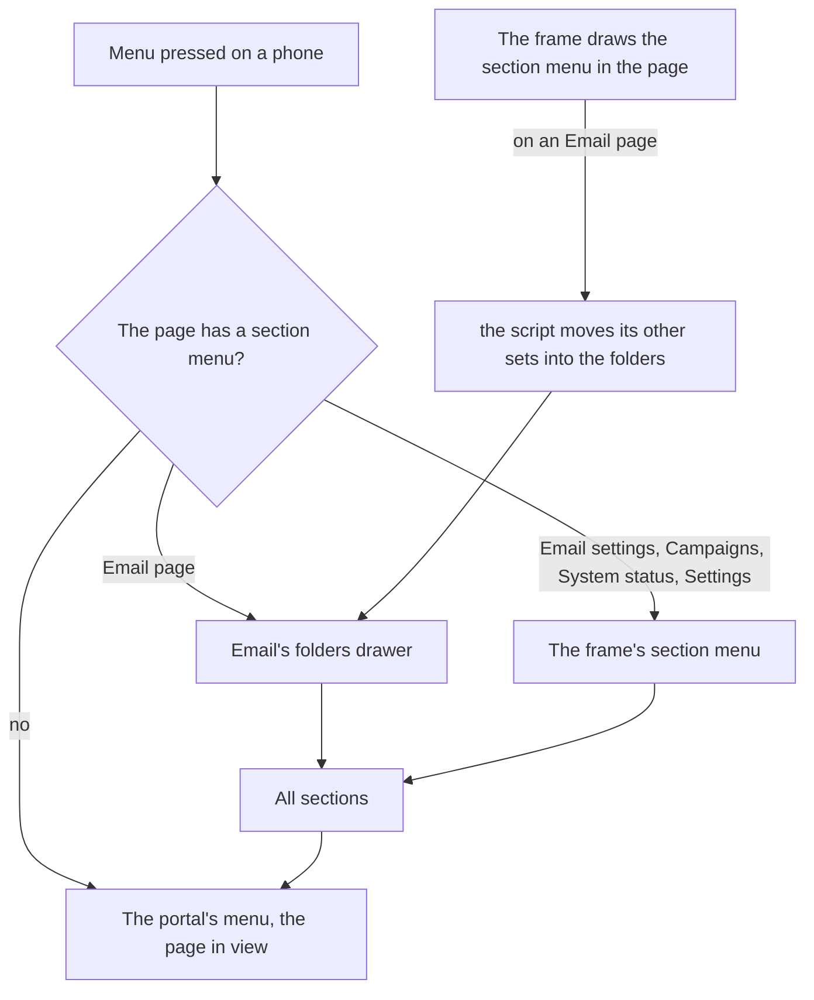

# Email's menu on a phone

> **In plain words.** The owner, on a phone: "I cannot access sidebar, options in Email". Three
> things were wrong. The menu button used a browser feature (command buttons) that Safari before
> 26.2, Samsung Internet and Firefox before 144 do not have, so on those phones it did nothing.
> Where it worked, it opened the whole portal at its top, with Email about 25 rows down. And the
> Email folders drawer held no Email settings or Campaigns. Now the menu button works on every
> phone, and inside Email it opens Email's own menu: the folders, labels and tools, then Email
> settings and Campaigns, with **All sections** at its top for the rest of the portal.

## What modern apps do (the research)

| App | On a phone |
|---|---|
| Gmail (Android, iOS) | one drawer from the menu button: folders, labels, then settings; Compose as a round button |
| Apple Mail | a hierarchy: Mailboxes, then a mailbox, each screen with "‹ Mailboxes" back up |
| Outlook | the avatar opens a drawer of accounts and folders; the folder's name opens its options |
| Material 3 navigation drawer | below 600 dp a modal drawer from the menu button, closed by a choice or a tap outside; never beside a bottom bar |
| Odoo and Zoho (suites of apps) | inside an app, the menu holds that app's sections, and a separate way goes back to every app |

The common rule: **one menu button, and it opens where you are first**, with the way up to
everything one press away. The owner's own rules keep it a sidebar: nothing along the bottom.

## What changed

| Where | Before | Now |
|---|---|---|
| The menu button, on Safari before 26.2, Samsung Internet, Firefox before 144 | did nothing (`commandfor` not known) | the frame's script does what the button asks; a press outside the drawer closes it (`closedby`) |
| Menu on an Email page (Inbox, Sent, a conversation, Delivery log, Templates, Mailboxes, Usage) | the whole portal's menu, at its top | Email's menu: **‹ All sections**, the folders, More, Labels, the tools, then Email settings and Campaigns, then the storage meter |
| Menu on Email settings or Campaigns pages | the whole portal's menu, at its top | the section's menu: Email, Email settings and Campaigns, each with its pages, the page on screen marked |
| All sections | | closes the section's menu and opens the portal's, scrolled to the section on screen |
| Menu elsewhere (Home, Users) | the portal's menu at its top | the same, scrolled to the page on screen |
| An Email list's head on a phone | "Email", then the folder button | the folder button is the heading (a head with buttons, such as Templates', stays) |
| Compose's round button | covered the last choice of a sheet (Quick settings) | steps aside while a sheet is open |
| A computer | | nothing changes: the sidebar and the folders pane as before |

## How it works now

The frame draws a **section menu** inside the page for a page that is one of a set of tabs: every
page of its sidebar group, set by set (`SectionMenu`). It is inside the page, which the script
swaps, not inside the sidebar the browser keeps, so it is always this page's. On an Email page the
script moves its other sets (Email settings, Campaigns) into the folders drawer's slot, so one
menu holds them all; the links it moves are not fetched ahead (`data-preload-skip`), so no page is
read from the database before it is opened. The menu button opens the page's menu
(`data-section-menu`); without the script it still opens the portal's.

## Impact on each part

- **screens:** `SectionMenu` in the frame; `frame.js` opens a section menu from the menu button,
  handles All sections, scrolls the portal menu to the page, moves the sets into Email's folders,
  and stands in for command buttons and `closedby` where the browser lacks them.
- **core-ui:** `AllSections` and `PORTAL_MENU`; `MailShell`'s drawer has All sections at its head,
  `data-section-menu` and a slot; the stylesheet's section menu, hidden on a computer.
- Oltrem Mail is unchanged: its pages already draw `MailShell`.
- Nothing stored, no new key, binding, variable or dependency; no extra database reads.

## How it was checked

- `packages/screens/test/frame.test.ts`: on a browser with no command buttons Menu opens the drawer
  and a press outside it closes it; on a page with its own menu Menu opens that menu, not the
  portal's, and All sections closes it and opens the portal's; the folders take in every set but
  the one on screen.
- `packages/screens/test/section-menu.test.ts`: a page of a set carries its group's pages set by
  set, inside the page, its links not fetched ahead; All sections opens the portal's menu; Home
  and Users have none.
- `packages/core-ui/test/mail.test.tsx` and `packages/screens/test/css.test.ts`: the drawer's
  All sections and slot; the rules, and none of it on a computer.
- The local portal at 390 px, light and dark, and at 1280 px: Inbox, a conversation, Addresses,
  Users and Home, before and after. Not checked: a real older iPhone, which the phone tests P185
  to P187 cover ([Email's](../phone-tests-email.md), [the rest](../phone-tests.md)).
