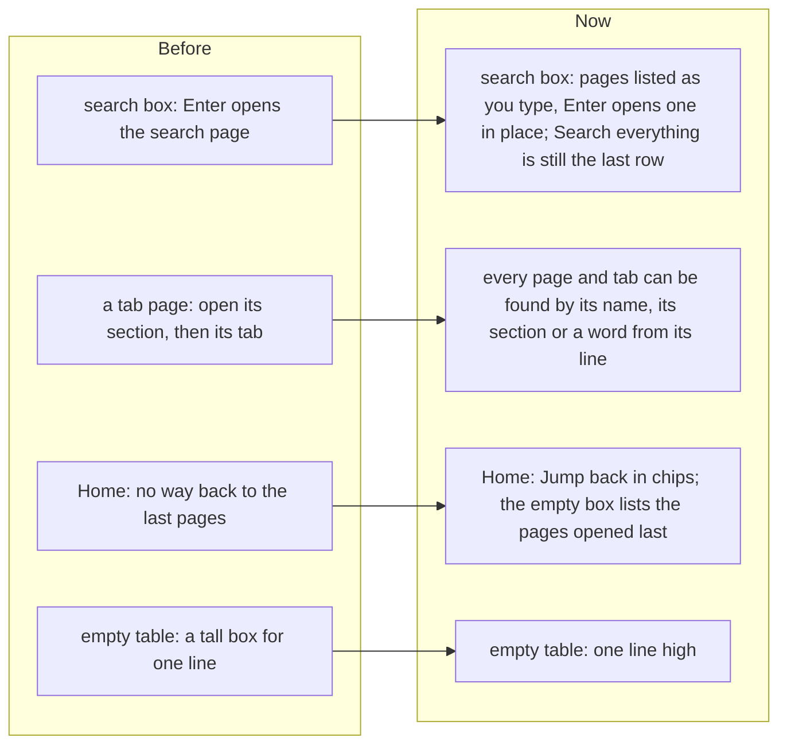

# Find any page as you type, jump back to recent ones, and one-line empty tables

> **In plain words.** The owner gave a free hand to make the portal better. The portal has more
> than thirty pages, and many of them are tabs that the sidebar does not show. Now the **search
> box finds any page as you type**: type "back" and Backups is first; press Enter and it opens.
> With the box empty, it lists the pages you **opened last**. Home shows them too, as a row of
> **Jump back in** chips. "/" or Ctrl K jumps to the box from anywhere; on a phone, the Search
> button opens it. The pages you opened are kept in your browser only, and signing out forgets
> them. Empty tables also got shorter: "No request is waiting" now takes one line, not a tall box.

## Why

The research of the day (SaaSFrame's 2026 dashboard patterns, AdminLTE's admin dashboard guide and
Eleken's empty-state guide) agrees on three points. A product with many sections is got around
best with a palette that finds a page by its name. A home page should offer ways to resume work,
not only figures. An empty state should say what is missing in one line and point to the next
step. Oltrem's search box went only to the search page, Home had no way back to what you were
doing, and an empty table took a box five lines high for one sentence.

## What changed

| Part | Now |
|---|---|
| The list | The sidebar carries every page the person may open (`template[data-go]`): its name, its set of tabs or sidebar group, the line that says what it is for, and the sidebar row whose icon it shows. A tab that only appears once the server says yes (Modules) is left out, so the list never offers a page the person cannot open. |
| Typing | The pages whose name, place or line hold every word typed, the best first (the name starting with it, then holding it, then the place, then the line), up to eight, then **Search everything for "…"**. Arrows move, Enter or a tap opens the page in place, Escape closes the list. |
| Empty box | The pages opened last, up to six, without the page you are on. |
| Jump back in | Home's row of chips under the welcome band, up to six, hidden until there is one. |
| Kept where | In the browser alone (`oltrem_recent` in its local storage): eight pages, each with its address and title. Nothing is sent to the server or stored in the database. Sign out clears it, so the next person on the same device never sees it. |
| Keys | "/" anywhere outside a field, or Ctrl K (⌘K on a Mac), focuses the box. On a phone, the top bar's Search opens the menu with the box focused. |
| Empty tables | A table with no rows shows its sentence in a box one line high (was about five). |

The server work is one hidden list in the sidebar, built from the menu the page already has: no
extra database read and no extra request.

## How it was verified

- Tests: the list's entries, a tab under its set with its set's icon, a probed tab left out, the
  list once in the sidebar, Home's empty row (`go-list.test.ts`); the pages opened last, newest
  first, one entry per address, Home's chips, sign out clearing them (`frame.test.ts`); the list's
  and the empty table's styles (`theme.test.ts`).
- Driven in a browser at 1440 and 390 px: pages opened from the sidebar, "/" then the list of
  recent pages, "back" typed then Enter, Home's chips, the phone's Search with "set" typed.
- `pnpm verify` green before the push.
- Not verified: on a real phone (P188, P189).
