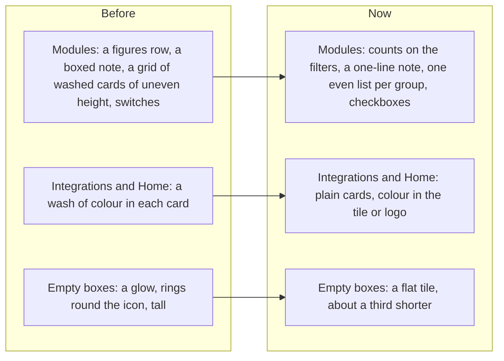

# Modules as one even list, and plain cards and empty states everywhere

> **In plain words.** The owner asked for the next part that needed work. A look at every page
> found three things he had already called uneven elsewhere. **Settings > Modules** was a grid of
> pastel cards of different heights, with switches that did nothing until Save. It is now one even
> list for each sidebar group: icon, name, what the module does, what it needs, and a checkbox, in
> lined-up columns. **Cards** on Integrations and Home had a wash of colour each; they are now
> plain, with colour only in the icon's tile or the logo. **Empty boxes** had a glow and rings
> around the icon; they are flat and shorter.

## Why

The owner's earlier reviews set the rules this follows: even lists with lined-up columns; colour in
tiles, tags and the picked control, not a pastel wash for each card ("amateur", "uneven"); a
checkbox for a change that waits for Save, a switch only for one that happens at once; no glow; no
wasted room.

## What changed

| Part | Now |
|---|---|
| Modules, the top | The All, On and Off filters carry the counts, so the row of figures is gone; the note is one line. |
| Modules, a row | Icon, name, what it does, what it needs or what needs it, and a checkbox, or **Always on** in the same column. On a wide screen each is a column that lines up with every other row; on a phone the words stack beside the icon. |
| Modules, extras | A module's extras (Daily seal, Nightly backup, the reminders) are rows under it, on a light grey band, lined up with the name column. |
| Modules, off | An unticked module's icon goes grey before Save; the warning when another module still needs it is unchanged. |
| Integrations | The provider cards are plain: the logo carries the brand colour, and Get a key and Docs are grey tags. |
| Home | The summary cards are plain: colour in the icon's tile and on the edge under the pointer. |
| Empty boxes | A flat tile behind the icon, no glow, less padding, and no second padding from a table's empty box around it. |

Nothing changed in what the pages save or how: the Modules form posts the same `on` values.

## How it was verified

- Tests: the Modules rows, the checkbox, Always on in the box column, the extras as rows, no
  figures row (`settings.test.ts`); the page on the client template (`screens.test.ts`); no wash
  or glow on cards and empty states, and the module columns (`theme.test.ts`).
- Looked at in a browser at 390 and 1440 px: Modules, Integrations, Home, Tasks (empty).
- `pnpm verify` green before the push.
- Not verified: on a real phone (P180, P181).
