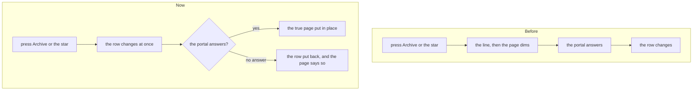

# Fewer database reads, indexes for growing lists, and changes shown at once

> **In plain words.** The owner asked for four things: find and fix every query repeated once per
> item, index the columns that are searched and sorted, keep a copy of what rarely changes, and
> change the screen before the server answers. The kit was mostly in order already: what rarely
> changes (the permissions, the settings, the session) has been kept in memory since it was
> built, and pages read together. Three places still asked the database again and again, and seven
> lists or cards read a whole table that grows. Those are fixed: Home now makes 30 queries where it
> made 32, a file uploaded with a taken name asks once instead of up to 50 times, and the lists of
> customers, invoices, quotes and resolved alerts, the Home cards of Email and Mail and the sign-in
> read only the rows they show. Archiving, snoozing, starring or marking an email read now changes
> the row at once, and puts it back if the portal does not answer.

## 1. Queries repeated once per item

| Where | Before | Now |
|---|---|---|
| A dangerous route's permission check | read the tenant's policy version on each call: Home asked three times | the calls of one request share one read; the next request reads again, so nothing goes stale |
| An upload whose name is taken | one query for each number tried, `(2)` to `(50)` | the 50 names asked about in one query (`json_each`) |
| Email's file sizes (Oltrem Mail) | one provider listing read per provider set up | the listings read once |

Checked but left, because each is bounded by a few items and already one read per item it acts
on: the task comment notice (two people at most), the provider detection, the access review
close, the automations schedule, the outbox, the health observers and the mail jobs' loop over
tenants.

## 2. Indexes on what is searched and sorted

Every migration only adds an index (`CREATE INDEX IF NOT EXISTS`), so the client deploys carry them
safely.

| Migration | Index | What it serves |
|---|---|---|
| `0061` | `customers_people_by_name` (`tenant_id`, `name COLLATE NOCASE`) | the Customers page and its search, in name order |
| `0062` | `invoices_invoices_recent` (`tenant_id`, `made_at`, `number`) | the Invoices page, newest first |
| `0063` | `quotes_quotes_recent` (`tenant_id`, `made_at`, `number`) | the Quotes page, newest first |
| `0064` | `oltrem_alerts_resolved` (`resolved_at`, resolved only) | System status's last resolved alerts |
| `1018` (Mail) | `email_messages_created` | Home's Email card, the last day only |
| `1019` (Mail) | `mail_threads_unread`, `mail_messages_received` | Home's Unread card; the nightly tidy |

Sign-in by email now reads through the existing `iam_principals_email` index (the query says
`email <> ''`, which that partial index needs), where it read every principal. Oltrem Mail's
hourly check counts stored messages only once the highest message number passes the warning
line.

## 3. Copies of what rarely changes

Nothing new was cached: the permissions index, the settings and the session were already kept in
the Worker's memory and in KV, each with the check that throws a stale copy away. A longer-lived
copy of anything else (the scopes, the provider listings) would be a copy one Worker could hold
after another changed it, so those are shared within one request instead, as the policy version
now is. No new KV write was added (the free plan allows 1,000 a day).

## 4. Changes shown at once

The frame script reads `data-optimistic` on a form or its button: `hide`, `set:<name>`,
`unset:<name>` or `toggle:<name>`, applied to the row it sits in (`data-optimistic-row`) or the
rows ticked for a list's command ([the screens' README](../../packages/screens/README.md)). Email's
conversation rows use it for archive, back to the inbox, snooze, spam, move, read, unread and the
star. A form with no mark works as before.

## How it was checked

- `modules/iam/test/sessions.test.ts`: three dangerous checks in one request read the version
  once, and the next request reads it again.
- `modules/files/test/files.test.ts`: `plan.txt`, `PLAN.txt` and `Plan.txt` are kept as
  `plan.txt`, `PLAN (2).txt` and `Plan (3).txt`, the third upload making as many queries as the
  second.
- The customers, invoices, quotes and alerts tests list the new migrations; Oltrem Mail's tests
  read each new index's plan with `EXPLAIN QUERY PLAN`.
- `templates/client/test/screens.test.ts`: Home's pinned query count moved from 32 to 30.
- `packages/screens/test/frame.test.ts`: two ticked rows hidden at once and back with no answer,
  the unread mark gone with no dim, the star and its label turned and back, a plain form still
  dimming; `packages/core-ui/test/mail.test.tsx` checks the row and star marks.
- `pnpm verify` green before the push; phone tests [P193 to P195](../phone-tests.md).
