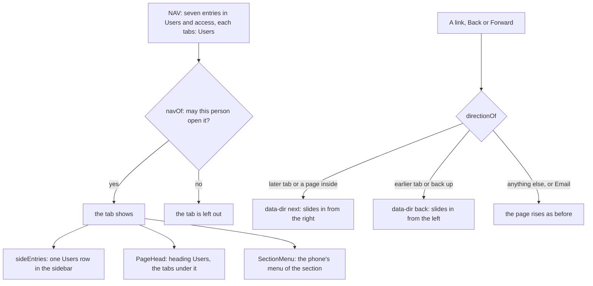

# Users as one page, and motion that says where you went

> **In plain words.** The owner, with a picture of the sidebar's seven Users & access rows: "I
> dont want this features outside, make a page and make all this sub-page or sub-header selection
> sections for that page", and then: "add bit animation and transition in expand, collapse, change
> in sidebar, change page, open page, move page, color". Now the sidebar has one **Users** row, and
> its page has the seven pages as a sideways row of tabs under its heading, each shown only to
> whoever may open it. Pages move the way you went: to a later tab, or into a person or a role,
> the content slides in from the right; to an earlier tab, or back, from the left. Folding a
> sidebar group glides, drawers slide out as they came in, a dialog's shade fades both ways, and
> what a fold holds drops in as it opens.

## What changed

| Where | Before | Now |
|---|---|---|
| The sidebar, Users & access | seven rows: Users, Roles, Groups, Locations, Access requests, Access reviews, Vendor access | one row, **Users**, marked on any of its pages; a module's own rows (Customers) stay beside it |
| A Users & access page | its own heading, no tabs | the heading **Users**, then a sideways row of the seven tabs, the open one underlined; a person, a role or a review keeps the row with its tab marked |
| Who sees which tab | each row shown to whoever may open it (`NavEntry.may`) | the same rule, now for the tabs: Access requests and reviews to those who may give roles, Vendor access to Owners and the Vendor; every page's API still checks on its own |
| The phone's Menu on a Users page | the portal's menu | the section's menu: the seven pages, then the group's other rows, with All sections one press up |
| Moving between tabs, into a page and back | every page faded and rose the same way; Back and Forward swapped at once | the content slides from the right going forward and from the left going back, Back and Forward included; the heading and tabs stay still and the underline glides |
| Folding a sidebar group | its rows vanished and came back at once | the rows glide shut and open while they fade, then are hidden from the keyboard |
| Email's folders and the section menu on a phone | slid in, vanished on close | slide in and back out, the shade fading with them |
| A dialog's shade | appeared and vanished | fades in and out with the dialog |
| A fold (More, How permissions work) | its contents appeared | its contents drop in over 200 ms |
| A press on a sidebar row | colour only | the row gives to 98 % |
| Changing the theme or colour | a circle spreading from the button (2026-11-08) | unchanged |

## How it works now

The seven entries name the same set of tabs, `Users`, so the frame's existing rules fold them into
one sidebar row and draw them as tabs under the page's head; nothing new was needed in the
permission model. When a page changes, the frame's script compares the old and new pages: the same
row of tabs with another tab marked gives the direction by its place, otherwise an address inside
the one on screen is forward and its parent is back. It sets `data-dir` on the root for that view
transition only, and marks the new page `data-arrive="slide"` so its parts do not also rise. Back
and Forward now count as a change of page (the script compares with the page it last showed,
because the address has already moved by then), so they move too.

## Impact on each part

- **screens:** the seven `NAV` entries carry `tabs: 'Users'`; `directionOf` and the `data-dir`
  attribute in `frame.js`; Back and Forward compared with the page last shown.
- **core-ui:** the directional keyframes, the sidebar fold on a grid track, the drawers' exit, the
  shade's fade, `ui-unfold` and the row's press, all in `theme.css` and none under reduced motion.
- **iam and users:** unchanged: the tabs read the same `may` from `/api/iam/me`, and every page and
  API route keeps its own check.
- Nothing stored, no new key, binding, variable or dependency; no extra database reads.

## How it was checked

- `packages/screens/test/people-access.test.ts`: the seven entries share the set, the tabs in
  order, one sidebar row marked on Groups, and each tab only for whoever may open it.
- `packages/screens/test/section-menu.test.ts`: on Groups the sidebar has one Users row, the
  heading is Users with Groups marked, and the phone's menu lists the set.
- `packages/screens/test/frame.test.ts`: into a page is `next`, back up is `back`, a sideways move
  keeps the rise, and the direction is cleared once the move ends.
- `packages/core-ui/test/theme.test.ts`: the fold, the slides, the exits and the shade.
- `templates/client/test/screens.test.ts`: the Roles page carries the Users tabs with Roles marked.
- The local portal at 390 px (light and dark) and 1280 px, and a recorded clip of the tabs, a role
  and Back, a group folding and the drawers. Not checked: a real phone, which P190 to P192 in
  [the phone tests](../phone-tests.md) cover.
