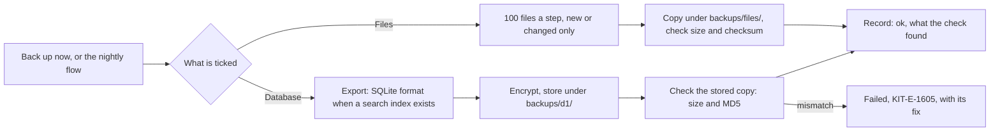

# Backups made complete

> **In plain words.** The owner found three things wrong with backups. Home offered "Make it
> now" and a restore drill while backups were switched off and nothing had ever been copied. The
> Backups page was only a list: no way to choose what to copy, no button, no progress and no
> check. And the copy he did try failed with `KIT-E-1602`: Cloudflare refuses to export a
> database that holds a search index (Mail's `mail_search`) unless it is asked for another format.
> All three are fixed. Home now says "Switch on backups" until a copy exists; the Backups page
> has Database and Files as ticked rows, one Back up now, the run's steps live as it goes, and a
> read-back check of every copy; and a database with a search index is exported in the SQLite
> tool's format, which the restore drill knows how to load.

## Why

The live failure came from Cloudflare's export API: since Mail added its full-text search table,
every export of the portal's database answered "cannot export databases with virtual tables".
Cloudflare added `dump_options.compatibility: 'sqlite3_cli_only'` on 2026-11-12 for exactly
this; that dump is valid SQLite but does not load into D1 as it is, so the drill had to learn it
too. The rest was the owner's own list: a run button, the choice, the process, the verification.

## What changed

- **Home's Get started** (`@oltrem/backup` onboarding): with no copy and the nightly backup off,
  one step, "Switch on backups", opening the Backups page; no drill step until a copy exists.
- **What a run copies**: the database, the files bucket's files, or both, from `POST /runs`
  `{ parts }` or the two new settings `backup.copy_database` (on) and `backup.copy_files` (off).
  Nothing ticked is `KIT-E-1606`; the files alone need no Cloudflare key.
- **Progress**: the row's new `step` column says where a running run is, in words.
- **Verification**: the stored database copy's size and MD5 checksum, as the bucket
  computed them, are compared with what was sent (opening a copy stays the drill's job); each file copy's size and checksum with its original. A mismatch is
  `KIT-E-1605`, and the run's fix is shown beside it.
- **The files**: copied as they are under `backups/files/<key>~<etag>`, only once each, 100 a
  step and up to 100 steps a run, within the Workflow step limits of the free plan; a run that
  runs out of steps records where it stopped and the next goes on from there.
- **Honest status**: only a run that copied the database counts as a database copy (health,
  Home, Get started, the drill); a run that stopped without finishing is closed as failed by the
  next one, through a heartbeat each step writes.
- **The Backups page** (`packages/screens/src/backups.tsx`): Back up now with the ticks (kept
  for the nightly copy too), what is missing with each fix, the newest run as steps refreshed
  every five seconds while it runs, the figures, every run with what it copied and what its
  check found, and what a backup does not copy (the cache, the secrets).
- **The export**: a database with a virtual table is exported in the SQLite tool's format; one
  without is exported as before. `oltrem backup drill` turns such a copy into one D1 loads, the
  search index made again empty.

Before, the flow was claim, export and copy, record: one part, no step shown, no check, and a
database with a search index could not be exported at all.

## Reviewed

The two review agents read the change before the push. What they found and was fixed: a
files-only run counted as a database copy; files past the 10,000th never reached; a bad file copy
taken as done on a retry; a trigger split in half by the drill's statement reader; the live steps
showing nothing done until the end; the ticks saved before the copy was known to start; a failed
settings save shown as a missing right; the cause of a failure lost when recording it failed; a
run that stopped left running for ever; and wording that called a storage check a read-back.

## What is left

- After a real restore from a SQLite-format copy, a search index is empty until the module that
  owns it fills it again (the backup README's "Not here yet").
- The nightly backup stays off on a new portal, by the owner's rule; Back up now works without it.

## How it was verified

The module tests run the files copy (103 files, two steps, never twice, a changed file copied
again), a copy stored wrong failing with `KIT-E-1605`, and an export of a database with
an FTS5 table asking for the SQLite format on every poll. The drill tests load a SQLite-format
copy with an FTS5 table into SQLite through `forD1` and find full-text search working. The
screens tests render the page's rows, its live steps and a failed run's fix, and the template
test refuses a Back up now with nothing ticked. `pnpm verify` ran once for the batch, green. The
phone checks are P227-P231 in [Phone tests owed](../phone-tests.md).
