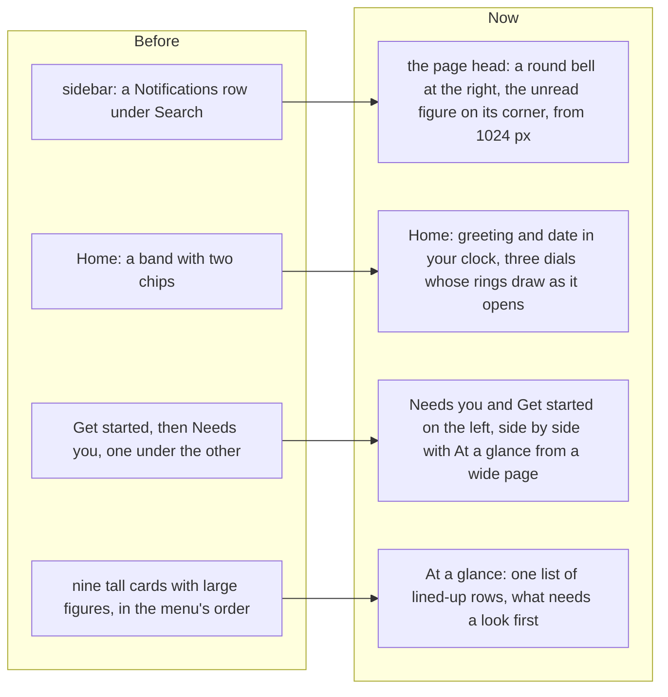

# A new Home, and the bell in the page head

> **In plain words.** The owner asked for two things: Notifications should not be a row in the
> sidebar, it belongs in the header; and Home needed "a complete makeover, better animations,
> transitions and much more". Now **the bell sits at the top right of every page** on a computer,
> with the unread figure on its corner (the phone's top bar already had one). **Home** opens with
> a band that greets you for the time of day and shows the date, with three dials: what needs
> you, how much of setting up is done, and how many parts are running well. Under it, Needs you
> and Get started sit on the left, and **At a glance** on the right: one list with lined-up
> columns, the parts that need a look first, in place of nine tall cards. The dials' rings draw as
> the page opens, rows arrive one after another, figures count up, and rows answer the pointer.

## Why

The sidebar is for places; a notification count is a status, and every product people know
(Gmail, GitHub, Linear, Stripe) keeps it at the top right. Home was a tall stack: a welcome band
with two chips, Get started, Needs you, then nine cards each with a large figure, about three
screens on a phone. The owner's rules ask for content in the top fifth, even lists with lined-up
columns instead of big boxes for small facts, and motion that helps.

## What changed

| Part | Now |
|---|---|
| The bell | `HeadBell` at the end of the head's first row on every signed-in page, from 1024 px; the phone keeps the bell in its top bar. Marked on the Notifications page; it swings a little under the pointer. The sidebar and the phone's menu no longer have a Notifications row. |
| The band | "Good morning", "Good afternoon" or "Good evening" and the date, written by the frame script in the person's own clock (the server draws "Welcome back"). One line on what waits and how many parts need a look. Dials: Needs you, Set up (while a step is open) and Running well (parts in the OK state), each a link to its part of Home. One colour from light to deep, no second hue and no glow. On a phone the dials are three equal columns. |
| Needs you, Get started | One bordered list each, rows 52 px with a one-line note (two on a phone); Needs you's rows carry an amber dot; Get started keeps its title and bar, a done step's tick pops in. |
| At a glance | Every module's figure as a row: its section's tile, name and line, figure, state, arrow, the columns lined up across rows (a CSS subgrid). Failing first, then needs a look, not known yet, OK. On a phone the state shows its icon alone and the line runs under the figure. |
| Layout | From a page 60rem wide, two columns side by side, each its own height; on a phone one column, Needs you first. |
| Motion | Rings draw from empty, dials rise one after another, rows arrive one after another, figures count up and Get started's bar fills on an in-place page change, rows tint and their arrow moves under the pointer. All done within the page's 800 ms arrival, and none with reduced motion. |

No extra database read or request: Home reads what it read before. To stay under the stylesheet's
164 KiB cap, the rows use the utilities the stylesheet already has, and two unused pieces went:
daisyUI's `swap` component (built only because the word appears in comments) and `.ui-tgroup`.

## How it was verified

- Tests: the band's greeting, date slot, dials and rings, a quiet Home with only Needs you; At a
  glance's order, its rows and a module that could not load; Get started's title, bar and tick;
  the bell in the head and not in the sidebar or the menu, none without the users module
  (`home.test.ts`); the greeting for morning, afternoon and evening and the date
  (`frame.test.ts`); the bell's styles (`css.test.ts`); the band as one hue (`theme.test.ts`).
- Looked at in a browser at 1440 and 390 px, light and dark: Home, Users, Email, Records,
  Notifications.
- `pnpm verify` green before the push.
- Not verified: on a real phone (P196 to P198).
