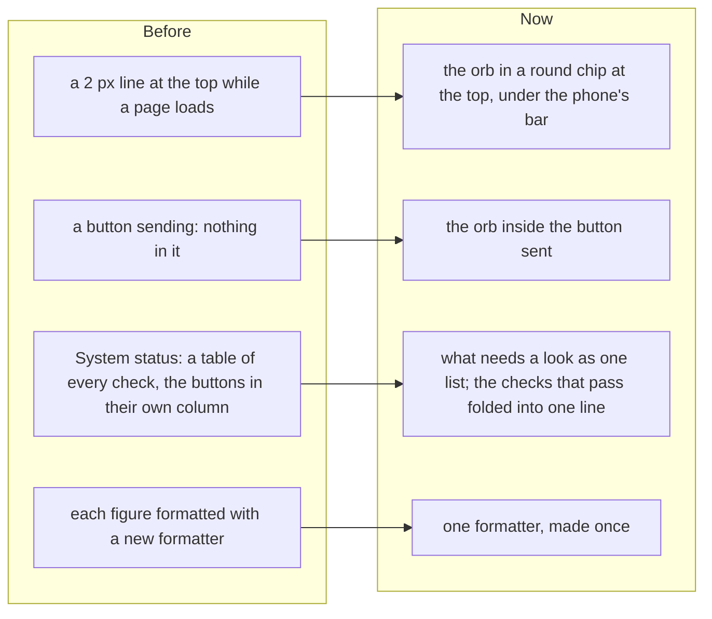

# The loading orb, System status as a list, and cheaper number formatting

> **In plain words.** The owner asked to replace the thin loading line everywhere with
> thinking-orbs, "unique and well animated", if it is light and smart for the long run; then said
> System status "doesnt look good" and that its report needed a review. Now **a small animated orb
> of dots** shows in a round chip at the top while a page loads, and **inside a button** while its
> form is sent. **System status** lists only what needs a look, each with its buttons on the same
> row, and folds the checks that pass into one line. The report's real problem, the Worker's CPU
> time, was looked into: the costliest line was number and date formatting, now made once instead of
> on every figure.

## Why

The line at the top was easy to miss on a phone and looked like every other site. System status
was a five-column table where eleven passing checks took most of the screen and the buttons of the
two problems sat in a column of their own. The report showed the Worker's CPU time per request at
29 ms at the 95th percentile, against the free plan's 10 ms.

## What changed

| Part | Now |
|---|---|
| The orb | thinking-orbs 0.3.2 (MIT), pinned once in the catalog as a build tool of the screens. Only its framework-free engine is used, so React is never installed (a package extension makes its React peer optional). `pnpm ui:build` reads the engine's two files and puts them before the frame's script as `oltremOrb`, refusing a version shaped otherwise; the browser gets it inside `/ui/app.js` (81 to 109 KiB, about 7 KB more zipped, kept for good under its version), so no request of its own. |
| Where it shows | A page that takes over 120 ms: the chip at the top (`ui-wait`), in the theme's colour; a form sent from a button: the orb in that button (`ui-orb`) and no chip. A change already on screen (`data-optimistic`) shows none. It is drawn only while something waits, the browser stops it in a hidden tab, and with reduced motion it is one still frame. |
| System status | The problems first, failing before needing a look, each row its state, what was seen, the check's name, then Open … and Turn off on the same row (under it on a phone). The passing checks are one line, "11 checks pass", that opens them. |
| CPU | `pnpm cpu` profiled by function: on Analytics the costliest line was `toLocaleString` and `toLocaleDateString`, which build a new formatter on every figure. Analytics and the budgets' figures now use one formatter each. Here: Analytics 20.9 to 10.2 ms, System status 10.6 to 7.4 ms. |

The live figure is a 95th percentile across every request and cron tick of the day, so it moves only
as the day's requests move. What else costs CPU on a page, measured here: drawing the page (Preact,
about a tenth), the icons (lucide, about a twentieth), and each page's reads through the portal's
own API. Those need a pass of their own.

## How it was verified

- Tests: the chip made with the orb once a page waits past 120 ms, not before; the engine before the
  frame's script, drawing a frame of dots (`frame.test.ts`); the checks list, its order, and the
  folded passing checks (`no-wasted-room.test.ts`).
- Looked at in a browser at 390 px light and 1280 px dark, with a page slowed down: the orb in the
  brand colour in its chip.
- `pnpm cpu` before and after on this computer (figures above).
- `pnpm verify` green before the push.
- Not verified: on a real phone (P202 to P204), and the live CPU figure after a day.
