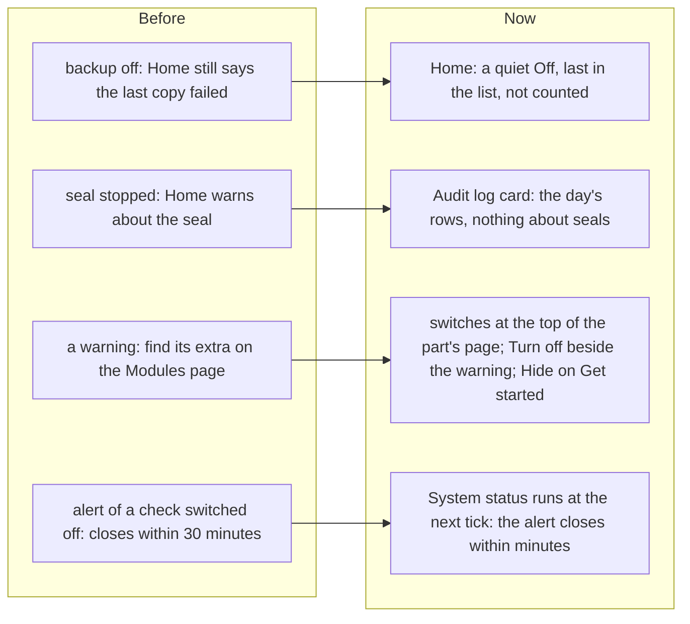

# Switched-off work goes quiet, and Off switches beside the work

> **In plain words.** The owner wrote that the last backup and other parts still showed errors
> from before they were stopped, with "no way to stop error or notification", that backups are
> not needed for now, and then: "Ensure that features do have switch off easy accessible!" Now
> **work that is switched off says a quiet "Off"** on Home instead of a warning, and is not
> counted as needing a look. **Each part's extras have their switches at the top of the part's own
> page** (Backups, Audit log, Roles), saving the moment they are flipped. **Each warning on System
> status that a switch can silence has a "Turn off" button beside it**, and Get started has
> **Hide**. When a check is switched off, System status runs again at the next five-minute tick,
> so its open alert closes within minutes.

## Why

Looking at the live portal on 14 Nov: System status already hid the checks of anything switched
off, but Home did not. The Last backup card kept saying the newest copy failed even with the
nightly backup off, and the Audit log card kept warning about a seal that had stopped. The only
way to make a warning stop was to know it came from an extra and find that extra on the Modules
page. An open alert of a check switched off only closed at System status's idle pace, up to half
an hour later.

## What changed

| Part | Now |
|---|---|
| Home | A card may answer `state: 'off'` (`@oltrem/core-module`). It reads "Off", sorts last in At a glance, shows the neutral pill, and the band's "running well" dial and "needs a look" line leave it out. The backup card answers Off while the nightly backup is switched off; the audit card says nothing about the seal while the Daily seal is off (`sealing`, wired by the template). |
| A part's page | Its extras as a sideways row of switch chips under the head, for the Vendor and Owners, on the part's first page (Backups: Nightly backup, Restore drill reminder; Audit log: Daily seal; Roles: Ending access emails, Access review reminder). A flip saves at once; without the script a Save button posts it. |
| System status | Beside a warning or failure: Turn off with the name of the extra that stops the check, or of its part when the part is not core (Deployments, for example). A check only a fix ends (the plan's budgets) has none. |
| Get started | Hide, which switches the card off as the Modules page would. |
| The route | `POST /do/switch` changes only the ids posted, checked against the Modules page's own list (never a core part), and saves through `PUT /api/settings/parts`, so the same permission, recent sign-in, refusals and audit row apply. Back to the page with "Switched", or the reason it was refused. |
| Alerts | The parts route answers what each extra stops (`skips`) and, after a save, calls `parts.changed`: the template wakes `health.run`, which closes the problem of a check switched off and its alert at the next tick. |

No extra database read on a page: the names of the parts and what each extra stops never change in
a running Worker, so the screens read them once per isolate, and whether each is on comes from the
request's list. No new style: the row uses the chips and switches the stylesheet already has.

Backups: the nightly backup and the drill reminder were already off on a new portal (since
2026-11-12). A portal that switched them on turns them off on the Backups page now; a copy by hand
still works there.

## How it was verified

- Tests: the strip on a part's page, on and off from the request's list, none for a part without
  extras, none for a Member; Turn off on System status for an extra and a part, none for a core
  check or a Member; `/do/switch` changing only the posted ids, ignoring a core part and an
  unknown id, refusing another site's address, and showing a refusal (`switches.test.ts`); the Off
  card's place and the band's count, Hide (`home.test.ts`); the backup card Off
  (`backup.test.ts`); the audit card with the seal off (`core-audit` `module.test.ts`); `skips` in
  the answer and `parts.changed` after a save (`core-config` `parts.test.ts`).
- `pnpm verify` green before the push.
- Not verified: on a real phone (P199 to P201), and the live portal's alert closing after a switch.
