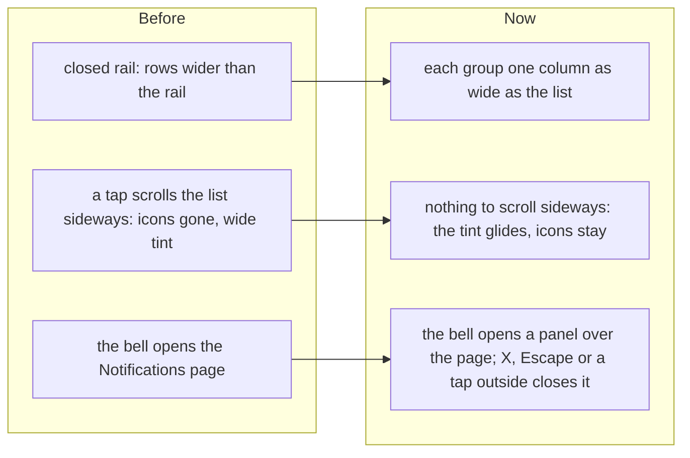

# The closed sidebar holds still, and notifications open in a panel

> **In plain words.** The owner sent a screenshot of the sidebar closed to icons after a page
> change: the icons were gone and the tint of the page on screen stretched across the rail. Now
> **the rail holds still**, and only the tint glides to the row tapped. He then asked for
> Notifications as **a pop-up that closes, over any page, instead of a page of their own**. Now the
> bell opens **a panel at the side** with the list, the Unread chip, Mark all read and the switches;
> a notification opens its page beneath it.

## Why

The sidebar's groups are laid out as small grids. A group's name, hidden in the closed rail but
still as wide as its words, set the width of its grid, so the rows grew to 75 to 141 px inside a
40 px rail. A tap focuses the row, and the browser scrolled the list sideways to show all of it:
every icon slid out of sight and the marked row's tint filled the rail.

Notifications were a page of their own, so reading them meant leaving the page in hand.

## What changed

| Part | Now |
|---|---|
| Sidebar | `.ui-side-nav > div` has one column, `minmax(0, 1fr)`, and a group's heading clips its own words, so no row is wider than the rail. The open sidebar is unchanged (every row 216 px). |
| The panel | The frame draws a `ui-dialog ui-drawer` (`notify-panel`) when the users module is on: from the right on a computer, the whole screen on a phone, its head clear of the phone's own bar. The script opens it from either bell (`data-notify`) and fills it with the list part of `/notifications` (`data-notify-list`), asking without the sidebar as any page does. |
| Inside it | All, Unread and Older load in the panel; Mark all read and the switches post from it and show the answer in it, and the bells' counts follow; a notification closes the panel and opens its page in place. |
| Without the script | A bell is still a link to `/notifications`, which still works whole. |

## How it was verified

- Tests: a group's one column and the heading's clip (`theme.test.ts`); the bell opens the panel,
  Unread and Mark all read stay in it, a notification closes it (`frame.test.ts`, whose page now
  hears capture listeners first, as a browser does); the panel and the bells' `data-notify`
  (`home.test.ts`).
- In a browser at 1280 px dark: before, a row in a group measured 141 px in the 40 px rail and sat
  at x = -77 after a tap; after, every row 40 px at x = 12, the tint gliding between them. The
  panel at 1280 px dark and 390 px light: opens from each bell, Unread loads inside, Escape and X
  close it, the page beneath unchanged.
- `pnpm verify` green before the push.
- Not verified: on a real phone (P205, P206).

## Later the same day: Write's More

The owner's screenshot of Write on a computer: opening More (the three dots) laid Words or HTML
code and its note inside the template bar. In Oltrem Mail (f35cd0c, taken into `vendor/mail`)
More is now a menu under its icon (`details.ui-menu`, `data-end`): its card opens over the
message. The frame closes any such menu on a press elsewhere or Escape, as it does a pick, so the
inbox's menus close that way too. Tests: `write-composer.test.ts` in Oltrem Mail, `frame.test.ts`.
Looked at in a browser at 1500 px dark and 390 px light (a sheet from the bottom on a phone, as
every such menu). Not verified on a real phone (P207).
