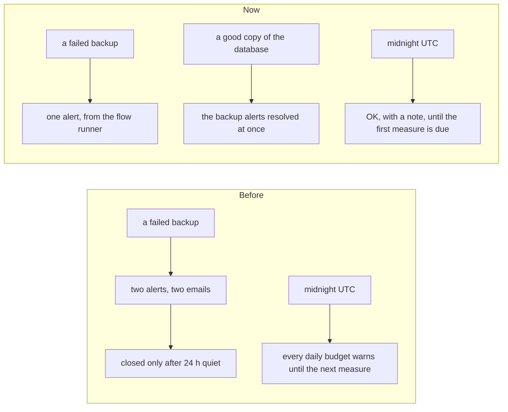

# Backup alerts closed by a good copy, and no budget warning after midnight

> **In plain words.** The owner sent a System status report taken at 00:16 UTC with one check
> needing a look and two open alerts. The two alerts were the backup failure of 14 Nov (the search
> index Cloudflare would not export), fixed the evening before and live on the portal since 00:13
> UTC. They were two because the same failure was reported twice. The budget warning was the
> first minutes of a new day: the figures reset at midnight UTC and the hourly measure had not run
> yet. Now a failure opens one alert, a good backup copy closes the backup alerts at once, and a
> budget waiting for the day's first figure is not a warning.

## What the live portal showed

Read with the Cloudflare connector, read-only:

- `backup_runs`: the last run, by hand on 14 Nov at 06:28 UTC, failed with the FTS5 refusal;
  earlier nightly runs failed on the old key (fixed 13 Nov). Migration `0066` and the search-index
  fix were applied by the deploy at 00:13 UTC on 15 Nov.
- `oltrem_alerts`: two open warnings from the same moment, one raised by the backup module
  (`backup`) and one by the flow runner (`flow backup.export`), each emailed.
- `oltrem_budgets`: every figure taken without a problem at 23:41 UTC on 14 Nov; `health.measure`
  next due at 00:41 UTC. Between midnight and then, each daily budget read "not measured yet
  today".

## What changed

- **One alert per failure.** `runExport` no longer reports the error it throws: the flow runner
  reports it. A failed record of a failure is still reported, and never hides the cause.
- **A good copy closes the alerts.** A new option `cleared(env)` runs once after a run that copied
  the database; the client template resolves the server errors of `flow backup.export`, where
  the flow runner reports a failed run, with the alerts module's new `resolveErrors(env, area)`.
  A database-only copy leaves them open while the files are ticked, since a files failure is not
  fixed by it, and a clear that fails is reported without touching the good run's record. The
  module's own errors (an audit or progress write) stay open: a copy does not fix them. The
  old `backup` alert of 14 Nov closes itself after a day without the error, at 06:31 UTC.
- **The budgets at midnight.** A budget whose figure was taken without a problem in the period that
  just ended, under 75 minutes ago (the measure's idle hour and a tick), reads OK with the note "a
  new day began: its first figure comes within the hour". Past that it warns again, since the
  measure has then stopped; a measure that failed keeps its problem and warns at once.

## What it does not change

The Worker's CPU time per request at the 95th percentile was 27 ms on 14 Nov, against the free
plan's 10 ms (the figure an earlier record looked into). Once the day's first figure is taken it
will show again on System status; it needs a CPU pass of its own.

## How it was verified

Tests: one report for a failed run and the alerts cleared once after a good copy
(`modules/backup`); an area's errors resolved without touching a longer area that starts the same
(`modules/alerts`); a budget at 00:02 after a measure at 23:41 reads OK with its note, and warns
again at 01:42 (`packages/core-health`). The two review agents read the change; on their word the
copy closes only the flow's alerts, only once it copied all that is ticked, outside the run's
failure path, matching the area exactly, and the wait is held to 75 minutes. `pnpm verify`: 14 gates passed. Phone checks P232
and P233 in [Phone tests owed: Backups and System status](../phone-tests-system.md).
