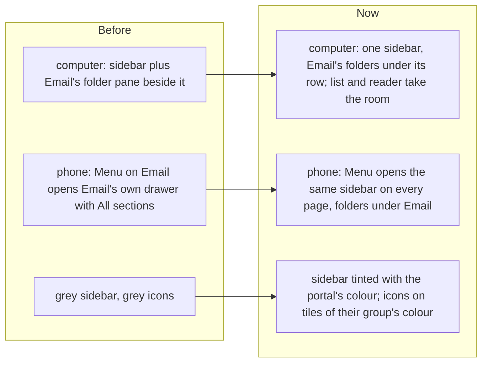
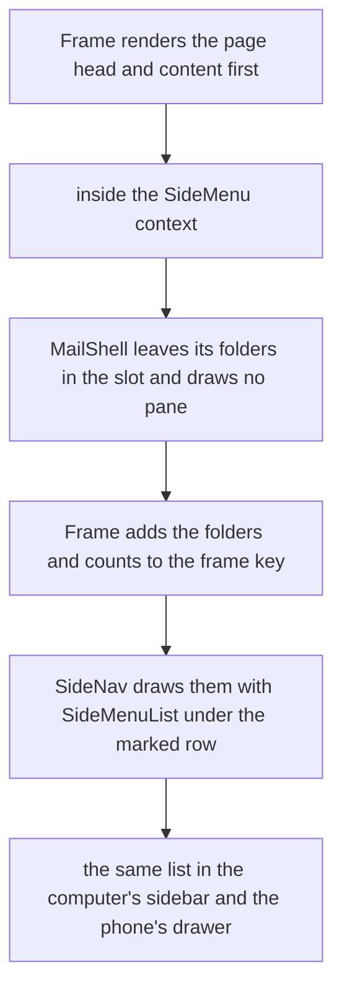

# One sidebar on every page, with more colour

> **In plain words.** The owner sent a phone screenshot of Email's menu and wrote: "The double
> sidebar is not something I am a fan of", it was "too color less, bland, wasting ton of blank
> space", and "sidebar should be universal and stick with all pages and sections".
> Now there is **one sidebar on every page**, on a phone and a computer. Email's folders sit
> **inside it, under Email's row**, instead of in a second menu. The sidebar is **tinted with the
> portal's colour**, and each section's icon sits on **a small tile of its group's colour**.

## Why

Email had two menus. On a computer the portal's sidebar stood on the left and Email's folder pane
stood beside it, so two lists of links took about 450 px before any mail. On a phone, Menu on an
Email page opened a different drawer (Email's folders, with "‹ All sections" at its head), not
the sidebar every other page opens. The sidebar itself was a flat grey with grey icons.

The research of the day pointed the same way: Vercel moved its tabs into one sidebar in 2026,
Material's navigation drawer and NN/g's guidance both favour one vertical list that grows, and
the portal the owner pointed to has one sidebar whose groups carry their colour.

## What changed

How the folders reach the sidebar:

| Part | Now |
|---|---|
| core-ui `mail.tsx` | `SideMenu` (a Preact context holding a slot) and `SideMenuList`. `MailShell` inside the frame hands Compose, folders, More, Labels, tools, meters and foot to the slot and draws no pane; its folder button over the list opens the portal's drawer. Outside a frame it draws its own pane as before, now headed by its name; `AllSections` is gone. |
| screens `layout.tsx` | `Frame` renders the page once with `renderToString` inside the context, then draws the sidebar with the menu under the current row (`aria-current="true"` on the row, `"page"` on the folder). The folders, counts, bold folders, labels and meters are in the frame key, so a change sends the sidebar again. A menu with no row to hang under is drawn at the top of the sidebar rather than nowhere. `SectionMenu` is gone. |
| screens `frame.js` | Every `commandfor="portal-menu"` button scrolls the drawer to the page on screen (the folder, else its section's row). On a computer the sidebar scrolls so the nested folders show (`showNest`). A kept frame marks its row with `data-here-as`. |
| `theme.css` | `--ui-side`, a 4% (light) or 8% (dark) tint of the portal's colour; the sidebar 16 rem (was 15), the phone drawer up to 20 rem (was 17); each icon a 16 px glyph on a tile of `--hue-tint`, solid `--hue` for the page on screen; group names in their colour; the nested menu on a line of the group's colour, rows 32 px (44 px on touch); on the closed rail the folders show as icons; Email's grid inside the frame drops the pane column. |

## How it was verified

- Tests: `one-sidebar.test.ts` (no page has a section menu or All sections; Email's folders in
  both sidebars under a `"true"` row and none in the page; another folder, count or bold folder
  changes the key; a menu with no row shows at the top), `mail.test.tsx` (the shell with and
  without the frame, `SideMenuList`), `frame.test.ts` (Menu and the folder button open the drawer
  and scroll to the folder, else the section row), `css.test.ts` (tiles, tint, the nest, no
  section menu rules).
- In a browser at 390 px and 1440 px, light and dark, on the local portal: Email's folders under
  Email in the drawer and the sidebar; the list and reader 448 px and 662 px wide at 1440 px with
  no pane; Drafts tapped in the drawer opens Drafts and marks it; Users shows no nest; Back
  brings it again; the closed rail centres its tiles. A before and after sheet of these went to
  the owner with the report.
- Two review agents (TypeScript, silent failures): both found the case of a menu with no row to
  hang under and fields missing from the frame key; both fixed here, with tests.
- `pnpm verify` before the push.

Not verified: a real phone (phone tests P237 to P241), and Mail's inbox pages on the local portal
(Mail was off there; they use the same `MailShell`).
