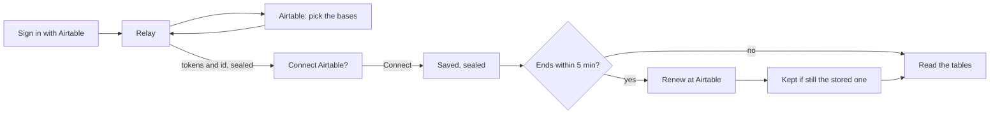

# Sign in with Airtable

> **In plain words.** Batch 5 of the owner's database review ("Begin all batches!", 22
> November). Airtable is an online spreadsheet-database many small businesses use. Its card on
> the Data page now says "Sign in with Airtable": the person signs in on Airtable's own page,
> picks the bases the portal may read, confirms "Connect Airtable?", and the connection is made.
> Nobody makes or pastes a token. Airtable's sign-in lasts an hour at a time, so the portal
> renews it by itself before each read. Pasting a personal access token still works.

## What changed

| Part | Before | Now |
|---|---|---|
| The Data page's Airtable card | Paste a personal access token, step by step | "Sign in with Airtable" above the steps once the sign-in service is set; the token form stays below |
| The connect relay | Four services, each app with an id and a secret | A fifth, Airtable, read-only (`data.records:read`, `schema.bases:read`). Its integration has no secret: the code is exchanged with the id alone and PKCE, and the relay sends back the tokens and the id, sealed. One new relay secret, `AIRTABLE_CLIENT_ID` |
| The way back | Supabase only was confirmed first | Airtable's tokens are held sealed in the same ten-minute cookie and the person confirms "Connect Airtable?"; a stale or cancelled trip lands on the Airtable page, Cancel says "You pressed Cancel", and Back or a second press after Connect opens the connection just made (for Supabase too) |
| An Airtable connection | One pasted token | Signed in: an access token (an hour), a refresh token (60 days, replaced on each use), when the first ends and the integration's id, sealed together. Five minutes before the end, the next read renews them at Airtable and keeps the new ones |
| The providers registry | Every credential write came from a person | `registry.renew` keeps a renewal only over the credential it was opened from, so two at once never overwrite each other; not audited, as it runs hourly under Database checks |

**Before**, a person made a token in Airtable's settings, ticked two scopes, added each base and
pasted it. **Now** the portal sends them to Airtable's own page, which lists their bases and asks
which ones; nothing is copied. The relay hands back what Airtable gave, because Airtable offers no
key an app can make that lasts, and the portal keeps it sealed like a pasted key.

## Why a public integration

Airtable lets an integration have no client secret when it uses PKCE. With a secret, every
renewal would have to go through the relay, which would then need its own address that portals
call, a way to know each portal, and would stop every portal's reads whenever it was down. Without
one, each portal renews its own tokens with the id, which is public, and the relay stays a
stateless sign-in step. A refresh token in a portal is no more than a pasted token was: it reads
only the bases picked, and Airtable or the person can take it back.

## Impact on each service

- **The relay:** one more entry and one more secret; `wrangler.jsonc` requires it, so the next
  relay deploy waits until it is set.
- **Each portal:** no new setting, table or migration; the Airtable definition has three optional
  fields the sign-in fills. Each renewal is one call to Airtable and one database write, at most
  once an hour per connection that is read.
- **Airtable:** asked only for read access to the bases the person picks.

## Left, to come back to

- Signing in again makes a second connection beside the first (Airtable has no address to tell
  them apart by). Back after Connect, or Connect pressed twice, does not: for ten minutes the
  browser keeps the new connection's id and opens it instead.
- No "Sign in again" button on the connection's page yet: an ended sign-in says to remove the
  database and sign in again (or paste a token with Change key). Its Home card and its pill still
  read "did not answer" and "Not answering"; the connection's page says the sign-in has ended.
- The portal does not ask the relay which services it signs in to. No relay is deployed yet (the
  Vendor's and the first client's Cloudflare accounts, read on 22 November), and a relay older than the portal now sends the
  person back as "not set up" instead of a dead end, once it is deployed with this change.
- A signed-in connection nobody reads for 60 days, with Database checks off, must be signed in
  again.
- If Airtable ever accepted two renewals at the same moment, the first one stored would win with
  tokens the second replaced; Airtable answers the second with a 409, which the portal handles.

The "Airtable's sign-in has ended" notice cannot be reached on a phone without waiting 60 days or
taking the access back in Airtable; it was checked in the data module's tests only.

## Owner steps

1. Register the Airtable integration with no client secret and set `AIRTABLE_CLIENT_ID` on the
   relay ([the relay's README](../../packages/relay/README.md), step 6), then deploy the relay.
2. Phone tests P430-P434 in [the data phone tests](../phone-tests-data.md).

## How it was checked

The relay, connect, data, providers and core-config tests (a new `airtable-sign-in` test file
for the renewals), the client template's screens test (the whole Airtable journey with a scripted
relay), then `pnpm verify`; the summary is in [the verification log](../verification-log.md). The
OAuth details were read from Airtable's own reference on 22 November. Not run against a real
Airtable account, a deployed relay or a phone.
