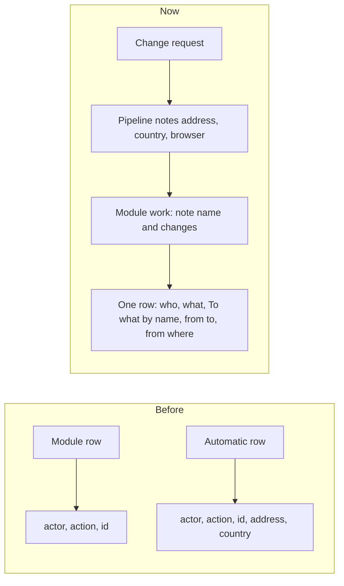

# A fuller audit log, and Home tells whoever looks after access

> **In plain words.** The owner looked at the Audit log on 20 November and found it held "close to
> nothing": a time, a person, an action and an id. Now each row says where the change came from
> (address, country, browser), names the record it touched as it was then (`Invoice 12: Repairs`,
> a task's title, a role's name), and on a change says what changed, from what to what. Each row
> opens to every fact it kept. He also asked for the emails about access ending and the review
> reminders to be off, because a review happens once a month or a year, and for an authorized
> person to be told instead: a new portal starts with both off since 21 November
> ([the optional extras](../../packages/core-config/README.md)), and now Home's Needs you tells whoever looks
> after access.

## What changed

| Before | Now |
|---|---|
| A row a module wrote itself had no address or country; only the automatic row did | Every row of a change request has `ip`, `country` and `browser` (`Chrome on Android`), a module's own row too |
| "To what" showed a long id | It shows the record's name as the row kept it (`name`), or the person or group an access row names; an id only when there is no name, shortened |
| A change said which fields were sent (`changed: ["title"]`) or nothing | `changes: { title: { from, to } }`, only the fields that changed, each side cut to 120 characters |
| The row showed four facts; the rest could not be seen | Details opens to every fact the row kept |
| A role edit kept the whole list of its permissions | It keeps the role's name, what changed from what, and the permissions `added` and `removed` |
| With `iam.expiring` and `iam.reviews` off (a new portal's default since 21 November), nobody was told that access ends or a review is due | Home's Needs you tells whoever may manage grants that a person's access ends this week, and that a review is due after 90 days without one |

**How it works.** The pipeline notes each change request's address, country and browser before
its route runs (`noteRequest`, kept in the isolate for the newest 512 requests); the audit writer
adds them to any row written for that request. A module writes its rows through `recorded`, which
now hands the work a `note(facts)`: the work notes the record's name as soon as it has read it,
and on a change the result of `changesOf(before, after)`. What was noted is written whatever the
outcome, so a refused change names what was tried. Taking the name when the row is written keeps
it after the record is deleted, and reading the log needs no look-up into each module.

**Personal details.** The log is kept for good and is not erased by a privacy request. So a
customer is named `Customer` and the start of their id, never by their name or address, and a
change to their name or note, a task's notes, an automation's condition, a form's addresses or
its page after sending is kept as "Changed (the value is not kept)". Time off is named by its
dates, not its kind. Staff are named by their work address, as the actor column always was. Who
may read the log (`audit.read`, for the whole company) may therefore read the name of a record they
may not open, and what changed at every location; that was the open question of
[the 15 November list](2026-11-20-left-items-finished.md), and the owner chose the professional
option on 20 November. Webhooks that ask for every event receive the same rows.

**Changes made from a page.** A page's calls to the API run in process; their rows take the
address, country and browser of the page's own request, so a change made on a screen says from
where as much as one made through the API.

**Impact on each part.** Every kit module that records its own rows now names them; the Mail
modules' campaigns and lists do too (oltrem-mail, in the same push). No table, migration, binding or
setting is added; a row stays under its 4 KB limit (`changesOf` names at most 10 fields, a list
fact at most 40 items). Needs you reads two more queries in Home's one batch, inside its query
budget.

## How it was checked

- core-audit (23): a noted request's facts on a module row, its own words win; `changesOf` names
  only what differs, hides personal fields, drops a credential-like field, cuts long values and
  counts the rest. core-http (59): the browser and address noted for a request, and for a page's
  inner call those of the page's request. customers (25): no row keeps a customer's name or address.
- iam (101, of them governance 29 and recorded 2: noted facts on a refused row, a too-long row written without its lists): a role edit names the role and what changed and the permission
  added; a refused grant end names the grant; Needs you tells the person who manages grants about
  another's ending access and a due review.
- tasks (11): an edit's row names the task and says title and assignee from what to what, the
  unchanged notes absent. invoices (21): every row names its invoice; a change never keeps an
  address. developer (13): a webhook's row keeps its host, never its path. screens (5): a row
  opens to every fact, a change as from → to.
- Every other module that records rows passed its own tests unchanged (19 modules).
- Two reviewers (TypeScript, security) read the change; from them, a test's types, a row too long
  for the log still written without its lists (`fitted`), customers and free text kept out of the
  log, a page's changes saying from where, and the browser kept as `browser` so a sign-in's device
  id no longer hides it.
- The full `pnpm verify` before the push (summary in the commit).

Not verified: any of this on a phone (P321 to P324 in [their list](../phone-tests-flows.md)).
