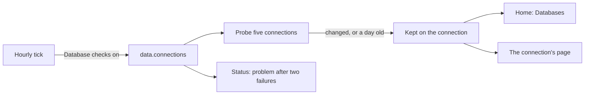

# Database checks, Rename and one connection per database

> **In plain words.** Batches 3 and 4 of the owner's database review ("Begin all batches!", 22
> November). Home has a Databases line, and an hourly check that Status reports on can be
> switched on; it starts off. A connected database can be renamed. When its list of tables is
> cut, any other table opens by its name. Pressing Connect twice, or coming back from Supabase
> twice, no longer makes a second connection: the one already there opens.

## What changed

| Part | Before | Now |
|---|---|---|
| Watching the databases | Checked only when someone connected one, pressed Check now or changed its key | `data.connections` checks them every hour once Database checks (`data.watch`) is switched on: five at a time, the next five in turn past five, 5 s each. Every outcome is kept on the connection only when it changed, or once a day; Status opens a problem after two failures in a row. A key that will not open is tried again once a day or when it is changed, as each failed opening is audited |
| Home | No line for databases; Email services counted databases as email services | A Databases line: answered of all, the failing count, "not checked yet", or None and Off; Email services counts only email and forwarding services |
| A portal that saved its Modules switches | A new extra would start on there | Migration `0077` adds `data.watch` to the saved list, so the check starts off there too |
| A connection's name | Set once, when connected | Rename on its page (`POST /api/data/connections/:id/label`, `registry.rename`, audited `providers.rename`) |
| Tables past the 500 listed | Out of reach | "Open a table that is not listed" under the notice that the list is cut, with how the service names one |
| The same database connected twice | A second connection, reading the same data | Refused (`KIT-E-4104`) for the same service and address; the Data pages and the Supabase confirm open the one already there, saying so. Not for Neon: one endpoint serves several databases and roles |

The usage count planned beside them is left out: it would cost a database write on every page read.

## What the review team caught, and what was done

Batch 3: a key that would not open was reported to Status but never kept, so Home said it
answered; the five checked each hour were always the same five past five connections; a
connection never checked counted as answering; each failed opening added an audit row every
hour. All four were fixed with tests. Batch 4: the duplicate refusal would have stopped a second
Neon database on the same endpoint (Neon is left out); the refusal now opens the existing
connection instead of leaving the person on a notice; the words of the by-name form and its
hints were made plain. Phone tests P422-P423 of the logos were renumbered P423-P424, as P422 was
taken.

## Left, to come back to

- Two requests at the same moment can both pass the duplicate check: no unique index, to avoid a
  migration.
- Airtable connections have no address, so they are not checked for a duplicate.
- The hourly check's limits are constants, not settings.

## Phone tests

P425-P429 in [the data phone tests](../phone-tests-data.md).

## How it was checked

The data, providers, connect and core-config tests, the parts lists of the tool and the template,
the template's screens test (Home's query pin 32 to 33, a replayed Supabase Connect), then
`pnpm verify` for each batch; the summaries are in [the verification log](../verification-log.md).
Not run on a deployed portal or a phone.
