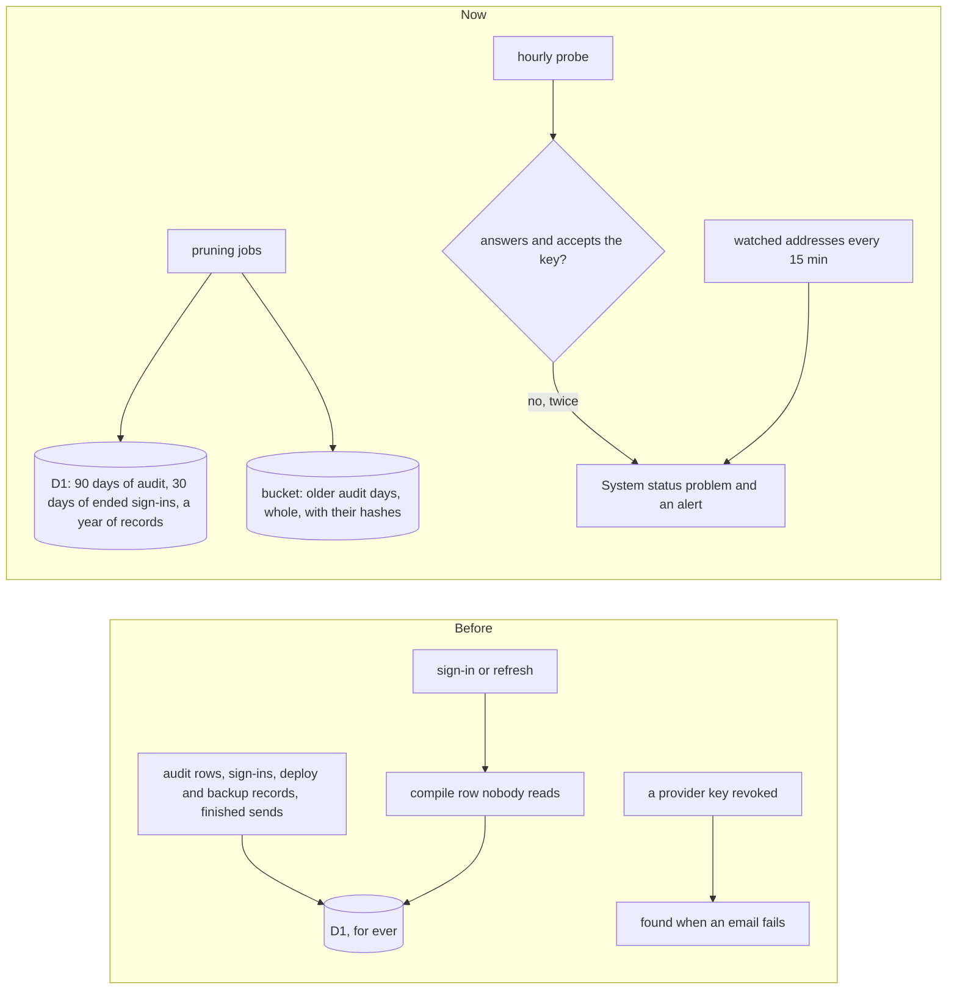

# A lighter database and a health watch

> **In plain words.** The owner asked for a full review of what the portal keeps in its database,
> and for an automatic system that checks the services the portal connects to still work. The
> database only grew: the audit log, sign-ins, deploy records and finished sends were kept for
> ever, and one table was written that nothing read. Now each kind of record has an age after
> which it goes. The oldest audit rows move to the bucket instead, where the export still finds
> them. Email history is kept: removing it would lose late spam reports and could send a message
> twice (Mail's record says why), and the owner chose to keep it.
>
> System status gained two checks: each email service is asked every hour whether it still answers
> and accepts its key, and an Owner can name up to ten web addresses for the portal to watch.

## What changed

| Area | Before | Now |
|---|---|---|
| Audit log | every row in D1 for ever | 90 days in D1 (`KEEP_DAYS`); `audit.archive` moves older days into the bucket, written before removed by the same bounds, hourly while rows wait and daily once none do; the export reads them back and fails by name on a missing file |
| Finished sends in the outbox | kept for ever | `Outbox.prune`; Mail's `email.outbox` job removes those older than 7 days |
| Customers' sign-ins | kept for ever, each with its browser | removed 30 days after they ended or ran out (`customers.prune`), 1,000 a run |
| Deploy reports and backup run records | kept for ever | removed after a year (`github.prune`, `backup.prune`); the newest of each repository, and of each kind and outcome of backup, always kept, so a failed run never removes the last good one |
| A compile of a person's access | wrote a row to `iam_policy_compiles` on every sign-in and refresh, which nothing read | writes nothing; the table is dropped in a later release, once every portal runs this code |
| Email services | probed only when someone pressed Test | probed every hour by `providers.connections`; a refused key (401, 403) is told apart from no answer, and a service asking to wait (429) only warns; the answer is written to the instance only when it changes, or once a day |
| The client's own websites | not watched | up to ten public addresses on Settings (`health.watched_addresses`), read every 15 minutes by `health.addresses`: 2xx, the words named; slow or moved warns; moves are not followed and a query never shows |
| Mail (its own record) | one extra write per email and per campaign recipient, finished sends kept, an unused table holding addresses | one write fewer each, finished sends 7 days, the table (its addresses copied once more, only widening) and an unused index dropped; email history kept |

## How it worked before and how it works now

Before, each table only grew. Now each pruning job keeps its table to a fixed age. Each job removes
at most a bounded number of rows a run, so a first run on an old portal stays small. The health
watch uses System status's existing rule, two failures in a row, so one bad minute never raises
an alert.

## Looked at, and not changed

- **Home's 32 queries.** They already run side by side, each module's card at once, so joining
  them would cut little time for a change across fifteen modules. The count stays pinned in the
  screens test.
- **File names in the bucket.** Uploaded files are named by a random id that only the portal's own
  rows lead to, so adding the company to the name would change nothing.
- **Zero Trust and outside services.** Checked on the live portal: the door leaves `/hooks/*`,
  `/healthz` and `/account` open, an outside fetch reached the Worker, and calls the portal makes
  are never checked by Access. The owner chose to keep it and add an outside check from the
  connect relay, later.
- **Retention as settings.** The ages are constants the owner chose, not settings a client edits;
  making them settings waits until a client asks.
- **Certificate days left** for a watched address: a Worker's `fetch` does not show the
  certificate, so this waits for the outside check.

## How it was checked

- Each job has a test on real D1 inside the Workers runtime. Old rows go and young ones stay, and
  the newest record is kept: of each repository, and of each kind and outcome of backup. The
  audit archive writes before it removes: a bucket that refuses the write leaves every row, and a
  row of the next day whose number falls among the day's stays. The export reads the archived
  days back, lists a row in both places once, and fails by name on a file that is not rows or on
  more than 40 files.
- A compile writes no statement other than reads (a test watches every statement it prepares).
- The connections check, against a stand-in provider: a refused key warns as a failover and fails
  as the active one, an accepted key is OK, and a key that can no longer be opened fails, named.
  The answer is kept on the instance, not written again an hour later, written again a day later.
- Watched addresses: 2xx with the words is OK, and an error status, no answer or missing words
  fail, named first. Two runs open the problem, slow and moved only warn, a move is not followed,
  a query never shows, and the setting refuses `http://`, markup, more than ten lines, numbers,
  inside names and an address with a user or password.
- Six review agents read the change (code, tests, hidden failures, data, security, mail); what
  they found is fixed above. The email history question went back to the owner, who chose to
  keep every email's row.
- `pnpm verify` in both repositories before the push: Mail's summary is in its commit, and the
  kit's in the commit that takes Mail's copy in.

Phone tests P348-P353 ([System status](../phone-tests-system.md)).
