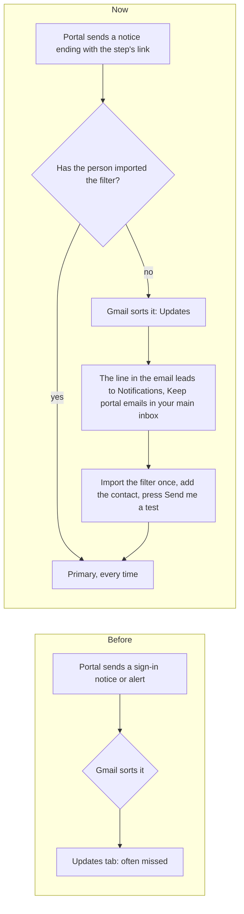

# The portal's own mail in each person's main inbox

> **In plain words.** On 22 November the owner found the portal's sign-in notices and alerts in
> Gmail's Updates tab, once nothing in them read as an offer any more. Gmail puts automatic
> notices there whoever sends them, and no sender can choose a reader's tab. What does keep a
> sender in Primary for good is the reader's own filter or contact. So the Notifications page now
> gives each person that step in one minute: a Gmail filter file, a contact card for the phone,
> the steps for Outlook, and a test email. Every sign-in notice, invitation and alert now opens
> with "Hello," and ends with a line pointing to that step.

## Why Updates, and why only the reader can change it

Gmail's help describes Updates as automated confirmations, notifications, statements and
reminders: a sign-in notice is exactly that, from any provider and any address. The portal's mail
already passed every sender check (its domain verified, DMARC set, never tracked, plain text), so
nothing more on the sending side moves a notice to Primary every time. A Gmail filter that says
"Categorize as Primary" does: Gmail applies it before its own sorting, to every message it matches.
The owner ruled out paid Google Workspace (free forever) and staff use any mail provider, so the
step has to be one each person can take in their own mailbox.

## What changed

| Before | Now |
|---|---|
| Nothing told a person how to keep the portal's mail in Primary | Notifications, **Keep portal emails in your main inbox**: Gmail filter, Add to contacts, Send me a test in a sideways row, then the steps for a computer, a phone and Outlook |
| A person had to write a filter by hand, address by address | The filter file names every domain the portal sends from (`@a OR @b`), so an address added later is covered too; Primary, never Spam, marked important; Gmail's own export format, imported in Settings, Filters and Blocked Addresses |
| A phone had nothing to save | A contact card (vCard 3.0) with every sender address, named after the portal's mail |
| No way to see where a notice lands | Send me a test: a plain, untracked email from the address the notices come from, once a minute at most, saying what to do if it is under Updates |
| Sign-in notices, invitations and alerts ended with their own link | Each opens with "Hello," and ends with "If this email landed under Updates, Promotions or Other, the one-minute step at `<portal>/notifications#primary` keeps the portal's emails in your main inbox" |
| An alert said "Opened 2026-11-22T06:00:00.000Z" | "Opened on 2026-11-22 at 06:00 UTC." |

Before, Gmail's own sorting decided alone. Now a person who finds a notice under Updates has the
fix one tap away in that same email, and once they import the filter every later message from the
portal's domains skips Gmail's sorting and lands in Primary.

## Where it lives

- **Oltrem Mail** (`@oltrem/email`): `GET /api/email/primary` names the main address and every
  sender address with their domains; `POST /api/email/primary/test` sends the test, keyed by the
  person and the minute. Both under `email.self`, which every account holds.
- **Screens**: the section, the two files (`src/primary.ts`) and the test's form, on the
  Notifications page every account has.
- **IAM**: `mainInbox(origin)` and `MAIN_INBOX`, the one line the notices end with; the sign-in
  alert and the invitation carry it, and the alerts module reuses it.

## What it cannot do

- It is each person's own step, done once in their own mailbox: no sender can set a reader's
  filter, and a free account has no way to set it for a whole company.
- The filter file imports in Gmail on a computer; the Gmail app on a phone has no import. On a
  phone the contact and Gmail's own Move to, Primary are what teach Gmail.
- Nothing asks a person to reply to a portal email: a reply to an address with no inbox would come
  back as a bounce.

## Phone tests

P400 to P405, in [Phone tests owed: Users and access](../phone-tests-users.md).

## How it was checked

- screens: the new `main-inbox.test.ts` (the filter file's every line, a value that is not a
  domain left out, the contact card's escaping and its 75-character lines, the section's row).
- The client template's screens test: the section on Notifications, the filter's download (its
  type and file name, Primary, the domain), the contact card, and Send me a test coming back with
  its notice.
- iam: the sign-in alert's first and last lines, the main-inbox line without an address, the
  invitation's last line; alerts: the email's whole text and its last three lines.
- Oltrem Mail: `portalSenders` (order, lower case, domains, no main address), the test template
  (plain, untracked, no unsubscribe), the two routes and a second press within the minute.
- The full `pnpm verify` of both repositories before the push (summaries in the commits).
