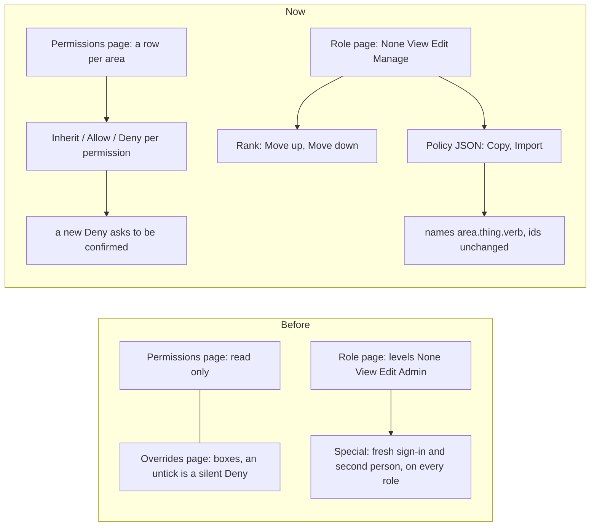

# Permissions anyone can follow

> **In plain words.** On 22 November the owner read the review of Users and access and said yes
> to all of it, in four batches. This is the third: permissions. The levels are now None, View,
> Edit and Manage, and an Admin gets everything an admin should, including what asks for a fresh
> sign-in. The ready-made roles are called Admin, Member and Viewer. A person's permissions are on
> one page, one row per area, each with Inherit, Allow or Deny, and a Deny has to be confirmed
> because it wins over every role. A role's rank shows, with Move up and Move down. Every
> permission has a name of the form `area.thing.verb`, and a role or a person's access can be read
> as Policy JSON (the format AWS uses), copied, and for a role pasted back in.

## What changed

| Before | Now |
|---|---|
| Levels None, View, Edit, Admin; a permission that asked for a fresh sign-in or a second person's yes sat in no level, under Special permissions on every role | None, View, Edit, **Manage**; those permissions sit in their level with a tag beside them; Special permissions is only the Owner's own, on the Owner role |
| Ready sets named View only, Standard user, Full admin | Viewer, Member, Admin, renamed in each portal by migration `0076` (only where the new name is free); setup and handover still find the old names |
| A person's Permissions page (read only) and a separate Overrides page of boxes, where an untick made a silent Deny | One Permissions page: a row per area with its level and "N of M", open for its permissions, each with Inherit, Allow or Deny; a new Deny needs "Yes, deny what I picked" ticked; `/people/:id/exceptions` moves there |
| A role's rank was invisible | "3 of 5, the Owner first" on the role page, with Move up and Move down |
| Counts read "3/8", "3 of 8 permissions", "Custom (3)" | One way: "3 of 8" |
| Permission ids of every shape (`records.write`, `iam.bindings.manage`, `timeoff.ask`) | Each has a name `area.thing.verb` (`lists.edit`, `access.grants.manage`, `time.off.request`); the ids stored never change; a new permission must be named this way |
| Nothing to read a role or a person's access as text | Policy JSON on every role (Copy, and Import in its place) and on a person's Permissions page (read only) |

**How Policy JSON works.** It is a view over the same permissions, never a second store: the
check, its speed and the stored ids do not change. A role reads as one Allow rule at `loc:*`
(everywhere it is given) with its permissions by name, the Owner role as `*`. A person reads as
one rule per role they hold directly and one per their own Allow or Deny, each at its location
(`loc:/downtown/front-desk`) and with `Condition: {"Ends": ...}` when it ends. An import accepts a
permission's name or old id, `*`, `area.*` and `*.verb`. Three rules keep it safe:

1. The Owner's and the Vendor's own permissions are never given by an import; a wildcard skips
   them and naming one is refused.
2. Anything the portal does not know (a field, a Version, a permission) is refused and named,
   with what to do instead: a Deny goes on the person's Permissions page, a location is picked
   when the role is given, Condition is not part of a role yet.
3. A wildcard is expanded to today's permissions and saved as that list (no new column, R-09), so
   a permission a later update adds is not covered until the role is saved again. The page says so
   under the box.

**Impact on each part.** Screens: the role editor's levels and wording, the Permissions page
(`person-perms.tsx`), the rank section and its route, Policy JSON (`policy.tsx`) on role and
person pages, one count. Iam: the alias table (`aliases.ts`), `name` on `GET /capabilities`,
ready-role names in handover, migration `0076`. The CLI's setup wording. No table, column,
setting key, permission id or API route changed; the screens gained routes (`move`, `import`).

**Left for later, and why.** Inviting with `users.manage` alone needs a look at how an invitation
carries a role, so it waits for the data review. The six new read permissions need new
permission rows and a data move. The check reading the Location from each request is an
architecture change. Conditions on a role, API keys and SCIM wait for a client who needs them. The
Vendor's default access stays as it is: the owner picked "the Vendor may enter any time" on 22
November. From the review: a row offers Allow and Deny even where the API will refuse the person
saving (they do not hold that permission themselves, or do not outrank the user), and the refusal
then reads in the API's words; Import and a new Deny are confirmed by a box and a second Save, not
yet by a dialog. Both wait for the page-by-page audit.

**What the review caught and was fixed before the push.** Seven review agents read the batch.
Fixed: Invite all on the Users page no longer found Admin and Member once renamed, and would have
made a second copy of each (now matched in any case, with a test); a save now makes the new Allow
or Deny before it ends the old one, so a refusal never leaves a Deny gone, and a refusal keeps the
picks and Access ends; two roles sharing a rank no longer claim a move that changed nothing, and a
refused swap puts the neighbour back; the migration matches names trimmed and in any case; a
search opens the module it finds, and a tile opens the module it names; Rank and Import show only
to whoever may change roles; a role's Policy JSON leaves out a switched-off part's permissions and
an import keeps them; a person's JSON shows a role-level Deny and marks a grant used only once
switched on; the old one-permission save asks for the same confirmation for a Deny; the words
"override" and "exception" gave way to "their own Allow and Deny".

## How it was checked

- screens: `policy.test.ts` (locations as paths, a role and a person as JSON, import of names, old
  ids and wildcards, every refusal named, a role's JSON imports back to the same permissions);
  `role-rank.test.ts`; `people-access.test.ts` (the Permissions page rows, levels and picks;
  `pickChanges`); `role-pages.test.ts` and `start.test.ts` for the new names.
- iam: `aliases.test.ts` (every alias fits the pattern, no two ids share a name, `nameOf` and
  `idOf` round-trip); `ready-role-names.test.ts` (the migration twice, and a clash left alone);
  `setup-admit.test.ts` (Member and Admin, with fresh-sign-in permissions included).
- The client template's screens test: the role editor's levels and ready-made roles, Manage
  holding `users.manage`, rank moved up and back, Policy JSON shown by name, an import saved, a
  refused import naming each problem with the box open, a new role's import needing its Name, the
  Permissions page's Allow and Deny with the confirm, and every permission named `area.thing.verb`.
- The full `pnpm verify` before the push (summary in the commit).

Not verified: any of this on a phone (P369 to P375 in [the list](../phone-tests-flows.md)).
