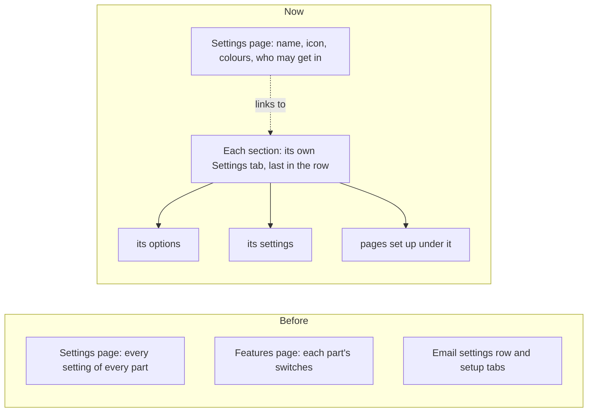

# Each section's own Settings tab

> **In plain words.** On 22 November the owner asked for a design anyone can follow, and picked
> "a setting lives with the thing it changes". Before, every setting of every part sat on one
> long Settings page, and a section's on and off switches sat on the Features page. Now each
> section whose parts have settings has a tab named **Settings**, last in its row. It opens with
> the section's options (its switches), then its settings, then the setup pages that belong to
> it. The Settings page keeps only what is about the whole portal: its name, icon and colours,
> and who may get in and how. It lists each section's tab. Email's two setups became one: its
> Setup, Addresses, Mail setup and Forwarding pages now open from Email › Settings.
> The same push makes Users and access four tabs and its own Settings, as the owner's review of
> Users and access asked.

## What changed

| Before | Now |
|---|---|
| One Settings page with every part's settings in sections (Company, Email, Money, Users and access, Security, System) | The Settings page: Name and icon, Colours for everyone, Security, then **Each section's settings**, one row per section's tab with how many settings it holds |
| A section's switches on the Features page or at the top of its first page | On its Settings tab, at the top |
| Email had Email settings in the sidebar and its setup pages as tabs | Email › Settings holds the sending settings and lists Setup, Addresses, Mail setup and Forwarding under **Set up** |
| Users and access had eight tabs: Users, Signed in today, Roles, Groups, Locations, Access requests, Access reviews, Vendor access | Five: Users, Roles, Groups, Locations, Settings. Signed in today and Access requests open under Users, as chips under the tabs; Access reviews, Vendor access and the two job switches under Settings |
| My access was a tab of Users and access | It opens from the account menu, as the person's own page |
| A role badge read "Admin"; a grant without an end read "No end"; a group's page was titled Groups | "Admin at Downtown" when the role holds at a location; "No end date"; the group's own name |
| An Owner's My access offered Ask for access | An Owner holds every permission, so it is left off |

**How it works.** A section gets a Settings tab when one of its parts defines a setting that is
not company-wide (`settingSections` in `section-settings.tsx`). The tab is built from the parts'
own setting lists and the sidebar, so a client's own module gets one with nothing to write. Its
address is `/settings/section/<the section's name in lower case>`. A section that was one row
becomes a set of its page and Settings, still one row in the sidebar. A page that would be a
sixth tab names its tab in `under`: it is left out of the row, marks that tab while open, and
the search box still finds it. Every form on a tab sends `to`, so its answer comes back to the
tab. The tab shows to an Owner and the Vendor, and to anyone who may open a page set up under
it; the API still decides each setting.

**Impact on each part.** Screens: the sidebar list, the head, the Settings routes and the
settings form. Core-module: a page entry may name `under`. Iam: the list of grants carries each
location's name and parent. Alerts, Expenses and Files point their notices at the new tabs.
Oltrem Mail: its four setup pages carry `under: '/settings/section/email'`. No setting key,
value, permission, table or API route changed.

## How it was checked

- screens: the new section-settings test (which sections get a tab, last in the row, a single row
  folding into one, what stays central, a page under a tab marking it and found by search);
  people-access (four tabs and the pages under them, a role at a place named once per place).
- iam: the list of grants carries `scopeName` and `scopeParentId`.
- The client template's screens test: the Settings page and the Files, Sales, System and Users
  and access tabs, saving and resetting with the answer back on the tab, one value for all on
  Sales, a list one per line, Email's provider set up from its tab, a group page titled with its
  name, no Ask for access for an Owner.
- Every package and module test, Oltrem Mail's verify, and the full `pnpm verify` before the
  push (summary in the commit). Checked on the local portal: the tabs of Users and access, Sales, System and Email, and the Settings tab of each.

Not verified: any of this on a phone (P361 to P368 in [their list](../phone-tests-flows.md)).
