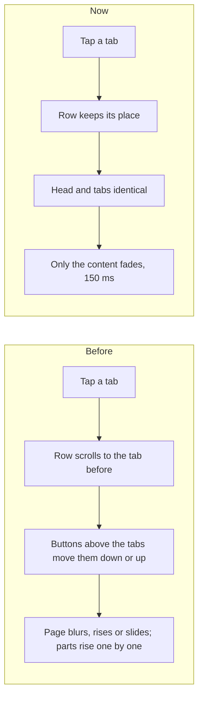

# A frame that never moves

> **In plain words.** On 22 November the owner sent phone screenshots. The tabs and buttons on
> Email settings jumped place from page to page, page changes were "a jerk", the big title looked
> ugly, the Modules page lagged when scrolled or changed, and the Audit log fell off the right
> side of the screen while its scroll jumped. He asked for a fixed place for these things,
> "inside core principles". Now the head and its tabs stay the same on every page of a set, and
> their buttons sit under the tabs. A page change is one quick fade. The top bar is solid. The
> title on a phone is small. No page can slide sideways. These are now rules in the design
> system, and this is the first part of the design rethink he approved the same day.

## What changed

| Before | Now |
|---|---|
| The row of tabs scrolled itself on every page so the tab before the marked one started it, so the row jumped | The same row opens scrolled where it was on the page before, and moves only as far as shows the marked tab whole |
| A tab's own buttons sat on the head's line, above the tabs; a tab with buttons and one without drew the tabs at different heights | The buttons start the content, under the tabs; the head and the tabs are the same on every page of the set |
| A page change faded the content in from a 4 px blur, rising 6 px over 320 ms, or slid it 32 px sideways, then each part rose in turn, panes and figures sharpened from a blur and a chart's columns grew | One fade of 150 ms (the old page out in 100 ms). Nothing slides, rises, sharpens or comes in by itself |
| The top bar and the stuck tabs were see-through, the page blurred behind them (`backdrop-filter`) | Solid, in the surface or page colour; no `backdrop-filter` anywhere in the stylesheet |
| A page's title was 20 px on a phone | 17 px on a phone, 20 px from 1024 px |
| A phone card's title grew as wide as its longest word, so an address or an id in Details pushed the Done tag off the right edge, and the whole page panned sideways | The title and each value may break anywhere (`min-w-0`, `wrap-anywhere`, `minmax(0, 1fr)`); the page itself clips sideways (`body { overflow-x: clip }`) as a last guard |

**Why the Modules page lagged.** Measured with a phone-sized headless browser at six times
slower CPU, the page's own scripts were not the cost. Headless software drawing cannot show a
phone's graphics chip, but two things on the page are known to load it: a blur behind a bar that
stays put while the page moves under it (redrawn on every frame of a scroll), and a page change
that snapshots a tall page and animates a blur on it. Both are gone. Saving the page reloads it,
which used to replay the whole arrival; now it is one fade.

**The rules.** The design system's skill gains "A frame that never moves": never wider than the
screen, the head and its tabs keep their place, no blur and no see-through bars, one quick fade
between pages, a small title on a phone. The theme tests hold the stylesheet to them.

**Impact on each part.** The stylesheet is about 4 KiB smaller (167 KiB of the 172 KiB cap). The
frame's script loses the code that worked out which way a page moved. No route, table, setting or
binding changes. Email's own pane moves (the folders and the reader) are unchanged.

## How it was checked

- core-ui theme tests: one 150 ms fade with no slide, rise or arrival; no `backdrop-filter`; the
  bars solid; `body` clips sideways; no rule puts a tab's commands above the tabs.
- screens frame tests (38): a marked tab already in view leaves the row where it is; one past the
  edge moves the row just far enough; the next page of a set opens its row where the last was.
  The test of the sideways slide is removed with the slide.
- screens CSS tests: no part sharpens in.
- In a headless phone browser on the local portal: 50 pages and their tabs at 360 px with every
  Details opened, nothing past the screen's edge; an audit card given a 60-character address keeps
  its Done tag inside the card.
- The full `pnpm verify` before the push (summary in the commit).

Not verified: any of this on a phone (P332 to P336 in [their list](../phone-tests-flows.md)).
