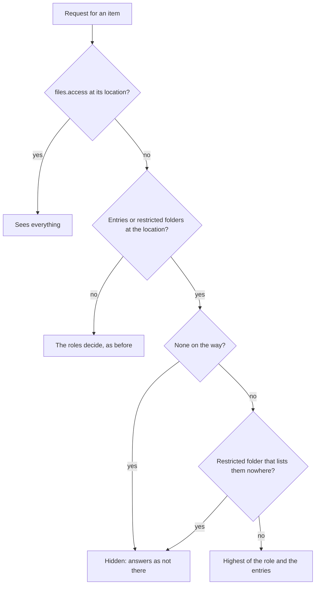

# Files: Manage access, batch 2

> **In plain words.** The owner asked for permissions, per-person access and hiding on the Files
> page (23 November). Until now a file was open to whoever held a role at its location. Now each
> folder and file has **Manage access**: give a person, a group or a role None (hidden), View,
> Edit or Manage on it and everything inside, optionally View only (no download) and ending on a
> day. A **restricted** folder is hidden from everyone not listed on it. What was given shows under
> **Shared with me**. Those who may change access at a location, the Owner among them, always see
> everything there.

## What changed

| Part | Before | Now |
|---|---|---|
| Who sees an item | the roles at its location | the roles, then Manage access: None hides, a restricted folder hides from those not listed, else the highest level wins |
| Hiding | not possible | None on one item for one person, group or role; Restrict on a folder |
| Download | anyone who sees it | not for View only (open and preview only) |
| Expiry | none | an entry may end on a day; ended entries are cleaned up a month later |
| New permission | | `files.access`, "Change who has access to folders and files" (alias `files.access.manage`) |
| Data | | migration `0079`: `files_access` and `files_items.restricted` |
| Pages | | Manage access on an item's page, Shared with me in the tree and the phone row, Download hidden for View only |
| Audit | | `files.access-grant`, `files.access-remove`, `files.restrict` |

Before, the first and last boxes were the whole story. A location without entries still costs
only two small reads, so pages that never use Manage access stay as fast as they were.

## Left for the next part (2b)

- A Files line on each person's Permissions page (waits for the person-page rework to land).
- Room per person or per role, and a size limit per location.
- Ask for access when a folder is closed to you.
- An entry widens only within the route gates: View for someone from another place needs a role
  with `files.read` somewhere, Edit or Manage the matching capability somewhere.

## How it was checked

The decision on its own (`test/access.test.ts`), the module through the pipeline beside IAM on real
D1 (a restricted folder hidden from a clerk and a keeper, back once listed by name or by group,
the audit rows; None on one file winning over a role and bulk trash refusing it; View only for
someone from another place, Shared with me, 403 on download but a preview, gone the day it ends;
giving access refused without `files.access`, to someone unknown, Restrict on a file), the pages
(the Manage access section, the form's request, Download hidden for View only, Shared with me),
then `pnpm verify` (its summary in the commit). Not run on a deployed portal or a phone:
P463-P467 in [their own list](../phone-tests-files.md).
