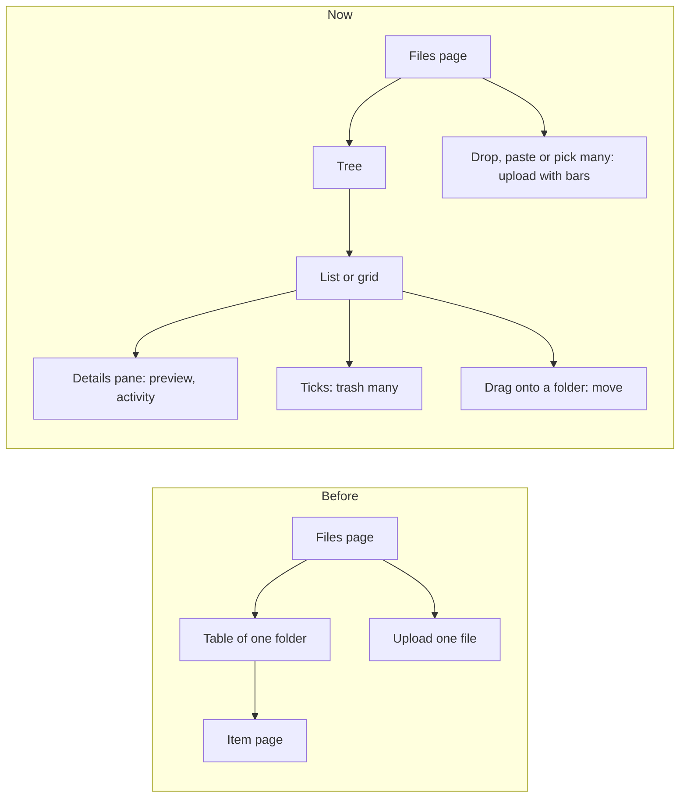

# Files as a file manager, batch 1

> **In plain words.** The owner found the Files page "close to nothing" (23 November) and picked
> all four batches of the plan "Oltrem Files: a real file manager", in order. This is batch 1, the
> look: Files now works like Windows Explorer. A folder tree on the left, a list or a grid you can
> sort, ticks to act on many at once, files dropped or pasted to upload with a bar each, rows
> dragged into a folder to move them, a menu on each row, a copy, and a details pane with a
> preview and who opened the file. No table changed. Who may see a file is still the roles held
> at its place; per-person access, hidden folders and the room per person come in batch 2.

## What changed

| Part | Before | Now |
|---|---|---|
| The page | places as chips, a plain table, a one-file form | a tree with a storage bar, List or Grid, sort by Name, Changed or Size, a find box, ticks with Move to the trash, a menu per row, a details pane (`?item=`) |
| Uploads | one file per form | many files or a whole folder; dropped or pasted files upload one at a time with a bar each and Stop; an upload's `path` makes its folders |
| Moving | the item's page, one at a time | rows (the ticked ones together) dragged onto a folder of the tree |
| New on the server | | `POST /items/:id/copy`, bulk `trash` in one batch, `GET /items/:id/activity` for a person who may delete for good, a `Range` answered with 206 |
| Opening a file | not audited for staff | `files.download` and `files.preview` audited, except a picture's preview and a later part of a video |
| Preview | pictures only | pictures, video, sound, PDF, plain text and JSON, each sandboxed but the PDF, which keeps `default-src 'none'` |

Before, every action meant opening the item's page. Now the list itself is where you work, and the
item's page stays for rename, move, links and sharing.

## Left out, on purpose

- A folder downloaded as one ZIP: zipping in the Worker costs more than its 10 ms of CPU.
- Thumbnails made in the browser: the grid shows each picture itself, loaded lazily.
- Retry per upload, and Ctrl+A: Stop exists; a refused file names its problem and what to do.

## How it was checked

The files module's tests (folders by path once and the depth refused, a copy numbered with its
content and audit, three trashed at once with one refused, a download and a text preview audited,
a picture's preview not, a range answered `bytes 1-2/4`, Activity for a keeper and 403 for a
clerk) and the pages tests (sorting, the tree, upload boxes, bulk bar, grid, details pane with its
Activity, the copy intent), then `pnpm verify` (its summary in the commit). Not run on a deployed
portal or a phone: P447-P454 in [their own list](../phone-tests-files.md).
