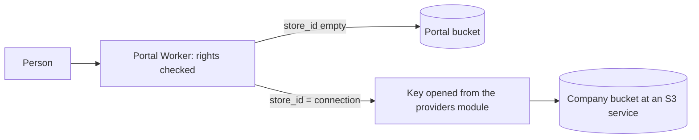

# Files: Storage locations, batch 3

> **In plain words.** The owner asked for S3 and other storage connections, with checks, easy to
> set up (23 November). Until now every file sat in the portal's own bucket, 10 GB on the free plan
> shared with the backups. Now an Owner can join a bucket of the company's own (Amazon S3,
> Cloudflare R2 in another account, Backblaze B2, Wasabi, DigitalOcean Spaces or any S3 service) on
> **Files, Storage**, see it checked in six plain lines, and choose per location where new files
> go. Who may open a file is decided by the portal exactly as before.

## What changed

| Part | Before | Now |
|---|---|---|
| Where a file is kept | the portal's bucket | the portal's bucket, or a storage connection chosen per location |
| Services | | six storage definitions in the providers module, each speaking S3 with a signed key |
| Setup | | Files, Storage: pick the service, follow its steps, paste bucket, place and key, Join and check |
| Checks | | list, write, read back, refused without the key, delete, versioning; on Join and on Check |
| Data | | migration `0080`: `files_items.store_id`; the setting `files.location_stores` |
| Errors | | `KIT-E-2410` the storage refused or failed, `KIT-E-2411` a connection still in use |
| Providers routes | listed every kind but data | leave storage out too: it is the Owner's, on Files |

Before, the Worker went to the portal's bucket only. Now each file's row says where its content
is, and the Worker signs a request to that bucket with the connection's key. Every byte passes
through the Worker, so the outside bucket stays private and needs no CORS rule.

## Left for later

- Bringing in the files already in a bucket, and moving a location's existing files between stores.
- WebDAV, Google Drive or Dropbox as stores: not S3, and each would need its own client.

## How it was checked

The store against an S3 bucket in memory that answers only signed calls (`test/stores.test.ts`),
the module through the pipeline beside IAM on real D1 with a stand-in registry (an upload kept in
the bucket, opened whole and in part, copied, still opened after the choice changed, deleted for
good; a service down refused with no row; the Storage routes for an Owner, refused to a clerk, a
connection in use kept), the page, the providers definitions and routes, then `pnpm verify` (its
summary in the commit). Not run against a real S3 service, a deployed portal or a phone:
P479-P483 in [their own list](../phone-tests-files.md).
