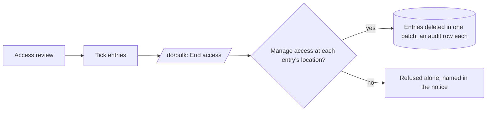

# Files: access review, request emails and activity export, phase 8

> **In plain words.** The owner asked (24 November) for more permission management and services
> for the long term. Whoever manages access can now see, on one page, every extra access given at
> their locations and when it ends, and end many at once. The person who makes a file request is
> emailed when files arrive. A folder's activity can be downloaded as a spreadsheet file.

## What changed

| Part | Before | Now |
|---|---|---|
| Who has extra access | one folder or file at a time | **Files, Access review**: every entry at the locations the person manages, soonest end first, filters for ending soon and ended |
| Ending access | one entry at a time | tick many and **End access**: one write, an audit row each |
| A file request receiving files | seen only by opening the folder | its maker is emailed who sent what, once per sending |
| Activity | the last 30 rows on the page | **Export (CSV)**: up to 1,000 rows, formula cells made plain |
| The Files row of pages | written out on each page | one list (Starred, Recent, Shared with me, Shared links, and for Manage access: Access review, Limits, Storage) |
| Data | | no migration |

## How it was checked

The module through the pipeline on real D1 (the review for whoever manages access only, soonest
end first; End access in bulk with an unknown entry refused alone and two audit rows; a file
request's maker emailed once with the sender and names; a folder's activity as CSV with a formula
cell started with a quote mark, refused without Manage), the pages against answers of the API
(the review's lines, its two filters and ticks, the Export link), then `pnpm verify` (its summary
in the commit). Not run on a deployed portal, with a real mailbox or on a phone: P498-P501 in
[their own list](../phone-tests-files.md).
