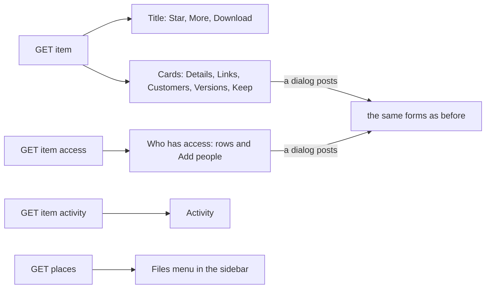

# Files: a file's page made over

> **In plain words.** The owner said (24 November) that managing the access of a file "feels like
> made by a 10 year old". A file's or folder's page is now a set of cards: its buttons sit beside
> its name, Who has access lists one row per person with their level and an X, and every form
> (Add people, New link, Share, Upload a new version, Keep, Rename, Move) opens in a dialog
> instead of filling the page.

## What changed

| Part | Before | Now |
|---|---|---|
| The top | the path, then a row of equal buttons (Download, Back to the folder, Star, Move to the trash) | beside the title: Star, a More menu and one filled button (Download, Open, Release or Open the folder); under it "PDF · 78 KB · changed 24 Nov"; then "In" with the folders above as links |
| Details | four boxes in a row with labels in capitals | a Details card on the right |
| Name and folder | a panel with a Rename form and a Move form, always open | Rename and Move in the More menu, each a small dialog |
| Manage access | a long paragraph, then each entry as "Person: name" with a Remove button, then the whole form under them | **Who has access**: the general access first (everyone whose role reaches the location, or only the people added, with Restrict), then one row per person (their initial), group or role with "Person · Edit, ends 31 Dec" and an X; Add people opens a dialog |
| Links, file requests, customers | each a panel with its rows and its whole form always open | cards with a count of open ones, one row each with End or an X, and New link, New request or Share opening a dialog |
| Versions and Keep | an upload form and a hold form on the page | cards that say the state in a row each; Upload and Change open a dialog |
| Activity | only in the folder's details panel | also on the page, last on a phone; access given, removed and restricted now read in words |
| Data | | none changed: the page also reads the places for the sidebar menu and the activity |

## How it works now

Every form posts the same fields to the same address as before, so nothing behind the page
changed. The dialogs are the portal's one dialog (a sheet on a phone), opened by the browser
with no script. On a computer the cards are a column on the right; on a phone the preview and
Who has access come first, then the cards, then the activity.

## Verified

The page against answers of the API: the buttons beside the title and the line under it, every
card, Who has access with its rows, remove buttons and dialog, a link's row and End, versions,
a held file and a View only one, the activity's words. The local portal at 390 and 1440 px, in
light and dark, on a folder, a PDF and a picture, with the More menu open and access given.
Then `pnpm verify`.

Phone tests: P530-P535 in [the Files list](../phone-tests-files.md).
