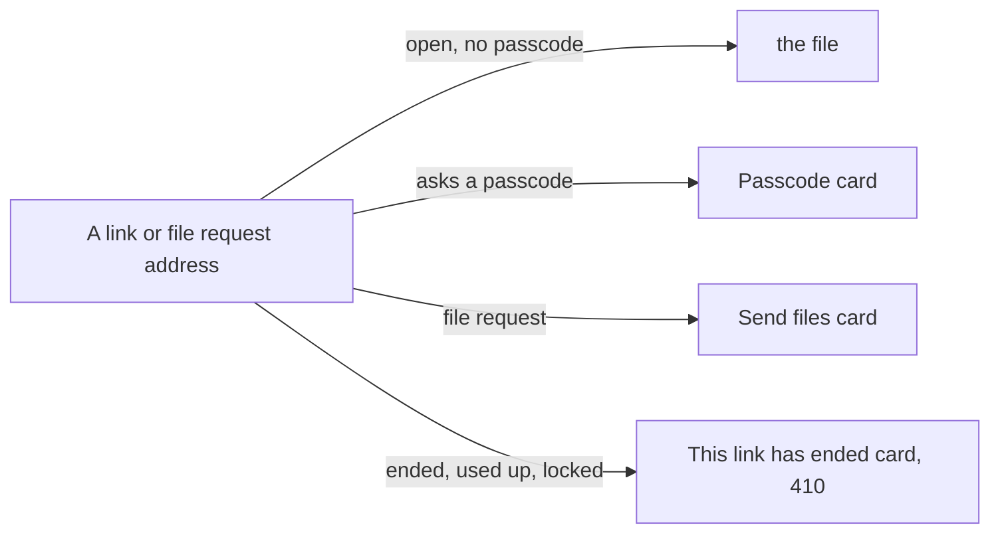

# Files: the public pages made over

> **In plain words.** The pages people outside the portal see (the passcode a link asks for, a
> file request, and a link that has ended) were bare text on a white page; an ended link was one
> line of plain text. Each is now one card in the middle of the screen, in the reader's light or
> dark, with a mark at the top, wide buttons and dates in words ("1 Dec 2026").

## What changed

| Part | Before | Now |
|---|---|---|
| An ended link or file request | a line of plain text | a page: "This link has ended", why, and to ask for a new one (still `410`) |
| The passcode page | a form on a white page | a card with a lock, the box and a wide Download button |
| A file request | the end date as `2026-12-01`; notices as coloured text | "until 1 Dec 2026"; what was received and refused in boxes |
| Every public page | light only | the reader's light or dark; a line saying the link is private and not listed |
| Data | | none changed |

## How it works now

Each page is still one piece of HTML with its style inline, no script and nothing else loaded,
never cached and never indexed; the content security policy is unchanged.

## Verified

On real D1: an ended link's page, its status, `no-store` and no script; the file request's date
in words. The local portal at 390 px in light and dark on an ended link and on a file request
with a passcode. Then `pnpm verify`.

Phone tests: P536-P538 in [the Files list](../phone-tests-files.md).
