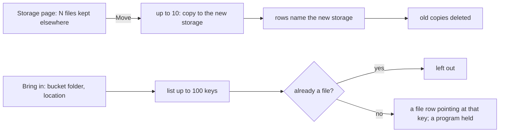

# Files: moving a location's files, and bringing in a bucket's

> **In plain words.** When a location starts keeping its files in a bucket of the company's own,
> its old files used to stay where they were. Now the Storage page says how many are kept
> elsewhere, and **Move** takes them across, ten a press. And a company that already has files in
> its bucket can **Bring in** a folder of them: they become files of a location, read where they
> are, with no copy.

## What changed

| Part | Before | Now |
|---|---|---|
| Old files after a location's choice changes | stayed in the old storage for good | the Storage page counts them per location; Move copies ten a press, changes their rows, deletes the old copies |
| Files already in a joined bucket | not seen by the portal | Bring in, under a folder of the bucket, into a location: up to a hundred a press, each key once |
| A brought-in file named like a program | | held for review, as an upload would be |
| Routes | | `POST /api/files/stores/move`, `POST /api/files/stores/:id/bring-in`, an Owner's |
| Data | | none added: the rows' `store_id` and `content_key` already said where content is |

## How it works now

Each press stays inside the free plan: one read of what is left, at most ten copies, one batch
that changes the rows. The old copies go only after the rows name the new ones, so a failure
half-way leaves every file opening from somewhere. Bring in writes the rows and their audit lines
in one batch after checking the location's room.

## Verified

On real D1 with an S3 bucket in memory: a location's files moved ten a press until none was left,
then opening from the bucket and gone from the portal's; a bucket's files brought in once, a
program held, a name numbered on a clash, a second press skipping them; both refused to a clerk.
The Storage page's Move and Bring in forms and their words, against answers of the API. Then
`pnpm verify`.

Phone tests: P539, P551 and P552 in [the Files list](../phone-tests-files.md).
