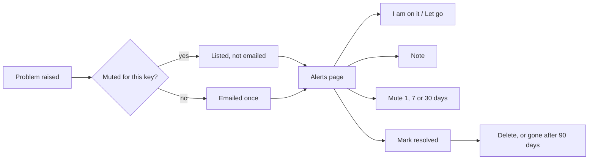

# The Alerts page remade, and sign-in alert emails that were refused

> **In plain words.** On 25 November the owner sent his live portal's Alerts page and asked for a
> deep look and a complete remake of how alerts are managed. The look found a bug: the email
> telling a person their sign-in was used from another browser was refused every time, so the
> person was never told. That is fixed. The page now reads like the Audit log, one row per alert
> that opens in place, with chips to pick what to see, a search, ticks to act on many at once,
> notes, muting emails for a while, resolving any alert, and deleting resolved ones.

## The bug

The open "Check what you entered (Audit)" alert held `KIT-E-0422 … messageKey: letters, digits and
. _ : -, at most 120`, raised from `signInMoved`. The sign-in-moved email was keyed by the
browser's name, `Chrome on Windows`, whose spaces Email refuses in a message key, so every such
email failed and opened an error alert instead. The key now ends in the name in lower case with
dashes (`…:CA:chrome-on-windows`); a test holds it to Email's rule. The access alert beside it
said the person "was emailed"; from now on it is true.

## What changed

| Before | Now |
|---|---|
| Four big number boxes, an info box, then two wide tables | One search, a Show row (Open, Nobody on it, Mine, Critical, Resolved, Everything, each with its count) and a Kind row (Checks, Errors, Sign-ins and reports) |
| Who is emailed behind a link in an info box | One line: who is emailed, the quiet hours, Change |
| A table row with a folded stack | One row per alert under its day, in the viewer's time zone, with a red or amber edge, who is on it and the email state; it opens to what was seen, what to do, when, who, the email, the key and the technical details, with Copy |
| I am on it; Mark resolved for errors and reports only | I am on it or Let go; Mark resolved on any alert; a note; mute emails for 1, 7 or 30 days, or unmute |
| Nothing to clear the 30 resolved ones shown | Delete a resolved alert (confirm dialog), tick many to take, resolve or delete together, page back through older ones; resolved alerts are deleted after 90 days |
| `alerts.read`, `alerts.manage` | plus `alerts.delete` (Delete resolved alerts), given to every Owner role |

A mute belongs to the problem: a new alert under the same key stays listed but is not emailed
until the mute ends. Migration `0096` adds `resolved_by`, `note`, `note_by`, `note_at` and
`muted_until` and an index on the key and the mute. Routes and rules:
[modules/alerts/README.md](../../modules/alerts/README.md).

## Then: the sidebar and the search list

The same evening the owner asked for a more compact sidebar and called the search box's list
"really ugly, no color, completely blend". The sidebar, open, is now as wide as its longest row,
between 12 and 16 rem, on a computer (on a phone too at first; see below). The search list had lost its look: the frame
script named it `ui-finder`, a class with no style, so it showed bare. It is `.ui-go` again, and
each row now has its section's icon on a coloured tile, the page's name over its section, the
selected row in its colour with Enter, suggestions when nothing was opened yet, and a line of key
hints on a computer. The stylesheet cap rose from 184 to 185 KiB for it (P819 to P822).

Then the owner asked to "completely wipe" the separate search page for something more compact.
It is gone: every Search (the sidebar's box, its folded icon, the phone bar's button, Ctrl K)
opens one pop-up over the page with the same coloured list, and the "Search everything" row went
with the page. `/search` now answers only the pop-up's JSON; an old link to it goes Home. Files'
"Search all of Files" opens the pop-up with its words (P821 to P825).

Last, the owner found an open alert bland and hard to read: "everything looks same", with small
gaps and parts out of line. Every fact stays, arranged better: What was seen and What to do are
two tinted panels (the alert's colour and blue); When, Who, Email and The alert are four lined-up
columns in one card, each headed in its own colour with the labels one width; the note's box and
button are one height; the actions are one bar, with Mark resolved solid, the mute choices one
track and Copy and Delete at its end (P826). The stylesheet cap rose to 188 KiB for both.

## The next morning: the account menu on a phone

On 2026-11-26 the owner found the account menu broken in the phone's drawer: once the drawer
followed its names it was too narrow, so the colour dots and the theme buttons ran past its edge
and Look and colours and the email were cut short. The drawer keeps its full width again (16 rem,
or the screen less 56 px), the colour dots wrap to a second line instead of leaving the menu, and
on a computer the menu is never narrower than 15 rem, over the page beside a narrow sidebar
(P820).

## Verified

- `modules/alerts` tests: let go, note, mute that survives a new alert and unmute, delete only
  when resolved and only with `alerts.delete`, bulk, paging, `emailing` hidden from a reader, the
  90-day clean-up; any open alert resolvable, keeping who did it.
- `modules/iam` test: the sign-in-moved key passes Email's message-key rule.
- `packages/screens` tests: the views and kinds, the actions and ticks for a manager only,
  Delete only on a resolved alert for whoever may delete, the empty states.
- `packages/screens` and the client template's tests: one palette outside the sidebar, opened
  by every Search, no link to a search page, `/search` sending a page request Home and answering
  the pop-up's JSON; Files' link opening the palette with its words.
- `pnpm verify` before the push. Not checked: the live portal on a phone (phone tests P810 to
  P826).
