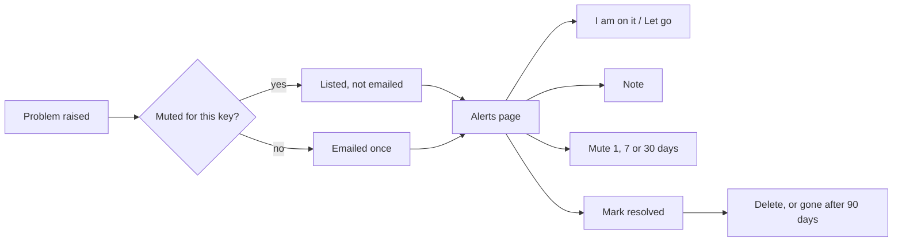

# The Alerts page remade, and sign-in alert emails that were refused

> **In plain words.** On 25 November the owner sent his live portal's Alerts page and asked for a
> deep look and a complete remake of how alerts are managed. The look found a bug: the email
> telling a person their sign-in was used from another browser was refused every time, so the
> person was never told. That is fixed. The page now reads like the Audit log, one row per alert
> that opens in place, with chips to pick what to see, a search, ticks to act on many at once,
> notes, muting emails for a while, resolving any alert, and deleting resolved ones.

## The bug

The open "Check what you entered (Audit)" alert held `KIT-E-0422 … messageKey: letters, digits and
. _ : -, at most 120`, raised from `signInMoved`. The sign-in-moved email was keyed by the
browser's name, `Chrome on Windows`, whose spaces Email refuses in a message key, so every such
email failed and opened an error alert instead. The key now ends in the name in lower case with
dashes (`…:CA:chrome-on-windows`); a test holds it to Email's rule. The access alert beside it
said the person "was emailed"; from now on it is true.

## What changed

| Before | Now |
|---|---|
| Four big number boxes, an info box, then two wide tables | One search, a Show row (Open, Nobody on it, Mine, Critical, Resolved, Everything, each with its count) and a Kind row (Checks, Errors, Sign-ins and reports) |
| Who is emailed behind a link in an info box | One line: who is emailed, the quiet hours, Change |
| A table row with a folded stack | One row per alert under its day, in the viewer's time zone, with a red or amber edge, who is on it and the email state; it opens to what was seen, what to do, when, who, the email, the key and the technical details, with Copy |
| I am on it; Mark resolved for errors and reports only | I am on it or Let go; Mark resolved on any alert; a note; mute emails for 1, 7 or 30 days, or unmute |
| Nothing to clear the 30 resolved ones shown | Delete a resolved alert (confirm dialog), tick many to take, resolve or delete together, page back through older ones; resolved alerts are deleted after 90 days |
| `alerts.read`, `alerts.manage` | plus `alerts.delete` (Delete resolved alerts), given to every Owner role |

A mute belongs to the problem: a new alert under the same key stays listed but is not emailed
until the mute ends. Migration `0096` adds `resolved_by`, `note`, `note_by`, `note_at` and
`muted_until` and an index on the key and the mute. Routes and rules:
[modules/alerts/README.md](../../modules/alerts/README.md).

## Verified

- `modules/alerts` tests: let go, note, mute that survives a new alert and unmute, delete only
  when resolved and only with `alerts.delete`, bulk, paging, `emailing` hidden from a reader, the
  90-day clean-up; any open alert resolvable, keeping who did it.
- `modules/iam` test: the sign-in-moved key passes Email's message-key rule.
- `packages/screens` tests: the views and kinds, the actions and ticks for a manager only,
  Delete only on a resolved alert for whoever may delete, the empty states.
- `pnpm verify` before the push. Not checked: the live portal's page on a phone (phone tests
  P810 to P816).
