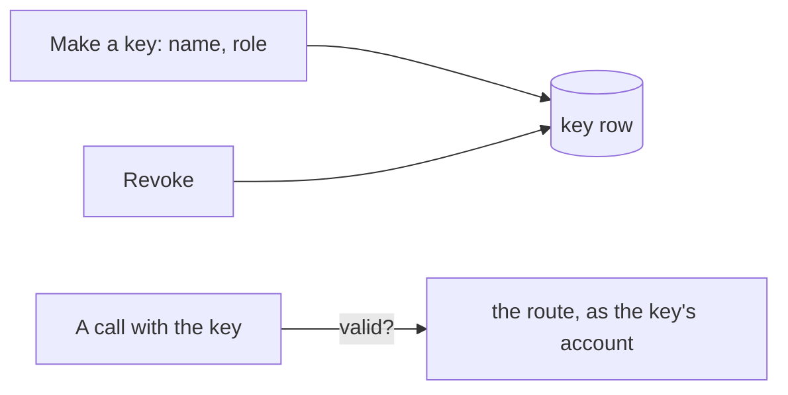
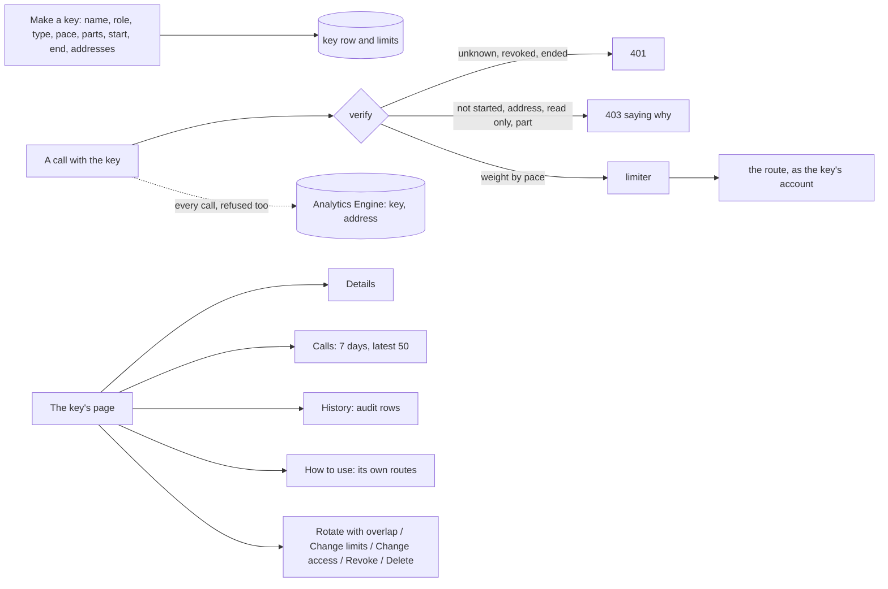

# API keys: limits, rotation, a page per key and how to use them

> **In plain words.** The owner made an API key, revoked it, and could not delete it: the key's
> account also sat in Users as a switched-off person. He asked for real key management, "rotate
> API key, access type, restriction, activation timer or limit like valid till when! DEEP
> LOGGING!", and for the access system to say how someone actually uses it. Now each key has its
> own page with four views (Details, Calls, History, How to use) and the actions Rotate, Change
> limits, Change access, Revoke and Delete. A key can be read only, limited to some parts, some
> internet addresses and a pace, start later and end at a set time. Every call it makes, refused
> ones too, is counted and listed. Key accounts no longer show in Users.

## What changed

Before, a key was made with a role and an end, listed, and revoked; nothing more.

Now:

- **Limits** (migration `0090`, columns added, nothing removed): calls a minute (60, 30, 15 or
  6), allowed addresses, start time, read only, and API areas. The pace uses the one rate-limit
  binding the portal has: a slower key's call counts more than once there, so no new resource.
- **Rotate** keeps the old secret working for 0, 1, 24 or 168 hours so a system can switch with
  no gap. The new secret is shown once, as on Make.
- **Change access** gives the new role first and then ends the old grant, both through the grant
  rules, so a refusal never leaves the key without a role. The Owner role is never given.
- **Who may change a key**: Rotate, Change limits and Change access first check that the person
  could give the key's current role at its place, as the grant rules decide (found by the
  security review before the push): an Owner at one location cannot take a new secret for, or
  loosen, a company-wide key.
- **Delete** works on a revoked or ended key; its account stays switched off so the audit log and
  the grants keep naming it.
- **Deep logging**: every change is in the Audit log in plain words (made, changed the limits,
  rotated, revoked, deleted). Every call, refused ones too, is written to the request figures with
  the key and the address, and the Calls view reads seven days of them.
- **How to use** (on the API keys page and on each key's page): the real address, the header,
  curl and JavaScript examples, what each answer that is not 200 means, how access works, and the
  routes this key may call, worked out from its role, type and parts.
- **Users** lists people only; a key's account page says it belongs to a key and links to it.

## Impact

| Part | Change |
|---|---|
| `@oltrem/iam` | `0090_iam_api_key_limits.sql`; `GET`, `PATCH /keys/:id`, `roll`, `access`, `remove`; `verify` checks the call |
| `@oltrem/core-http` | `keys` is given the call and may answer a weight; its 403 is the answer; key calls carry the key and address in the figures |
| `@oltrem/core-health` | `GET /api/health/requests/key/:subject`, `readKeyCalls` |
| `@oltrem/screens` | API keys with Keys and How to use; a key's page; key accounts out of Users |

No new binding, variable, secret, table or dependency. Outgoing webhooks stay in the Developer
part.

## How it was verified

- `modules/iam/test/keys.test.ts`: start time, read only, areas, addresses and their refusals;
  rename, pace and end (the grant's end follows), rotation with a 24-hour overlap and at once,
  change of role, delete refused before revoke, activity, and 404 after delete; an Owner at one
  location refused Rotate, Change limits and Change access on a company-wide key (shown failing
  without the check).
- `packages/core-http/test/app.test.ts`: the call shape, the weight counted three times, a 403
  with its detail and no `Retry-After`, the key and address in the figures, and none on other
  requests.
- `packages/core-health/test/budgets.test.ts`: the key's week read from the dataset, and a
  subject of any other shape never reaching the SQL.
- `packages/screens/test/api-keys.test.ts` and `first-run.test.ts`: the list, Make with limits,
  a key's four views, its routes filtered, every action's API call, Delete back to the list, and
  Users asking for people only.
- `pnpm verify`, quoted in the [verification log](../verification-log.md).

Not checked: a live key on the client portal, which the phone tests P658 to P665 cover.
