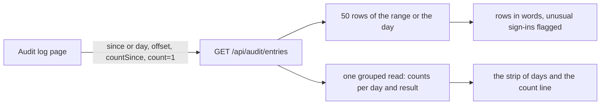

# The Audit log: a strip of days, unusual sign-ins, every action in words

> **In plain words.** The owner asked (25 November) for whatever makes each area better, easier
> and better looking. On the Audit log, the chosen range now shows as a small chart of its days
> (done, refused, failed), and a tap on a day lists only that day. A sign-in from an unusual
> country or a new browser says so on its row. Every action the portal writes now reads as a
> sentence, and a test keeps it that way.

## What changed

| Part | Before | Now |
|---|---|---|
| The range | a count of entries and refusals | the same count, and from 7 days up a strip of one column a day in the reader's clock, coloured by result; a tap lists that day (`day=`), a second tap or "show all" returns to the range |
| A picked day | not possible | its rows only; the count says that day's entries; the strip keeps the whole range so another day is one tap away |
| Unusual sign-ins | the row looked like any sign-in | "Unusual country" or "New browser" in amber on the row, from the facts the sign-in already keeps |
| Words | 18 actions the portal writes showed as their code | every action written anywhere in the code has a sentence; `scripts/audit-words.test.mjs` fails the build on a new one without |
| The API | `since`, `kind`, `q`, `count=1` | also `until`, `offset` (the reader's minutes from UTC, so days are their days), `countSince` (counts over a wider span than the rows) and `days` (each day's counts by result) |

Before, the count read was one group by result; now it groups by day and result in the same read,
so the page still makes the same number of database reads (the `/audit` query pin stays 5).
Nothing new is stored.

## How it was checked

The audit package on real D1 (days split by the reader's offset, `until` narrowing the rows,
`countSince` keeping the range counts), the page's tests (day bounds in Kolkata and Mexico City,
the strip's links, labels and picked day, the sign-in flags), the action-words scan, and
screenshots of the local portal at 390 and 1440 px with sample rows. Then `pnpm verify`. Not run on
a deployed portal or a phone: P780-P782 in [their list](../phone-tests-system.md).
