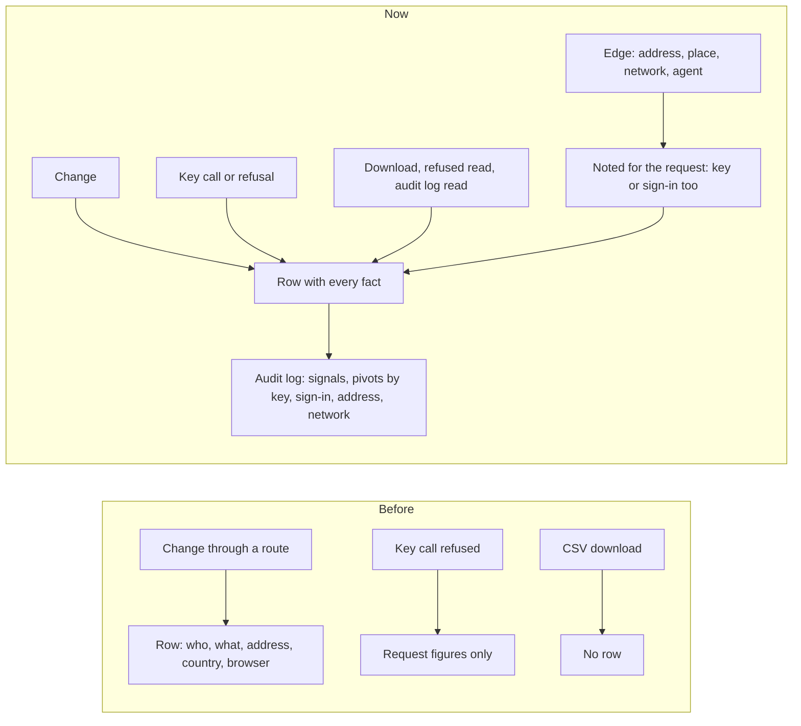

# The audit log, rich enough to trace a breach or a stolen key

> **In plain words.** The owner asked (25 November) for audit logs that can triangulate a threat:
> if someone breaks in or an API key is stolen, what did it read, download and change, from where,
> and why was something refused. The log now keeps every call made with an API key and every
> refused one, every file handed over, every refused read, who read the audit log itself, a
> setting's value before and after, and the refusal's own words. Each row says from which address,
> place and network, in which browser or program, and with which key or sign-in. The Audit log
> page counts the signals an investigation starts from and links each row to everything done from
> the same key, sign-in, address or network.

## What the well-known logs keep, and what this log keeps now

| Reference | What it asks for | Here |
|---|---|---|
| [OWASP Logging Cheat Sheet](https://cheatsheetseries.owasp.org/cheatsheets/Logging_Cheat_Sheet.html), [OWASP Logging Vocabulary](https://cheatsheetseries.owasp.org/cheatsheets/Logging_Vocabulary_Cheat_Sheet.html) | when, where, who, what; authorization failures; source address, user agent; reason for a failure | every row: time, address, browser and agent, actor, action, target, result; a refusal keeps its own words and fields |
| [AWS CloudTrail record contents](https://docs.aws.amazon.com/awscloudtrail/latest/userguide/cloudtrail-event-reference-record-contents.html), [userIdentity](https://docs.aws.amazon.com/awscloudtrail/latest/userguide/cloudtrail-event-reference-user-identity.html) | the access key id, the session, read-only or not, data events for reads, the error code and message | `key` (the public id), `session`, `method`; every key call including reads; `code` and `reason` |
| [GitHub security log](https://docs.github.com/en/authentication/keeping-your-account-and-data-secure/security-log-events), [token data in the audit log](https://docs.github.com/en/enterprise-server@3.18/admin/monitoring-activity-in-your-enterprise/reviewing-audit-logs-for-your-enterprise/identifying-audit-log-events-performed-by-an-access-token) | which token made a call, the actor's location, programmatic access | `via: key` and `key`; `country`, `region`, `city`; the program named (`curl`, `A Python script`) |
| [Okta System Log `securityContext`](https://developer.okta.com/okta-sdk-java/apidocs/com/okta/sdk/resource/model/LogSecurityContext.html) | the network's number and owner, the session id | `asn` and `network`; `session` |
| [Elastic Common Schema, event fields](https://www.elastic.co/docs/reference/ecs/ecs-event) | outcome, reason, category; `source.as` | `outcome`, `reason`; `asn`, `network` |
| [PCI DSS v4.0 requirement 10](https://learn.microsoft.com/en-ca/entra/standards/pci-requirement-10) (10.2.1.1 to 10.2.1.7, 10.2.2) | access to data, admin actions, access to the audit logs, invalid access attempts, changes to credentials; each with user, type, time, result, origin, what was affected | reads with a key and downloads; every change; `audit.read`; refused reads and key calls; key and role changes already written by their modules |
| ISO/IEC 27001:2022 A.8.15, NIST SP 800-53 AU-3, AU-9 | the content of a record; protection of the log | the same fields; each row hashed and sealed daily, now shown as its fingerprint |
| MITRE ATT&CK T1078 (valid accounts), T1552 (unsecured credentials) | a stolen credential used from somewhere new | the signals: key calls, refused calls, sign-ins from new places; pivots by key, address and network |

## What changed

| Part | Before | Now |
|---|---|---|
| API key calls | changes only; refused calls kept only in the request figures | every call, reads included, and every refusal before a route (no key, a key that is not one or was revoked or rotated away, its own rules, its limit, a path it does not have) as `iam.key-refused`, with the key's public id |
| Reads | only connected-data reads marked `audited` | also a read that handed over a file (a list's or a form's CSV, which no module recorded before), a read refused outside a page's own render, and who opened the audit log (`audit.read`) |
| From where | address, country, browser | also region, city, the network's number and owner, the user agent as sent, and programs and robots named for what they are |
| Who and how | the person | also the API key's id or the sign-in the call rode on (its second, the IAM module's device id), and `local` on the owner's computer |
| Refusals | the error code | also the refusal's own words and the fields a refused input named |
| Settings | the new value | the value before and after; a sensitive setting's only as changed; the person's reason |
| Writes | one row a change | reads share a limit, so a stolen key cannot spend the free plan's daily writes: the same read stays quiet ten minutes, ten rows of reads a minute per caller, the rest counted on the next row |
| The page | the count and the strip of days | the signals (Refused, API key calls, Downloads, New places) as a chip row, each a count and a tap; Who: API keys; a key's rows marked; a file named under its row; an open row with Who and how, Where from (place, network, agent), the file and size, the fingerprint, before muted and after in green; links to everything in the same sign-in, with the same key, from the same address or network |

Nothing new is stored beyond these facts on rows already written; no table, binding or variable
was added. The city and network are personal data like the address the log already kept, and age
with the log (ninety days in the database, then the bucket). The page makes the same five
database reads: the signals are three more sums in the count read.

## How it was checked

The pipeline's tests (a key's call told with its key, a wrong key told as outside with the key's
id and why, a probing key's 404, a download named and sized, a refused read told and a plain read
not, the refusal's words and fields), the automatic audit's tests (reason, fields, file, outside,
the read share and its count carried to the next row), the audit package on real D1 (filters by
address, network, key, sign-in and signal, the signals counted), the settings row's before and
after, the device names of programs and robots, and the page's tests (the open row, the pivots, the
signals). Then `pnpm verify`. Not run on a deployed portal or a phone: P786 to P791 in
[their list](../phone-tests-system.md).
