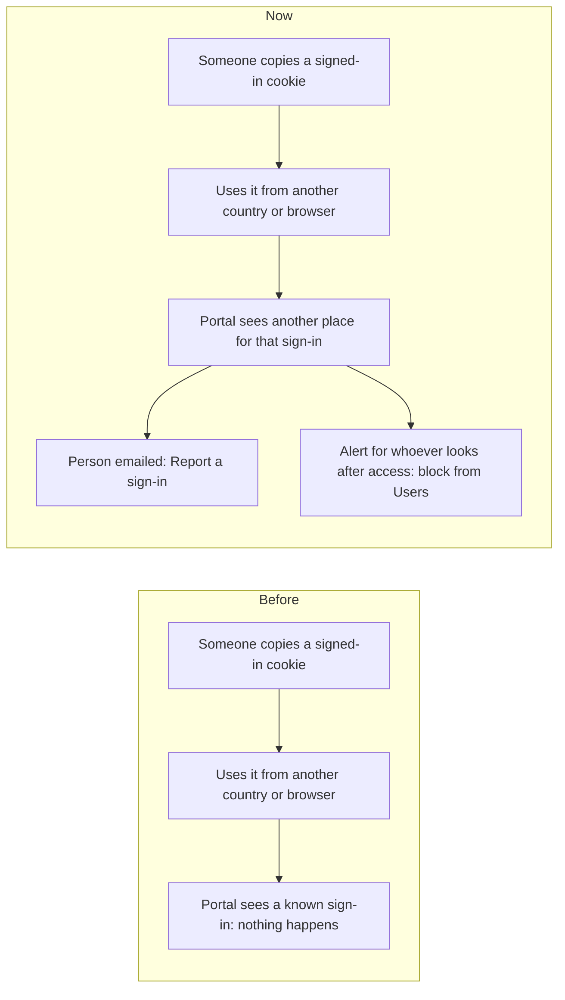

# A sign-in used from another country or browser

> **In plain words.** The owner asked that Oltrem learn from the first client's admin portal on
> sign-ins and sessions. That portal emails at once when one sign-in shows up from another country
> or another device, which is how a copied sign-in shows. Oltrem now does the same: the person is
> emailed (even with Sign-in alerts off), and whoever looks after access gets an alert, critical
> when another browser used it. Sign-in emails also read the time in the person's own time zone,
> and their subject names the browser and the country.

## Why

A sign-in at Cloudflare Access is a token in a browser cookie. Whoever holds a copy of that cookie
holds the sign-in until it ends, from anywhere. Until now Oltrem compared only new sign-ins with
earlier ones, so a copied cookie used from another country or browser went unseen.

## What changed

| Before | Now |
|---|---|
| A known sign-in was never compared again | Each request of a known sign-in is compared with where it was made: another country, or another browser by name, is another place |
| Nothing told anyone | The person is emailed once per place, whatever the Modules page says; an alert is raised for whoever looks after access, critical for another browser, a warning for another country alone |
| | An `iam.sign-in-moved` row on the Audit log, "used a sign-in from another country or browser" |
| Sign-in email: "New sign-in to Acme", the time in UTC | "New sign-in to Acme: Firefox on Android, from Mexico", the time as "17:30 Kolkata time (12:00 UTC)" |

Before, a copied sign-in looked like its owner. Now its first use from another place reaches both
the person and whoever looks after access, each with the one step that ends it.

## How it works

- `sessions.ts`: on a known sign-in, `movedTo` names another place as `"<country> <browser>"`
  (another country when both are known, or another browser by name, so a browser update is not
  one). It is kept on the device's `moved` list, so each place is told once, at most three
  (`MOVED_LIMIT`, one write each). An `iam.sign-in-moved` row is written and `signInMoved` is told,
  after the answer; the request still answers, since a VPN or travel can do this too.
- `createIam` emails the person (`signInMovedAlert`) and hands the event to its `moved` option;
  the client template raises `report.sign-in-moved.<person>.<device>.<country>` with
  `signInMovedReport`'s words, resolved by hand like a person's report.
- The device keeps the time zone Cloudflare placed the sign-in in (`timeZoneOf`); `localTime`
  prints it in the emails, with UTC beside it, and UTC alone when there is none.

## Later the same day: seen in the lists, and one browser signed out

- My access, Your sign-ins, and a person's Sessions page show where else a sign-in was used, in the
  attention colour: "Also used from Firefox on Android, from Mexico" (the device's `moved`, passed
  by `GET /api/users/people/:id/sessions` too).
- My access, Your sign-ins: Sign out on each other browser, a dialog first
  (`POST /access/mine/sign-ins/:id/end`, the existing `DELETE /api/iam/me/devices/:id`), so a
  person can end one browser without signing out everywhere. Checked by the screens test (the
  line, the colour, one Sign out on the other browser and none on this one) and the client
  template (a second browser signed out from My access, the first one still in).

## Phone tests

P644 to P647, in [Phone tests owed: Users and access](../phone-tests-users.md).

## How it was checked

- iam: one sign-in used from its own place, after a browser update, then from three other places
  and a fourth: three told, in order, once each, kept on the device, with three rows and the
  request answering; the email's words for another browser and another country, local times; the
  alert's words and severity; `createIam` emailing with Sign-in alerts off and telling `moved`;
  the sign-in alert's new subject and local time.
- The full `pnpm verify` before the push (summary in the commit).
