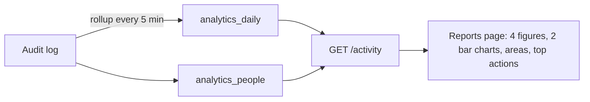
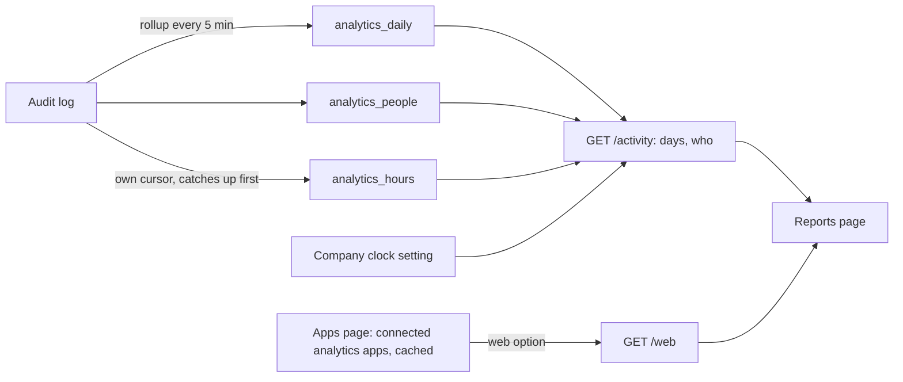

# Reports remade: one trend with the period before, who and when, every list with its move, and the website from connected apps

> **In plain words.** The owner asked for the Reports page (`/analytics`) to be remade from top
> to bottom: better visuals, more analytics, better figures. It now reads like the web analytics
> tools people know (Plausible, PostHog, Cloudflare Web Analytics): six figures with how each
> moved, one main chart of the figure you pick with last period as a dashed line, the figures said
> in plain sentences, who did the work and how it went, the busiest hours of the week, and every
> list (areas, actions, people, named work, refusals) with its trend and a link into the audit
> log. A Website part shows each connected analytics app's visitors once the Apps page adds them
> (the owner's second message: PostHog and the others are connected through Apps, not built in).

## What changed

| Before | Now |
|---|---|
| A row of periods | A row of periods and a row of whose work: Everyone, People, Automatic, Vendor |
| Four figures, each with a sentence | Six figures (actions, people active, sign-ins, automatic share, went through, refused or failed), each with a coloured move (`↑50%`) and last period's number |
| Two bar charts (actions, people) of the same days | One trend of the figure picked (actions, people, sign-ins, automatic, refused or failed), a scale, last period as a dashed line, each day named on hover |
| Nothing said in words | **What stands out**: busier or quieter and by how much, the busiest day, the busiest hour, the area that grew most, people and how many a day, the portal's own share, what was refused most |
| Not shown | **Who did the work** (people, automatic, Vendor) and **how it went** (through, refused, failed) as split bars, each part a link into the audit log |
| Not shown | **When work happens**: a week of hours in shades, on the company's clock |
| Areas with a bar; a table of the top actions | **By area** with a trend each and its move; **Most frequent** with its move; each row a link into the audit log narrowed to it |
| Not shown | **People**: active, new, came back, how many a day, and who did the most |
| Not shown | **Work done**: the Monday summary's named work (forms answered, quotes, invoices, bookings, tasks...) against last period |
| Not shown | **Refused or failed**, the actions that did not go through most, each linked to the audit log |
| No website figures | **Website**: each connected analytics app's visitors, page views, bounce rate, visit length, live visitors, trend and lists (pages, sources, countries, devices, browsers, events), once the Apps page hands them in |
| CSV: day, actions, automatic, people, refused, failed | CSV adds vendor and sign-ins, and follows whose work |

New report charts in the kit (`@oltrem/core-ui`, `src/charts.tsx`): `TrendChart`, `Delta`,
`Heatmap`, `SplitBar`, `BarList`, `Spark`, for any page that reports. Drawn on the server, no
style attribute, a fixed height whatever the numbers, so nothing on the page moves. Their styles took
the stylesheet past its 188 KiB cap, which rose to 196 KiB.

## Impact on each part

| Part | Impact |
|---|---|
| `@oltrem/analytics` | the activity route reads more (both periods' days, the areas' days, people, problems, hours, named work) in one batch of eleven statements; a new `GET /web`; a new table `analytics_hours` (migration `0097`) filled by the same rollup job from its own cursor; the options `timeZone`, `web`, `report` |
| `@oltrem/core-ui` | six chart pieces and their styles |
| The client template | passes the company clock's time zone and the error reporter; the Apps page will pass `web` |
| The Apps page's work | builds the analytics apps and hands their reports in through `web` (the `WebReport` type, agreed 2026-11-26) |
| The free plan | no new binding, variable or KV write; one more table in the one database; the rollup's statements a run unchanged (four) |

## How it worked before

## How it works now

The rollup still runs at most four statements a run; while the hours catch up with an older log,
those chunks go to the hours first, then the hours move with the days in the same transaction, so
no row is counted twice. The page asks both routes at once.

## How it was verified

- The module's tests in the Workers runtime: whose work narrows the actions and keeps the people
  figures whole, the week of hours on India's clock (five and a half hours ahead), the hours caught
  up for a portal that counted by day first, the people new and back, the refused most, the named
  work. The page's tests: the words, the links into the audit log, what stands out, the rows of
  options keeping each other, the figure the chart draws, the Website part hidden, empty, filled
  and failed, the CSV. The charts' own tests in core-ui.
- A local portal (`npm run dev`) with real local activity (a company made, an Owner and three
  people invited and joined, tasks made, the rollup run from Scheduled jobs), looked at 390 px light
  and dark and at 1440 px: no sideways scroll; one list ran past the card's edge on a phone and was
  fixed (a grid column now shrinks to the card).
- `pnpm cpu` on the local portal: Reports at 30 days 8.3 ms fastest, at 90 days 10.0 to 10.9 ms,
  beside Home's 11.9 ms and the Audit log's 12.0 ms on the same computer (a ranking, not the live
  figure).

Phone tests P900 to P905 in [Phone tests owed: Backups and System status](../phone-tests-system.md).
