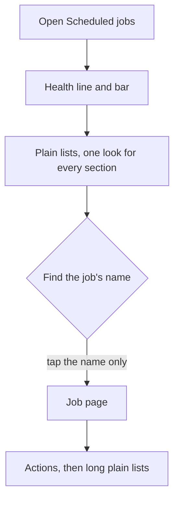
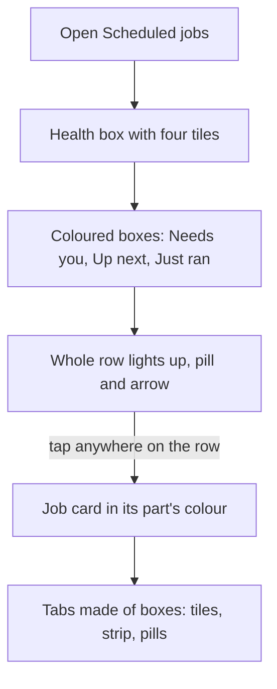

# Scheduled jobs in panes: rows that open, coloured boxes and pills

> **In plain words.** The owner said the Scheduled jobs page still looked unorganised: it was
> hard to see how to open a job, every part looked the same, and the status had no clear colour.
> Now every job is one whole row that lights up under the finger or the pointer and opens its
> page, with an arrow at its end. Every part of the page sits in its own box with a coloured
> icon, and a job's state is a soft coloured pill (green, amber, red). A job's own page opens on a
> card in its part's colour.

## What changed

- **Rows that open.** Every job in every view is a whole-row link (the kit's `Row` with `href`):
  the row's background changes on hover and on a tap, and an arrow at its end says it opens.
  Buttons such as **Run now** sit beside the link, not inside it.
- **Boxes with colour.** Every section is a `Pane` with its own icon on a coloured tile:
  **Needs you** (shown only when something does), **Up next** in blue, **Just ran** in green,
  **Timeline** in violet, **History** in amber, **Flows** in slate. On **All jobs** each part of
  the portal has its own box in that part's colour, with how many jobs it holds and how many need
  a look; each row carries its 24-hour strip.
- **Pills.** A job's state is a rounded pill with a dot: green Active, amber Paused or Held back,
  red Needs a look. The hour-by-hour list uses the same pills.
- **Figures in tiles.** The health box on the Overview shows four tiles (Active, Needs a look,
  Paused or off, Last 24 hours), each a link to its filter; the other views show only the
  headline, so they open on their list.
- **A job's page.** It opens on a card tinted in its part's colour: the name, the pill, how often
  it runs, why it is in its state, and the actions. Each tab is boxes: **Right now** (four
  tiles), **Last 24 hours**, **Last failure**, **Coming up**, **What it does**, **Runs**,
  **Schedule**, **Access** (the three permissions, each with "You have it" or "Not yours") and
  **About**.
- **Words.** "in 0 s" now reads "Now"; middle dots became commas; dates no longer break in the
  middle.
- **A rule set aside on the owner's word.** The kit shows status as a dot and a word, not a pill.
  The owner asked for pills with colours on this page, so this page uses them.

## How it worked before and how it works now

Before, the sections looked the same, the status was a small dot and a word, and only the name
opened a job, so it was not clear what could be tapped.

Now each section is its own coloured box, every row is one target that lights up, and the state
is a coloured pill.

## Impact

| Part | Effect |
|---|---|
| `@oltrem/jobs` pages | remade layout; no route, permission, query or table changed |
| Stylesheet | built from the kit's existing pane, row and tile classes; under its cap |
| Clients | the new look arrives with the next kit update |

## How it was verified

- The local portal with its real local jobs, screenshots at 390 px (light) and 1440 px (light
  and dark) of the four views and a job's tabs; no sideways scroll at either width.
- The phone UI review checklist: no box inside a box, no empty pane, no middle dots, targets at
  least 44 px.
- `pnpm verify` before the push; phone tests P960 to P964 in
  [phone-tests-system.md](../phone-tests-system.md).
