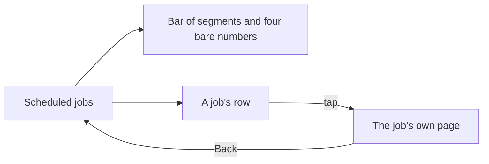
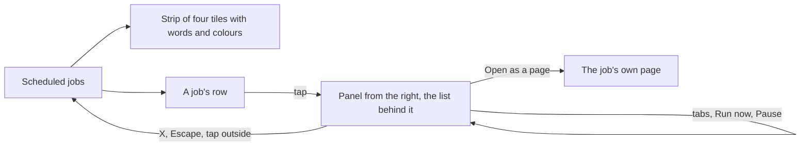

# Scheduled jobs in a side panel, and a summary strip

> **In plain words.** The owner asked for a job to open in a panel from the right instead of a
> page of its own, and disliked the top of the page: a bar of coloured segments and four boxes
> holding a bare number each. Now a tap on a job opens it in a panel beside the list, where its
> tabs and its buttons (Run now, Pause, Resume) work, and the list stays where it was. The top of
> the page is one strip of four tiles that each say something: how many jobs are active and
> whether any need a look, what the last 24 hours did, when the next tick is and which job is due,
> and whether the plan's daily allowance is holding jobs back.

## What changed

- **The side panel.** A job's row opens the job in a panel from the right, 42 rem wide on a
  computer and the whole screen on a phone. The panel shows the job's own page: its coloured
  card, its actions and its five tabs. Tabs change inside it; Run now, Check for work, Pause and
  Resume are sent from it and their answer shows there; **Open as a page** opens the job in full;
  any other link closes it. X, Escape or a tap outside closes it, and after a change the list
  behind it is fetched again. Without the page script a row still opens the job's page.
- **A kit feature, not a jobs one.** The frame script gains `data-peek`: a list marks itself with
  the panel's id, the panel names the path its records live under, and the record's page marks
  the part to show. Any other list can use it (described in the
  [screens README](../../packages/screens/README.md)).
- **The summary strip.** The bar and the four bare boxes became one bordered strip of four tiles,
  as the portal the owner holds up as the model has: **Jobs** (active of all, paused or off, a
  green "None need a look" or a red link to the ones that do), **Last 24 hours** (hours that did
  work, hours that looked and found nothing, failures), **Next tick** (seconds to it and the next
  job due) and **Plan allowance** (Normal, or Holding back with the reason). It shows on Overview;
  the other views open on their list.

## How it worked before and how it works now

Before, opening a job left the list, and the top of the page spent its room on a bar and four
numbers without words.

Now the job opens beside the list and everything about it works in the panel; the full page is
one tap away.

## Impact

| Part | Effect |
|---|---|
| `@oltrem/jobs` | the summary strip, the panel on the list, the job page's body marked for it |
| `@oltrem/screens` frame script | `data-peek`, a record opened beside its list |
| `@oltrem/core-ui` stylesheet | the panel's width and layout; still under its cap |
| Routes, permissions, tables | unchanged |

## How it was verified

- The frame test: a link in the list opens the panel and fills it, a tab and a form stay in it,
  Open as a page and other links close it.
- The jobs page tests: the four tiles, the panel and the job page's marked body.
- The local portal in a headless browser at 390 px (light) and 1440 px (dark): a row opens the
  panel with the job's name, a tab changes inside it, Run now confirmed inside it shows its note,
  Escape closes it; no sideways scroll and no script errors.
- `pnpm verify` before the push; phone tests P960, P961 and P965 in
  [phone-tests-system.md](../phone-tests-system.md).
