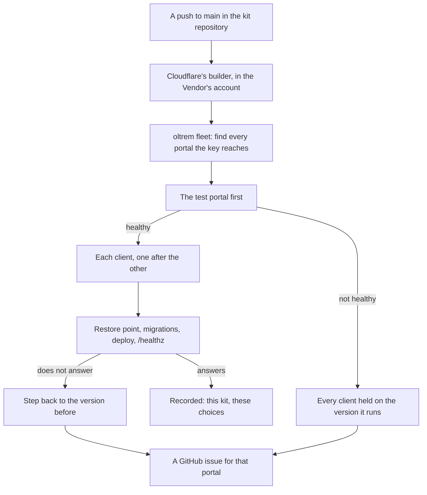

# The fleet

> **In plain words.** Every push to the kit's `main` updates every client's portal by itself.
> Cloudflare's own builder runs it once, in the Vendor's own Cloudflare account. It updates the
> Vendor's test portal first. When that one is healthy it updates each client in turn, each one
> from the choices that client made at its first deploy (its name, its address, Oltrem Mail or
> not), with the template's default for any choice never made. Every update saves a restore point,
> applies the migrations, deploys, checks that the portal answers, and goes back to the version
> before when it does not. A portal that did not update gets a GitHub issue, which closes itself
> when a later push updates it.

The owner chose this on 2026-11-11 ("every push, test portal first"). It replaces the plan's
GitHub Actions deploy in each client repository: no client repository is needed, and no GitHub
Actions minutes are spent.

## Why one build in the Vendor's account

- **One connection.** Cloudflare's builder (Workers Builds) deploys from a GitHub repository, but
  a GitHub account should point at one Cloudflare account only. So the kit repository is
  connected once, to the Vendor's account, and the build reaches the clients' accounts with a key.
- **Free.** The build uses the Vendor's account's own free build minutes: 3,000 a month, one build
  at a time, 20 minutes at most per build (Cloudflare's limits page, read 2026-11-11). A portal
  takes about one to two minutes. A portal whose code and choices did not change is skipped.
- **No list to keep.** The build finds the portals itself in every account the key reaches.

## What one run does

1. **Finds the portals.** For every account the key can open, it looks for a database named
   `<worker>-db` whose Worker carries `CLIENT_ID` set to `<worker>`. That is an Oltrem portal. A
   database or Worker of anything else is left alone.
2. **Reads each portal's choices.** Every `npm run deploy` records them in the portal's own
   database (the `build_choices` row of `oltrem_meta`). A portal deployed before this existed is
   read from its running Worker instead: its address (`PUBLIC_HOST`) and whether it has Oltrem
   Mail's sending binding. Its name is then made from its Worker's name until the next deploy or
   update records the real one.
3. **Puts the test portals first.** These are the Workers named in `OLTREM_FLEET_FIRST`. If one of
   them does not update, or the key cannot find it, no client is touched in that run.
4. **Skips what is current.** After a good update, the run records a fingerprint of the kit's
   folders (`packages`, `modules`, `vendor`, `templates/client`) and the choices. When neither has
   changed, the portal is skipped. A push that changes only documents updates nobody.
5. **Updates the rest.** For each portal it copies the client template beside it (`.fleet/`),
   writes the choices in, and runs `oltrem release`: the restore point, the migrations, the
   deploy, the health check and the step back. The database is never stepped back: the kit's
   migrations only add, so the version before runs on it.
6. **Says how it went.** The build's log has a line per portal: `updated`, `unchanged`, `off`,
   `held` or `failed`, with the steps under it. The build is red when any portal failed or was
   held, or when the key found no portal at all. With the GitHub token, each portal that did not update gets an issue named
   `Fleet: <worker> did not update` (a comment is added when it is already open), and the issue is
   closed by the first run that updates it.

A portal can be kept out: set `autoUpdate` to `false` in its `build_choices` row.

## The one-time setup

The Vendor does this once. Nothing is written in any repository, and no key is pasted anywhere
but Cloudflare's build secrets.

1. **Be a member of every client's account.** In each client's Cloudflare account, the client adds
   the Vendor's Cloudflare login under Manage Account, Members, as an Administrator. An account the
   Vendor's login cannot open is not updated; it stays on `npm run deploy` by hand.
2. **Have a test portal of your own.** Deploy one portal in the Vendor's own account with
   `npm run deploy`, from the kit's `templates/client`. A bad push then breaks this portal and no
   client's.
3. **Make the fleet key.** In the Vendor's Cloudflare profile: My Profile, API Tokens, Create
   Token, Custom token, with these permissions:
   - Account: Workers Scripts Edit, D1 Edit, Workers KV Storage Edit, Workers R2 Storage Edit,
     Queues Edit, Account Settings Read.
   - Zone: Workers Routes Edit (a portal on its own address).
   - User: Memberships Read, User Details Read.
   - Account Resources: the accounts that hold portals, your own and each client's. All accounts
     works too: the fleet only ever acts on an Oltrem portal, and only reads the lists of any
     other account. Zone Resources: All zones. TTL: no shorter than a year.
4. **Connect the kit once.** In the Vendor's account: Workers and Pages, Create, Import a
   repository, pick the kit repository, name the project `oltrem-fleet`, with these build
   settings (all of it works from a phone):
   - Branch: `main`. Root directory: `/`.
   - Build command: `npm install && npm run build`.
   - Deploy command: `npm run oltrem -- fleet`.
   - Build watch paths, include: `packages/*`, `modules/*`, `vendor/*`, `templates/*`.
   - Build variables and secrets:
     - `OLTREM_FLEET_TOKEN` (secret): the fleet key of step 3.
     - `OLTREM_FLEET_FIRST` (variable): the Worker name of the test portal of step 2; several are
       separated by commas.
     - `OLTREM_FLEET_GITHUB_TOKEN` (secret, optional): a fine-grained GitHub token with Issues read
       and write on the kit repository only.
     - `OLTREM_FLEET_REPO` (variable, optional): the kit repository as `owner/name`, for the issues.
5. **Try it.** Run the build once from the dashboard (Deployments, Retry). The log lists every
   portal found. A key that finds no portal at all turns the build red. `npm run oltrem -- fleet --check`, with `OLTREM_FLEET_TOKEN` set, says the same
   from a computer without changing anything.

## The key

One key reaches every client's account, so it is kept in one place: Cloudflare's build secrets,
which are never shown again and never reach a portal. It can deploy Workers and change their
databases, storage and queues, and nothing else: it cannot change members, billing, DNS records
or Access. Rotate it yearly, or at once if it may have been seen: make a new one from the same
permissions, replace the build secret, delete the old one. Its row is in the
[token registry](tokens.md).

## Not done yet

- **Client modules.** A client's own modules (`oltrem new module`) live in a client repository,
  which the fleet does not build. A portal with modules of its own stays on its repository's
  deploy until the fleet learns to take them.
- **Checked on a real account.** Everything above runs against stand-ins in
  `packages/cli/test/fleet.test.ts`, and a real build of a client's portal from `.fleet/` was
  bundled by wrangler. The first run in Workers Builds is the owner's setup above.
