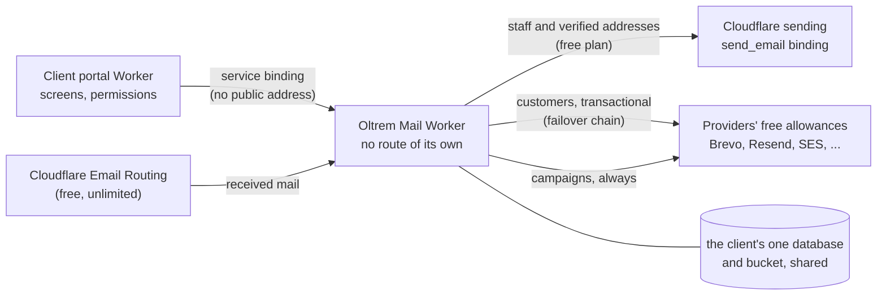

# Mailflare and about 35 other email projects compared

> **In plain words.** The owner asked for a wide search: Mailflare and every project that does
> the same or more, their good and bad sides, and whether to adopt one of them instead of
> building our own. About 35 projects were read on 2026-11-02. **The answer: do not adopt or
> fork any one of them, but borrow freely from several.** The strongest ones are webmail apps,
> each with its own sign-in, screens and stack, and none of them does what the kit needs most:
> sending a business's transactional and bulk mail through several providers with automatic
> failover, on the free plan, inside a portal with real permissions. The kit already has that
> part. What the other projects do better is the mail plumbing around it: a private Worker with
> no public address, an inbox that rejects unknown addresses at the door, a sent-mail journal
> that never sends twice, and consent kept per list. The recommendation is a **separate private
> repository, "Oltrem Mail"**, built fresh around the kit's provider engine and these ideas.
> One finding changes the plan: **Cloudflare's own sending is for transactional mail only.**
> Its rules forbid marketing and bulk mail, so campaigns must always go through a provider.

## The short answer

| Question | Answer |
|---|---|
| Is there a project to adopt as it is? | No. The best ones are webmail apps with their own sign-in and screens; forking one means two sign-ins, two designs and an upstream to follow. None sends bulk mail through several providers with failover. |
| Can we take their code? | Only from the MIT and Apache-2.0 projects, with their licence notice kept. Mailflare and every AGPL project cannot go into a kit that is sold under the Oltrem Licence. Taking the ideas, not the code, is cleaner and is what this page proposes. |
| Which approaches are worth it? | Fourteen, ranked [below](#approaches-worth-adopting). The top five: a private mail Worker, a failover chain that only retries mail that was surely not accepted, every recipient written down before a campaign starts, consent per list, and a sent-mail journal. |
| Does it all fit the free plan? | Yes, with one boundary: on the free plan Cloudflare sends only to verified addresses (staff), so mail to customers goes through a provider's free allowance, and bulk mail always does. Receiving is free and unlimited. |
| Separate repository or inside the kit? | A separate private repository fits: it keeps the kit small and lets a client have mail or not. It needs the owner's yes for a second Worker per client (R-09) when it runs on its own. |

## What was searched

GitHub and the web, for four kinds of project: email systems that run wholly on Cloudflare,
self-hosted mail servers, sending and campaign platforms, and the libraries they are built on.
For each, the README, the licence file and, where the design was interesting, its design
documents. Star counts are from 2026-11-02 and are only a rough guide to how widely used a
project is: a young project with one star had the best-documented design of all.

## The projects, side by side

### Email systems that run on Cloudflare

| Project | Licence | Stars | What it is | Free-plan fit | Best idea in it |
|---|---|---|---|---|---|
| [Mailflare](https://github.com/hieunc229/mailflare) | AGPL-3.0 | 5.2k | A Google Workspace alternative: mailboxes, calendar, booking, drive, AI agents, 34 languages | Receives free; sends through Resend or SES free tiers, Cloudflare only on Paid | Routing rules (store, forward, reject, sort); import from IMAP, Gmail Takeout and mbox |
| [cloud-mail](https://github.com/maillab/cloud-mail) | MIT | 15.0k | Many mailboxes on one domain, admin with roles, Telegram push, open API | Yes for receiving; sending via Resend or Cloudflare | Role limits on what each user may use |
| [cloudflare_temp_email](https://github.com/dreamhunter2333/cloudflare_temp_email) | MIT | 12.0k | Temporary and full mailboxes, passkeys, OAuth, IMAP and SMTP through a proxy | Yes; the proxy needs a server | A second, sturdier mail parser for mail the first one fails on |
| [Agentic Inbox](https://github.com/cloudflare/agentic-inbox) | Apache-2.0 | 8.5k | Cloudflare's own sample: a webmail client with an AI agent | Receives free; sends through Cloudflare (Paid for customers) | One Durable Object with its own SQLite per mailbox; the agent drafts, a person always presses Send |
| [Quickinbox](https://github.com/DivinPrince/quickinbox) | MIT | 428 | Webmail for your own domain, several users, REST API, CLI, MCP with OAuth | Yes with Resend (which also delivers received mail by webhook), or Cloudflare on Paid | Two provider tracks, one per deploy; inbox tabs that fail open into Primary |
| [cmail](https://github.com/Rob142857/cmail) | MIT | 1 | Organisational mail: personal and shared mailboxes, inbox rules, manager tools | Yes; Cloudflare or Postmark for sending | A **private mail Worker** with no route, reached over a service binding; a sent-mail journal; inbound authentication trusted only from a named server |
| [cf-mail](https://github.com/Coldplay-now/cf-mail) | MIT | 7 | One Worker, one database, one bucket: a personal mailbox | Receives free; sends on Paid | A mailbox is a row: unknown or inactive addresses are refused at the door; mailboxes for AI agents |
| [AgentMail](https://github.com/mtpark-ai/AgentMail) | MIT | — | Multi-domain mailboxes, aliases, groups, scoped API tokens | Yes; Resend by default, Cloudflare per domain | The sending provider chosen per domain |
| [OmniDock](https://github.com/ufukayyildiz/omnidock) | MIT | 7 | A team inbox with file management and Gmail or IMAP accounts | Yes | Long imports continued as database jobs, so a page refresh does not stop them |
| [orange-inbox](https://github.com/InventiveHQ/orange-inbox) | MIT | 2 | Gmail-like webmail with scheduled send, undo send and booking links | Receives free; sends on Paid | Mail metadata spread over extra databases as one fills up |
| [CloakMail](https://github.com/dreamshive/cloakmail) | MIT | 53 | Disposable mailboxes, with a one-command setup on the free plan | Yes | A setup command that creates everything and checks it works |
| Picket | AGPL-3.0 | — | Multi-tenant webmail on Workers, D1, R2 and Queues | — | An IMAP bridge, in progress |

Smaller projects read for one idea each: Temp Mail (Hono and D1, a daily clean-up), QuickMail,
cloudflare-email (one-tap codes from received mail), and the mail-room, Cloudflare-mail,
OpenMail, Open Workspace and EmailFlare projects read for the first page.

### Sending, newsletters and campaigns

| Project | Licence | Stars | What it is | Best idea in it |
|---|---|---|---|---|
| [big-mailer (kolea)](https://github.com/robconery/kolea) | MIT | — | A self-hosted replacement for a paid newsletter service on Workers, D1 and Queues | Every recipient's row written before a campaign starts; consent checked again just before the provider call; queue concurrency pinned; consent in three scopes |
| [0list](https://github.com/d4mr/0list) | MIT | — | Waitlists and campaigns on Workers and D1 | A per-list chain of transports (Cloudflare, SMTP, Gmail) that fails over only on errors that prove the mail was not accepted; self-hosted open and click tracking |
| [Ownlist](https://github.com/pfstr/serverless-cloudflare-newsletter) | MIT | — | A newsletter on your own account, with any provider | Sending paced by a cron in small batches sized for the free plan |
| [feedmail](https://github.com/alexmensch/feedmail) | — | — | RSS to email, double opt-in, passkey admin | A first run that seeds old items without mailing them |
| [listmonk](https://github.com/knadh/listmonk) | AGPL-3.0 | — | The best-known self-hosted newsletter manager | Lists, templates and analytics; the yardstick for campaign features |
| [Keila](https://github.com/pentacent/keila), [Plunk](https://github.com/useplunk/plunk), [useSend](https://github.com/usesend/usesend), [Hyvor Relay](https://github.com/hyvor/relay), [BillionMail](https://github.com/aaPanel/BillionMail) | AGPL-3.0 | — | Self-hosted newsletter and sending platforms; all need a server | Separate queues for transactional and bulk mail (Relay); DNS records shown with a check button (BillionMail) |
| [Dittofeed](https://github.com/dittofeed/dittofeed) | MIT, with closed paid parts | 3.0k | Customer messaging across email, SMS and push, with journeys | Journeys built from events |
| [Novu](https://github.com/novuhq/novu) | Mixed: open and commercial | 40.2k | Notification infrastructure across channels | One workflow, many channels, with digests |

### Mail servers and mail clients

| Project | Licence | Why it does not fit |
|---|---|---|
| [Postal](https://github.com/postalserver/postal) | MIT | A full sending server; needs a machine with port 25 and its own IP reputation |
| [Stalwart](https://github.com/stalwartlabs/stalwart) | AGPL-3.0 | A complete mail server (SMTP, IMAP, JMAP); needs a server |
| [Zero](https://github.com/Mail-0/Zero) | MIT | A client for existing Gmail and Outlook accounts, not a mail system |
| [Inbox Zero](https://github.com/elie222/inbox-zero) | AGPL-3.0 | An AI assistant on top of Gmail and Outlook |

### Libraries

| Library | Licence | Use |
|---|---|---|
| [postal-mime](https://github.com/postalsys/postal-mime) | MIT, no dependencies | Reads received mail inside a Worker; limits deeply nested messages |
| [worker-mailer](https://github.com/zou-yu/worker-mailer) | MIT | SMTP from a Worker over TCP sockets (the kit already has its own SMTP adapter) |
| [MIMEText](https://github.com/muratgozel/MIMEText) | MIT | Builds raw messages; only needed for the old raw-message binding |

## Cloudflare's rules that shape the design

Read on Cloudflare's Email Service pages on 2026-11-02:

- **Transactional only.** The FAQ: "Can I use Email Service for marketing emails? No. Email
  Service supports transactional email only." Campaigns and newsletters must use a provider.
- **Free plan.** Sending to verified destination addresses is free on every plan and does not
  count toward any quota; sending to anyone else needs Workers Paid. Receiving through Email
  Routing is free on every plan.
- **Daily quota grows with reputation.** New accounts start low and rise with good delivery.
- **Separate subdomains** for transactional and marketing mail, so a campaign's complaints
  cannot hurt password resets.

## Approaches worth adopting

Ranked by what they add for a business, each with where it was seen. None of them needs code
copied: each is a design the kit can write fresh.

1. **A private mail Worker** (cmail). The mail Worker has no route, `workers_dev = false` and
   `preview_urls = false`; the portal reaches it only through a service binding; it holds the
   `send_email` binding, so no sending token exists at all. This is design B of the
   [private mail Worker page](private-mail-worker.md), now seen working in a real project.
2. **Fail over only when the mail surely was not accepted** (0list). Every provider's errors are
   mapped onto one list: a recipient problem (mark it and continue), a throttle or a used-up
   day (wait and resume, or try the next provider), a fatal setup problem (stop and say so). An
   unclear answer is never retried elsewhere, so nothing is sent twice. The kit's `failureOf`
   already sorts failures this way; Cloudflare's own error codes become one more input.
3. **Write every recipient down before a campaign starts** (big-mailer). One row per intended
   message, then the queue: a campaign can resume after a crash, cannot double-send, and can be
   audited afterwards. The kit's bulk engine is close to this already.
4. **Consent in three scopes** (big-mailer). Leaving one series, leaving the newsletter, and
   leaving everything are different choices; only the last, a hard bounce or a complaint adds an
   address to the global suppression list, which is kept by address, not by contact.
5. **A sent-mail journal** (cmail). Each outgoing message is recorded before it is handed over,
   so a retry never sends it again and a missing copy in Sent is recovered.
6. **Check consent again just before sending** (big-mailer). A queue can run minutes later;
   someone who opted out in between is not mailed.
7. **A mailbox is a row** (cf-mail). Adding a row makes an address live; mail to an unknown or
   inactive address is refused while the sender is still connected, so spam to made-up
   addresses dies at the door. Plus-addressing (`name+shop@`) comes free.
8. **Trust a received mail's authentication only from a named server** (cmail). SPF, DKIM and
   DMARC results are recorded only when the top `Authentication-Results` header comes from the
   configured server; anything else could have been written by the sender. Refusing a message
   is permanent, so a rate limit warns instead of refusing.
9. **One-click unsubscribe that a scanner cannot trigger** (Hack the Hill's list manager,
   Ownlist, feedmail). The link opens a page; only a POST changes anything, and the RFC 8058
   headers let mail apps unsubscribe in one tap.
10. **Self-hosted open and click tracking** (0list). Click links are signed so they cannot be
    abused as a redirect, and tracking works with every provider, not only those with webhooks.
11. **Mailboxes for AI agents** (cf-mail, Agentic Inbox). Correspondents denied by default, a
    token for one address, a received, delivered, handled queue, and a person always confirming
    a send that the agent drafted.
12. **Classification that fails open** (Quickinbox). Sorting into tabs or spam never hides
    mail: when the sorter fails, mail lands in the main inbox.
13. **A setup that creates and checks everything** (CloakMail, Quickinbox). One command creates
    the resources, sets the routing and sends a test, and says which step failed.
14. **Routing rules and imports** (Mailflare). Store, forward, reject or sort incoming mail by
    rule; bring old mail in from IMAP or an mbox file.

### What not to copy

- **Broad Cloudflare tokens.** Mailflare's runtime token may edit DNS and zone settings on every
  zone. The kit keeps tokens narrow (R-05); the `send_email` binding needs no token at all.
- **Fixed Worker names** ("keep the name `mailflare` or it breaks"). The kit names each client's
  Worker.
- **Counters in KV.** Several projects keep caches and counters in KV; the free plan allows only
  1,000 KV writes a day, so counters stay in D1.
- **Webmail as the centre.** Calendar, drive and booking are other products; the kit's mail is
  for a business's own messages first.

## Recommendation: a separate repository, "Oltrem Mail"

A private repository under the owner's account, with the same rules as the kit (an `ai.md`
first, a token registry, `pnpm verify`). It holds the mail service; the kit keeps its provider
definitions and screens. It is packed into a client's repository the same way the kit is, so no
registry or public package is needed.

The portal asks the mail Worker to send, and reads the inbox through it; received mail arrives
at the mail Worker directly; it decides who sends each message: Cloudflare for the staff's
verified addresses (free), the failover chain of providers for customers, and providers only for
campaigns. It shares the client's one database and bucket, so the only new resource is the
Worker itself.

**Two ways to run it.** For a small client the same code can be mounted inside the portal
Worker, keeping one Worker per client (R-09 as it is). For a client who wants the inbox, or the
isolation, it runs as its own private Worker, which needs an exception row in the resource
manifest and the owner's yes.

| Good | Not so good |
|---|---|
| The kit stays small; mail is added per client, only when wanted | A second Worker per client when run on its own: one more deploy, and the portal and the mail Worker must agree on versions |
| The mail Worker has no public address and no sending token | Each call over the binding counts toward the 50 outside calls a request may make, and both Workers' processing time adds up |
| A fault or a heavy import in mail cannot slow the portal's screens | Service bindings work only inside one Cloudflare account, which is already how the kit works |
| Its own release pace and its own tests | Packing it into client repositories needs the same step as the kit's own packing |

**What stays the same.** The kit's twelve email provider definitions, its failover and its bulk
engine move behind this service, not away. The paused work on a Cloudflare provider (saved,
not pushed) becomes this service's first sender.

## What it would need from the owner

1. A yes to the direction on this page.
2. The new private repository, created under the owner's account and opened to this work.
3. Later, at the build: the `send_email` binding and, for the separate mode, the second-Worker
   exception (R-09), each with its own row and his yes.

## Related

- [A private mail Worker](private-mail-worker.md): the first answer, with Cloudflare's facts and
  the four designs.
- [Open-source ideas](open-source-ideas.md): the earlier, wider list for the portal.
